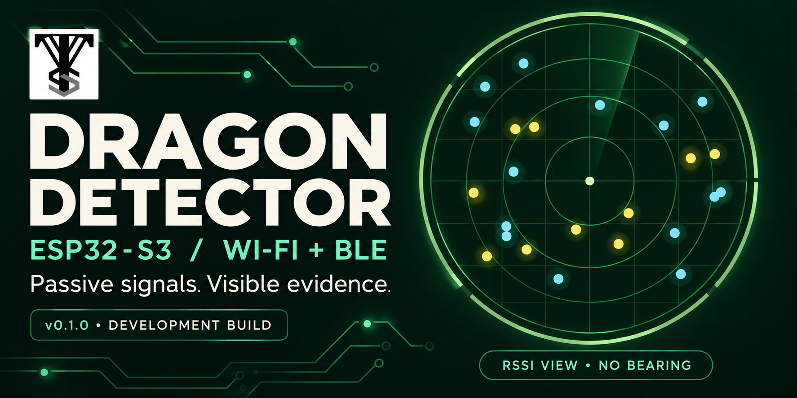
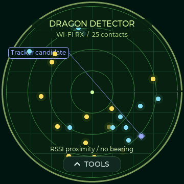
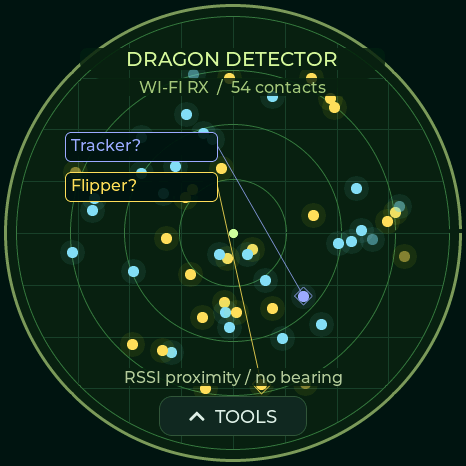
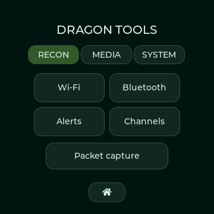
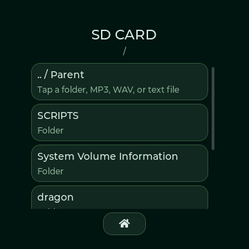
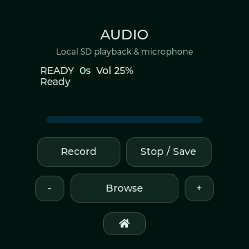

# Dragon Detector

A Dragon Radar-inspired interface for passive Wi-Fi and Bluetooth LE observation, with separate firmware for **Spotpear JC3636W518** and **M5Stack StopWatch C152**.

**Start here: [choose your board and flash it](docs/FLASHING.md).** You do not need to compile the source to use the included BIN files.

## Choose your hardware

| | Spotpear / Guition round LCD | M5Stack StopWatch |
|---|---|---|
| Exact board | JC3636W518, 360×360 | C152, 466×466 AMOLED |
| Version | 0.1.1 | 0.2.0 |
| Complete source | [Spotpear project](hardware/spotpear) | [StopWatch project](hardware/m5stack-stopwatch) |
| Fresh-install BIN — flash at **0x0** | [Download Spotpear BIN](hardware/spotpear/firmware/Dragon-Detector-0.1.1-ESP32S3-JC3636W518-0x0.bin) | [Download StopWatch factory BIN](hardware/m5stack-stopwatch/release/Dragon-Detector-StopWatch-v0.2.0-factory-0x0.bin) |
| File storage | microSD | Internal flash |
| Media | WAV/MP3 playback and manual recording | Badge images; no music player or microphone recorder |
| Navigation | Touchscreen and radar bottom-edge swipe | Touchscreen, yellow radar button, blue menu button |

**The BIN files are not interchangeable.** Open a BIN link and use GitHub's **Download raw file** control. Do not save the HTML preview page as a BIN. A StopWatch factory flash replaces its internal files and settings.

## Compatible devices

| Spotpear / Guition JC3636W518 | M5Stack StopWatch C152 |
|---|---|
|  |  |
| [Official Spotpear product](https://spotpear.com/shop/EPS32-S3R8-1.8inch-360x360-Round-LCD-Display-WIFI-Secondary-TouchScreen-AIDA64-Arduino-LVGL-WirelessAida64-Wireless-Power-Video-Electronic-Photo-Frame-MP3.html) | [Official M5Stack product](https://shop.m5stack.com/products/m5stack-stopwatch-dev-kit-esp32-s3) |

Manufacturer-hosted photographs identify the devices; their pictured screens may show factory/demo software. The Dragon Detector interface is shown separately below. Photograph rights remain with Spotpear and M5Stack.

## Screenshots

| Spotpear radar | StopWatch radar | StopWatch custom badge |
|---|---|---|
|  |  |  |

These are captures of the firmware renderer, not photographs of the physical displays. The top cover is promotional artwork. See [hardware identification and product photographs](docs/HARDWARE.md).

### Spotpear tools and media

| Tools menu | File browser | Audio controls (Spotpear only) |
|---|---|---|
|  |  |  |

The StopWatch intentionally omits the player and recorder; its UI keeps scanning tools and custom badges.

## What it does

- Shows Wi-Fi/BLE contacts on a green radar with received signal strength, candidate signatures, and evidence details.
- Observes deauthentication/disassociation bursts and selected BLE advertising patterns; provides alerts and optional logs/captures.
- Provides channel activity and selected-channel monitoring.
- Uses distinct markers and callout lines for selected device candidates. Tap a dot to inspect the evidence.
- Keeps list scrolling within the current screen. Only a bottom-edge upward swipe on the radar opens tools.
- Supports custom image badges, yellow/blue hardware keys and optional tone/vibration feedback on StopWatch.

**Signal strength is not measured distance; dot angle is not direction.** Names and advertisements can be spoofed. A candidate label does not prove device identity, surveillance, recording, or malicious intent. The ESP32-S3 scans 2.4 GHz Wi-Fi and BLE in alternating windows; silent devices and traffic outside those windows may be missed. Bluetooth Classic and 5/6 GHz are not supported.

This is a custom firmware using selected passive detection work, not a complete port of ESP32 Marauder. Active attack workflows are not included. See the [detailed signature and feature notes](hardware/spotpear/docs/FEATURES.md); storage and media differences are listed above.

## Guides

- [Install, back up, flash, update and recover](docs/FLASHING.md)
- [Controls, radar, logs and badge import](docs/USER-GUIDE.md)
- [Build the firmware from source](docs/BUILDING.md)
- [Upload source, pictures and firmware to GitHub](docs/GITHUB-UPLOAD.md)
- [Submit the StopWatch build to M5Burner](publishing/m5burner-stopwatch/SUBMISSION.md)
- [Testing and known limitations](docs/VALIDATION.md)
- [Credits and licenses](CREDITS.md)

## Credits

**[JustCallMeKoko](https://github.com/justcallmekoko)** — creator of [ESP32 Marauder](https://github.com/justcallmekoko/ESP32Marauder), the upstream reference for adapted passive detection work. Original MIT attribution is preserved.

**[CodeHedge](https://github.com/CodeHedge)** — acknowledgment for related [Marauder/CYD and Biscuit community work](https://github.com/CodeHedge/ESP32Marauder) and [flashing tools](https://github.com/CodeHedge/biscuit_flasher). This credit does not imply that CodeHedge authored or reviewed Dragon Detector.

Thanks also to M5Stack, Spotpear/Guition, Espressif, LVGL, NimBLE-Arduino, ESP8266Audio, and the other dependencies documented in [CREDITS.md](CREDITS.md). VTS branding was supplied by the project owner. This project is not endorsed by those projects, manufacturers, or the Dragon Ball rights holders.

Project source is [GPL-3.0](LICENSE); third-party components and artwork retain their own licenses and rights.
