

# Dragon Detector

Wi-Fi and Bluetooth detection, signal tracking, and logo watch faces for ESP32-S3 displays.

**Web flasher available:** [Install from the independent host](https://valleytech-dragon-detector.pages.dev/). The original GitHub Pages address and GitHub-hosted images are temporarily unavailable. Source, artwork and release files are intact; existing devices are unaffected. [Hosting status](docs/HOSTING-STATUS.md).

[**Install firmware**](https://valleytech-dragon-detector.pages.dev/#install) · [Latest release](docs/RELEASE-0.13.22.md) · [User guides](docs/GUI.md) · [Clock setup](https://git.churchofmalware.org/Valleytech/Dragon-Detector/wiki/Clock-Setup)

## Radar controls and repeating Find My Beeper · 0.13.22

Press a dot for immediate selection, then tap its summary or double-tap for details.
Device shades are distinct within their type's color range; AirTags stay low priority.
Find My Beeper can repeat one selected tracker or **Beep All**, with a visible **Stop**
control, sequential requests and per-device results. [Instructions](docs/RELEASE-0.13.22.md)
· [Validation](docs/VALIDATION-0.13.22.md).

## Waveshare AMOLED 1.75 / 1.75-G · 0.13.21 beta

The tested non-C baseline now has SD-first profiles, events, captures and surveys,
plus a separate LC76G GPS build for passive Wi-Fi/BLE wardriving and WiGLE CSV.
Tap a dot for its summary; double-tap for details, Hunt and BLE/GATT tools.
New SD/GPS/touch behavior awaits physical testing. No mandatory SD pack is needed.
[Beta guide](docs/WAVESHARE-AMOLED-175.md) · [Change notes](docs/RELEASE-0.13.21.md).

## Can Commander · 0.13.18

A tribute to Matthew Kukanich: the original MK emblem, silver and navy instruments, animated CAN-H/CAN-L traces and a dedicated clock-data watch. Includes matching menus and a session stopwatch on all six profiles. [Explore Can Commander](docs/CAN-COMMANDER.md).

## Clock and timer power saving

On every board, the clock and stopwatch/Locksport Timer pause background Wi-Fi and Bluetooth scanning. Lap history and time/date settings also stay paused. Return to the radar or other tools to resume scanning; a running timer keeps counting in the background. Previously configured Wi-Fi clock recovery may briefly connect for time synchronization. See [power-saving behavior](docs/CLOCK-POWER.md).

## Personal themes and DZ_AZ

Build your own clock, radar and counter in the [Custom theme tab](https://valleytech-dragon-detector.pages.dev/#theme-studio). Add a logo, choose colors, hands and numerals, and enable locksport controls. The personal slot appears on the device only after you explicitly install a design. [Creator guide](docs/CUSTOM-THEME.md).

DZ_AZ adds a crow-and-name emblem, rotating feather radar sweep, and short/long feather clock hands. [Theme guide](docs/DZ-AZ.md).

| DZ_AZ radar | DZ_AZ clock | Personal theme example |
|---|---|---|
|  |  | 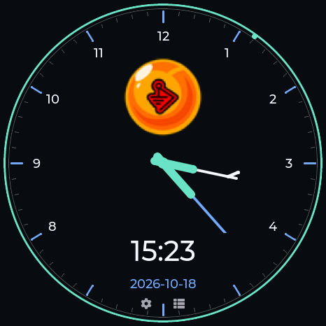 |

## Install

1. Open the [web flasher](https://valleytech-dragon-detector.pages.dev/#install) in desktop Chrome or Edge and connect your board with a USB data cable.
2. Select the exact board. Use **Update matching Dragon Detector** for a compatible installation, or **Fresh install** for a new board. Fresh install replaces saved files and settings.
3. Choose **Connect & install** and keep USB connected until installation and automatic date/time verification finish.

[Installation and recovery](docs/FLASHING.md) · [M5Burner package](docs/M5BURNER.md) · [Release checksums](https://git.churchofmalware.org/Valleytech/Dragon-Detector/releases/latest)

## Supported hardware

| Board | Display | Controls and peripherals |
|---|---|---|
| **Waveshare ESP32-S3-Touch-AMOLED-1.75C** | 466 × 466 AMOLED | Touch, BOOT/PWR, 32 MB flash |
| **Waveshare ESP32-S3-Touch-AMOLED-1.75 · Experimental** | 466 × 466 AMOLED | Touch, BOOT/PWR, PCF85063 RTC, microSD, 16 MB flash; hardware testing pending |
| **M5Stack StopWatch C152** | 466 × 466 AMOLED | Touch, yellow/blue buttons, RTC, haptics, 16 MB flash |
| **Spotpear / Guition JC3636W518** | 360 × 360 LCD | Touch, optional microSD, 16 MB flash |
| **Seeed XIAO ESP32-S3 + Round Display** | 240 × 240 LCD | Touch, RTC, microSD, 8 MB flash |
| **Waveshare ESP32-S3-LCD-1.28 Lite** | 240 × 240 LCD | BOOT button, 16 MB flash; no touch |

The five full profiles share the radar, 35 built-in themes, logo watch faces, timers, notebook, badge editor, radio tools, and BLE Lab. StopWatch and Waveshare AMOLED support 2 MiB captures and 2 MiB recon sessions. Their total file storage differs.

Lite provides five button-operated pages: radar, clock, timer, signals, and diagnostics. It shares detection and all 35 built-in themes, with compact clocks. It does not include Badge Studio, audio, or active labs.

Firmware is board-specific. The Waveshare **1.75C** and non-C models have different wiring. [Hardware guide](docs/HARDWARE.md) · [Feature comparison](docs/FEATURE-MATRIX.md) · [Tested hardware and limitations](docs/VALIDATION.md)

## Radar and watches

| Dragon Ball | Covert Instruments × McNally | Logo watch |
|---|---|---|
| 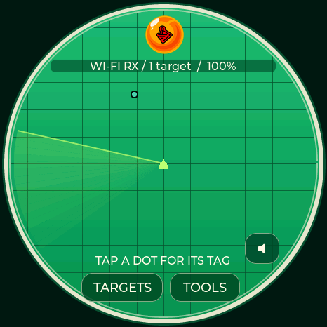 | 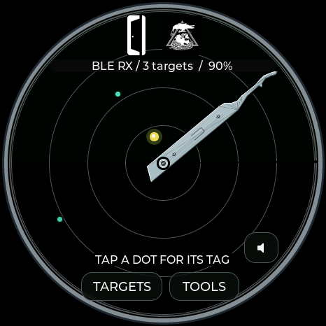 | 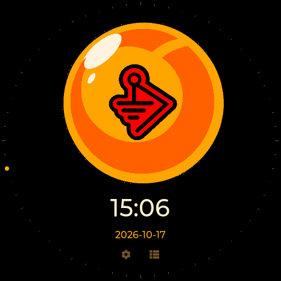 |

Choose a theme in **Settings → Theme & radar labels**. It applies to the radar, matching clock, menus, and dialogs. The Dragon Ball/BWM animation appears at power-on on every board. Swipe the clock to choose another watch face.

The collection includes maker, community, character, and locksport designs. [Browse the theme gallery](docs/THEMES.md) · [Watch controls](docs/STOPWATCH-CLOCK-ORIENTATION.md) · [Artwork credits](CREDITS.md)

## Capsule Corp

A silver Dragon Radar bezel, emerald grid and yellow signal markers, paired with a white-and-blue Capsule Corp chronometer. Included on all six profiles, with matching menus on the full profiles. [Theme guide](docs/CAPSULE-CORP.md).

| Radar | Watch |
|---|---|
| 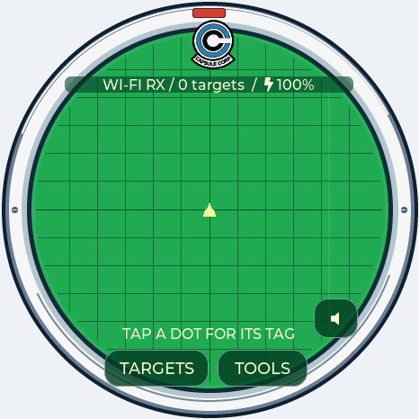 | 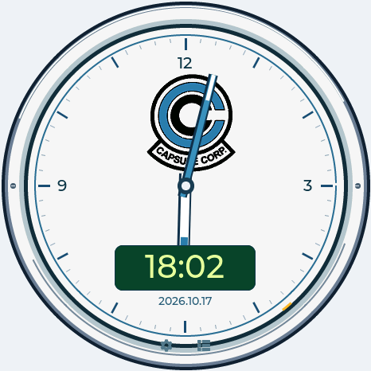 |

## Sparrows

Black, red and steel with the supplied keyhole emblem, a hook sweep and pick-shaped clock hands. The Locksport Timer includes SPLIT, OPEN and a moving rim. [Theme guide](docs/SPARROWS.md).

| Radar | Watch | Locksport Timer |
|---|---|---|
| 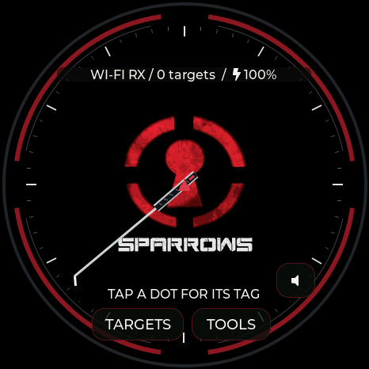 | 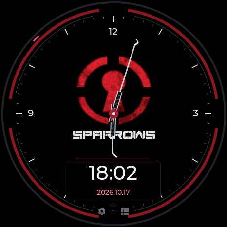 | 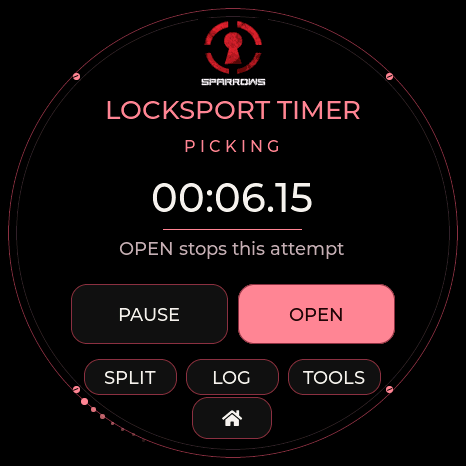 |

## Locksport

| McNally × Covert Instruments | LockPickingLawyer × CI | DMAC | Lockpickers United |
|---|---|---|---|
| 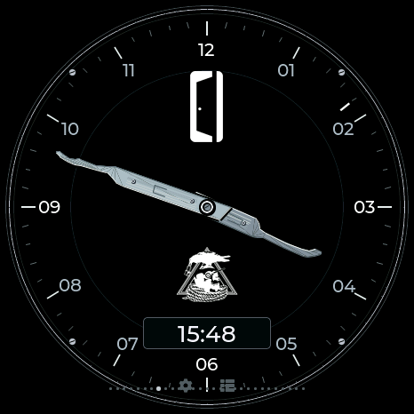 | 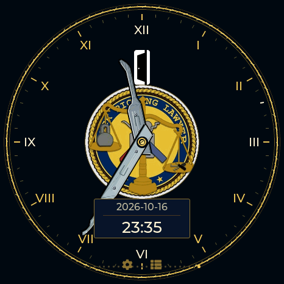 | 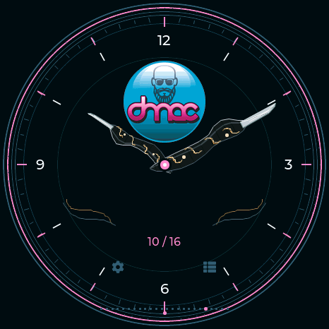 | 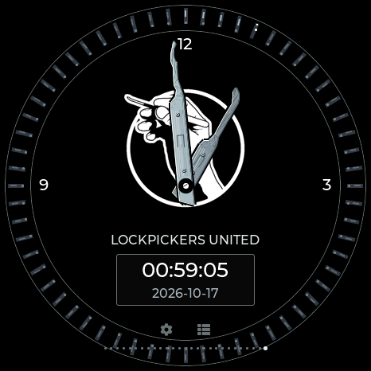 |
| 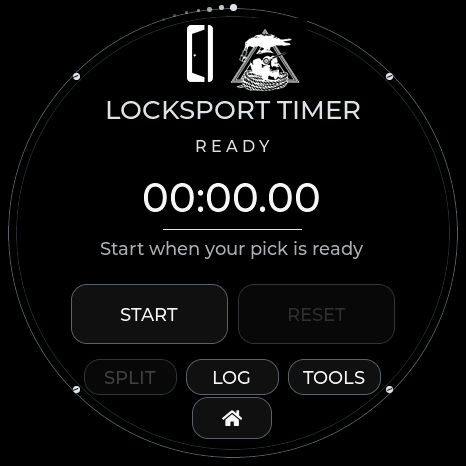 | 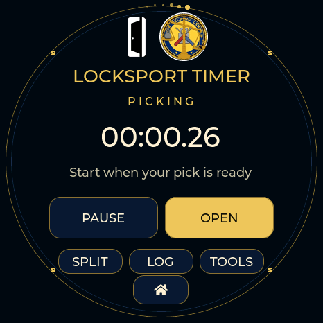 | 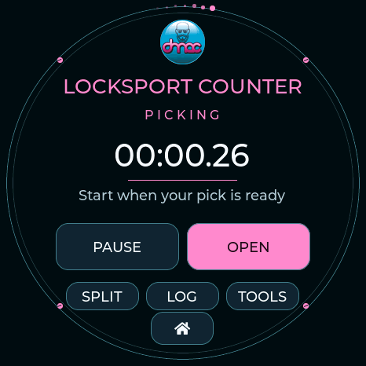 | 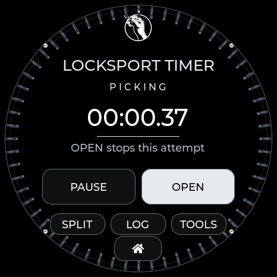 |

**START / PAUSE** controls the attempt, **SPLIT** records a milestone, and **OPEN** records the finish. The rim animates while counting and stops when paused. **LOG** holds the latest 50 splits until reset or reboot. TOOOL and TOOOL Dark also include matching locksport timers.

Images are firmware display captures. [Locksport gallery](https://valleytech-dragon-detector.pages.dev/#locksport)

## Tools

- **Detection and Hunt:** Wi-Fi/BLE signature matching, evidence labels, filtered signal strength, per-family alerts, watch/ignore rules, and local encounter history.
- **Recon:** surveys, protocol counters, packet captures, sessions, and CSV exports. [Recon guide](docs/RECON-013.md)
- **BLE Lab:** GATT inspection, explicit pairing, profile storage, emulation, and a cached-read bridge. [Capabilities and limits](docs/FEATURE-MATRIX.md)
- **Clock and timers:** analog/digital watches, stopwatch, locksport timing, and separate Time, Date, and Sync settings. USB sets local time and timezone. Devices without an external RTC need USB or configured Wi-Fi after complete power loss. [Clock setup](docs/CLOCK-SETUP.md)
- **Badge Studio:** prepare and upload your own artwork from the browser. [Open Studio](https://valleytech-dragon-detector.pages.dev/#studio)

Detection matches observable radio signatures; it does not establish intent, ownership, or recording state. Radar radius represents signal strength, and its angle is decorative. Silent devices, Bluetooth Classic, and 5/6 GHz Wi-Fi are outside coverage. [Detection evidence](docs/DETECTION.md)

## Development

[Build instructions](docs/BUILDING.md) · [Security](SECURITY.md) · [Release notes](https://git.churchofmalware.org/Valleytech/Dragon-Detector/releases)

| Directory | Contents |
|---|---|
| `firmware/` | Shared application and board adapters |
| `web/` | USB flasher, personal-theme creator, device tools, and Badge Studio |
| `tools/` | Build, packaging, and validation scripts |
| `tests/` | Native firmware and browser-module tests |
| `hardware/` | Board partitions and archived projects |
| `docs/` | Setup guides, architecture, and validation |

CI tests the firmware core and browser modules, builds all six profiles, and publishes matching firmware, manifests, and SHA-256 checksums. Historical projects under `hardware/` retain their original licenses and are not current update targets.

## Credits and license

Original application, web, and tooling code: [MIT](LICENSE), Your Pal Kal / Valleytech Custom Solutions. Dependencies, reference research, and supplied artwork retain their own rights and notices. [Attributions](CREDITS.md)

Dragon Detector is an independent project. Brand and character artwork does not imply affiliation or endorsement.
