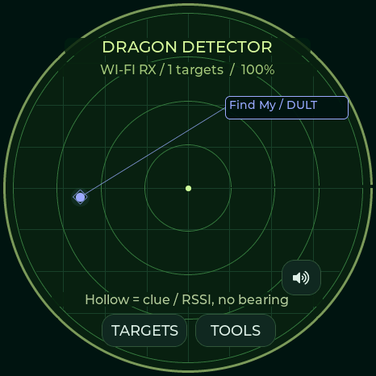
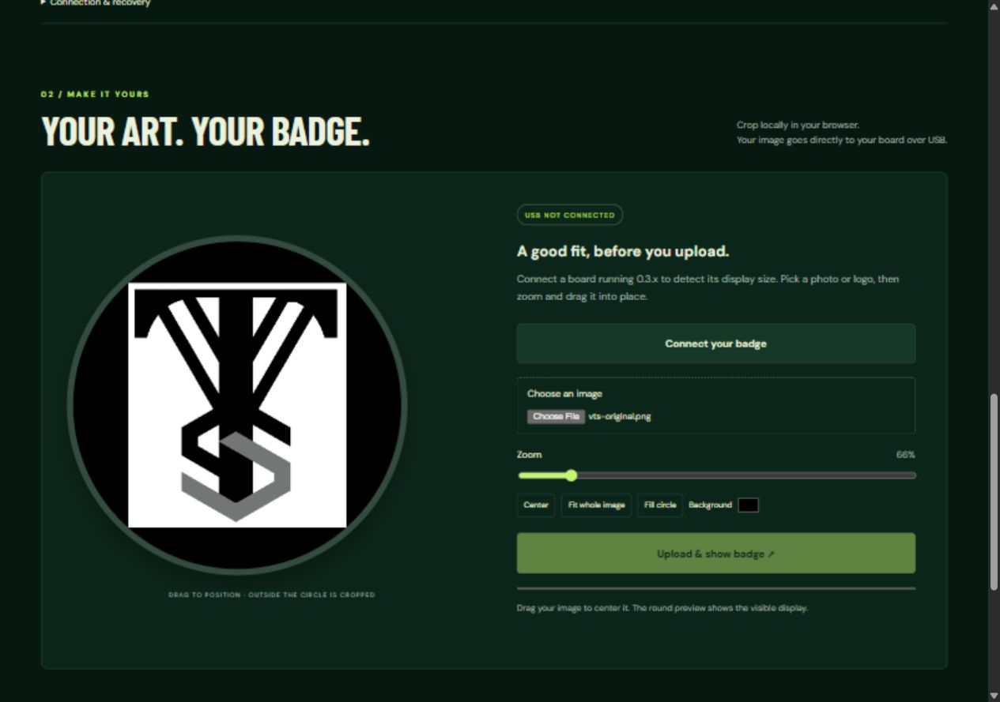

# Dragon Detector · Detection & Hunt Edition

**A Dragon Radar-inspired detector for three ESP32-S3 boards.** Observe device signatures, hunt a selected signal, and keep the evidence in local history. The existing image badge remains available.

**[Open the web flasher & detector tools](https://valleytechsolutions.github.io/DragonBall-Z-Radar/)** · [Install guide](docs/FLASHING.md) · [Controls](docs/USER-GUIDE.md) · [Detection evidence](docs/DETECTION.md) · [Credits](CREDITS.md)

Version **0.5.1** is an experimental development release. See [what has actually been tested](docs/VALIDATION.md) before installing. The flasher requires desktop Chrome/Edge, HTTPS, a USB data cable, and the exact board selection; it stays disabled if matching release files are unavailable.

## Choose the exact board

| Board | Display | Controls | Build |
|---|---|---|---|
| **Spotpear / Guition JC3636W518** | 360×360 round LCD | Touch | `spotpear` |
| **Waveshare ESP32-S3-Touch-AMOLED-1.75C** | 466×466 round AMOLED | Touch + BOOT key | `waveshare` |
| **M5Stack StopWatch C152** | 466×466 round AMOLED | Touch + yellow/blue keys, haptics | `stopwatch` |

The Waveshare **C variant** has different reset wiring from the non-C 1.75. Firmware is not interchangeable just because a board contains an ESP32-S3. [Board details and manufacturer links](docs/HARDWARE.md).

| Spotpear hardware | M5Stack hardware |
|---|---|
|  |  |

Photographs are manufacturer-hosted identification images, not pictures of this firmware. [Waveshare's official C-variant source and hardware reference](https://github.com/waveshareteam/ESP32-S3-Touch-AMOLED-1.75C) identifies the third board. The cover is promotional art; no manufacturer or Dragon Ball affiliation is implied.

## A radar you can wear

*Actual 466×466 LVGL render from Waveshare 1.75C, not a panel photograph. Targets opens the paged list; the speaker button toggles quiet mode.*

- **Audited signature coverage:** all 134 table entries in the pinned SquachWatch reference have recognition and radar tests. Includes Flock, Axon/TASER, Raven, camera glasses, Find My/DULT, SmartTag, Google Find Hub, Tile, Ring/camera/ALPR vendors, decoded drone Remote ID, iBeacon, pentest devices, disconnect bursts and SSID security conflicts. [Coverage and comparison](docs/DETECTION-PARITY.md).
- **All recognized candidates on radar:** first sightings appear immediately; hollow dots distinguish weak clues. A paged Targets list, quick quiet toggle and live radio-health screen make crowded areas easier to navigate.
- **Dragon Hunt:** dedicated target listening, filtered dBm, signal history, peak, trend, stability, a saved comparison mark, and automatic channel searching for stale Wi-Fi targets. Optional Dragon fox beacons support board-to-board training; transmission starts only when explicitly enabled.
- **Useful alert controls:** per-family and confidence filters, persistent watch/ignore rules, temporary snooze, repeat-alert suppression, quiet mode and grouped advertisement bursts.
- **Local detection history:** 512 address/radio/family records, bounded flash journal, encounters and peak signal. Connect USB to synchronize UTC and download CSV through the [detector tools](https://valleytechsolutions.github.io/DragonBall-Z-Radar/#detector).
- **Your requested display defaults:** 100% brightness, always on, no automatic dimming. Settings offers independent dim and screen-off timers, dim level and wake-on-alert.
- **Hear the hunt:** 26 original device-family melodies, a distinct Axon alert and double heartbeat, signal-dependent pitch/cadence, and a lost-signal cue. Edit, preview, silence or reset RTTTL tones in the [USB audio editor](https://valleytechsolutions.github.io/DragonBall-Z-Radar/#sound).
- **More room for reception:** 384 contacts in PSRAM, bounded packet processing, indexed packet queues and faster lookups across every board. Passive BLE is the default; optional active scanning requests response-only names.
- **Shared firmware:** all three profiles use the same detection, tracking, history, controls and release pipeline. All profiles have synthesized RTTTL speaker alerts. StopWatch adds haptics; Spotpear adds optional SD CSV/PCAP.
- **Existing image badge:** browser crop/position/zoom, CRC-checked USB upload and saved-image startup are retained. Further badge work is deferred for this detection release.

**A detected signature does not prove malicious intent, ownership, recording state or a particular product model.** AirTag/Find My family matches may be another compatible accessory; Biscuit Pro and Ultra are not reliably distinguishable from their shared advertisements. Radar radius reflects filtered signal strength, not measured distance. Angle is decorative, not direction. These radios cannot detect silent devices, Bluetooth Classic, or 5/6 GHz Wi-Fi.

## On-device display settings

A 466×466 LVGL capture from the attached Waveshare. This is the firmware render, not a physical-panel photograph.

## Audio alerts and RTTTL editor

Open **Settings → Audio & hunt tones** on the device, or connect to the [USB audio editor](https://valleytechsolutions.github.io/DragonBall-Z-Radar/#sound). Fresh installations use 100% volume; existing preferences are retained on update. Axon, glasses, trackers, ALPR candidates and the other detector families each have their own original melody. Select a contact to Hunt or enable automatic Axon / ALPR / glasses focus.

*0.4.0 browser screenshot. USB enables loading, previewing and saving tones. The image editor remains directly below it.*

## Existing Badge Studio

Browser capture of the Badge Studio editor. This is a crop preview, not a photograph of a flashed device.

## Install and customize

1. Open the [web flasher](https://valleytechsolutions.github.io/DragonBall-Z-Radar/), select the exact board, and choose **Fresh install** for your first current installation. This replaces stored files. Back up existing firmware first.
2. Connect USB and follow the installer. Reset when finished if necessary.
3. Open **Detector tools** on the same page to sync UTC, export history, or set display timers. On the device, tap a radar dot → **Hunt signal**, or use Tools → History.
4. Set detector families and the audible-alert threshold in Tools → Detectors. Weak clues remain visible when the alert threshold is raised. A target’s Controls page offers watch, ignore and snooze. Badge Studio is still available separately.

Use **Update** only for an existing 0.3.x, 0.4.x or 0.5.x installation on the same board. Split update images preserve NVS and the badge filesystem. A merged factory BIN writes at **0x0** and resets stored settings/files. [Full recovery and manual flashing instructions](docs/FLASHING.md).

## Repository map

| Path | Purpose |
|---|---|
| [firmware](firmware) | Current 0.5.x shared application and board adapters |
| [platformio.ini](platformio.ini) | Pinned board profiles and build dependencies |
| [web](web) | GitHub Pages flasher, USB detector tools and existing Badge Studio |
| [tools](tools) | Build, package and validate releases |
| [tests](tests) | Native detector/tracking tests and image-protocol tests |
| [lib/opendroneid](lib/opendroneid) | Pinned Apache-2.0 Remote ID decoder and notice |
| [lib/esp_lcd_co5300](lib/esp_lcd_co5300) | Pinned Apache-2.0 CO5300 driver with original notice |
| [hardware](hardware) | Previous 0.1/0.2 projects, board partition tables and retained vendor libraries |
| [docs](docs) | Current guides, validation limits and third-party notices |

The older Spotpear multimedia and StopWatch releases remain in `hardware/` for reproducibility. The current builds omit the GPL audio decoder and microphone/music workflows. Earlier binaries are **not** 0.3.x update targets.

## Build and contribute

See [BUILDING.md](docs/BUILDING.md). CI tests the packet parser and tracking code, builds every board, and packages matching firmware, manifests and SHA-256 checksums. A successful `main` build feeds the GitHub Pages deployment from the same source commit.

Original current application, web and tooling code is **[MIT](LICENSE)**, by **Your Pal Kal / Valleytech Custom Solutions**. Dependencies keep their own notices; historical `hardware/` projects retain their existing licenses. Thanks to **Colonel Panic / OUI Spy / Unified Blue**, **JustCallMeKoko / ESP32 Marauder**, Flock Noir, **skizzophrenic / SquachWatch**, OpenDroneID, CodeHedge, and the hardware/library authors. Read [CREDITS.md](CREDITS.md) for the exact scope and provenance.
