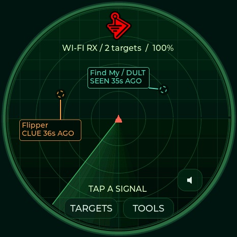
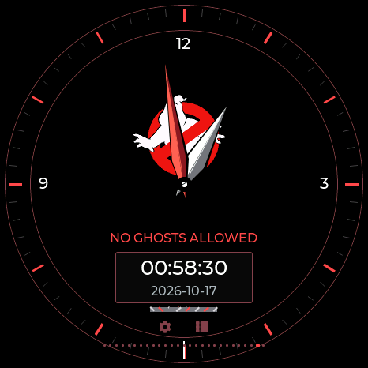
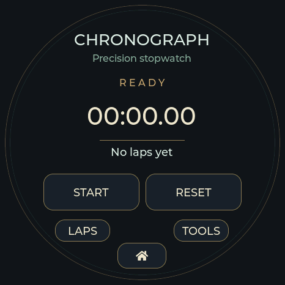
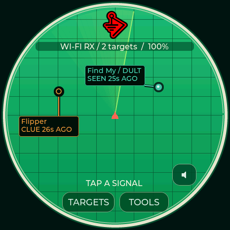
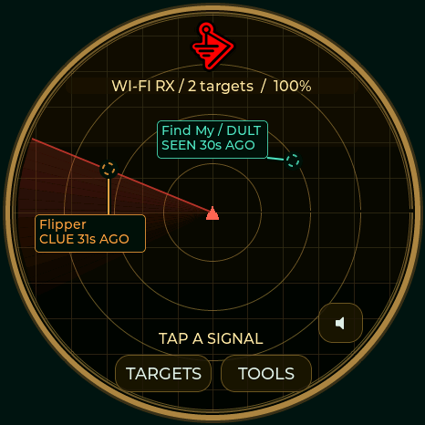
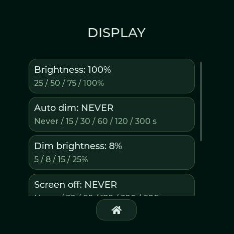
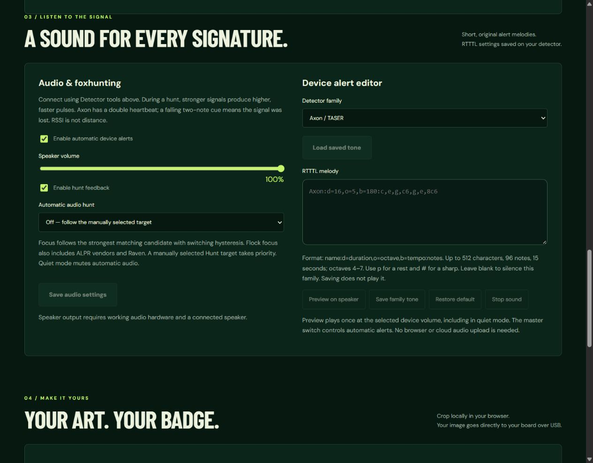
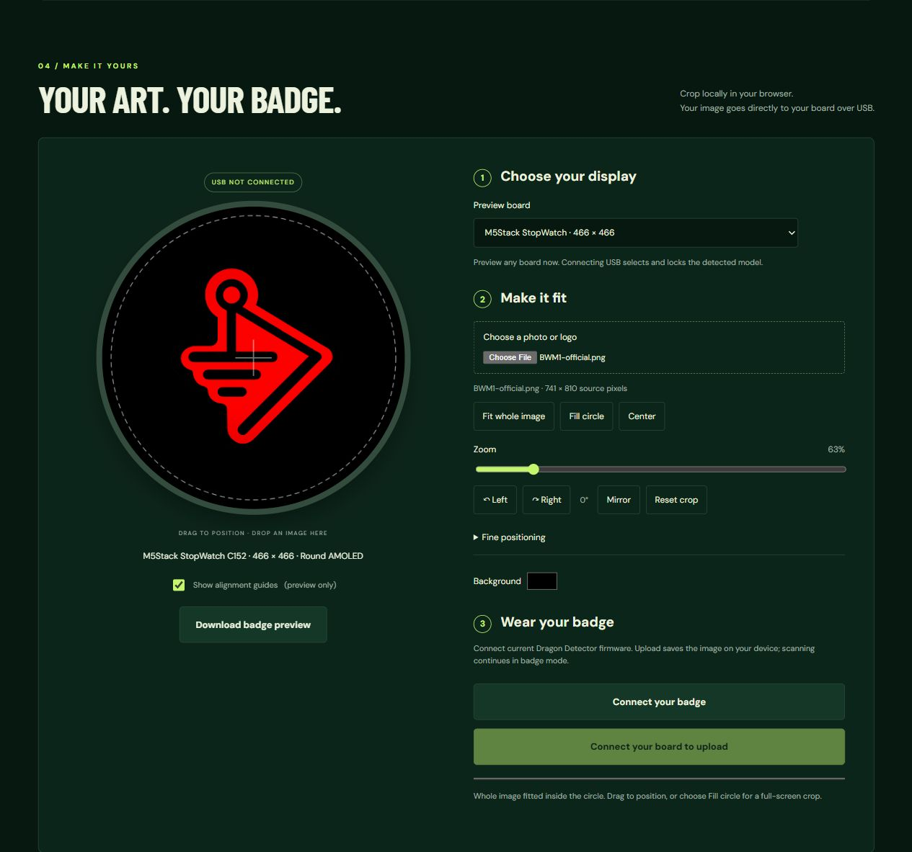
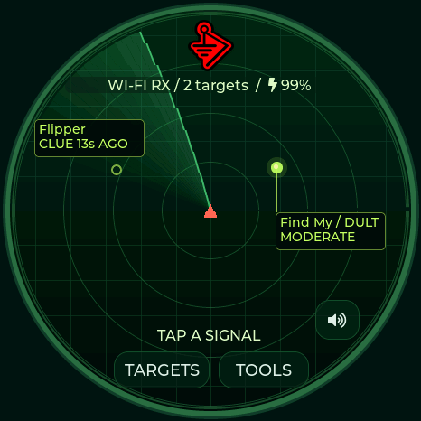

**0.13.9:** Ghostbusters and Lockpickers United, 29 GUI themes and 27 logo watches, a shared VTS boot animation, five BOOT-operated Lite pages, lossless artwork compression, and optional saved-Wi-Fi clock recovery on all four full boards. [Release notes](docs/RELEASE-0.13.9.md) · [Spotpear time setup wiki](https://github.com/valleytechsolutions/Dragon-Detector/wiki/Spotpear-Clock-Setup).

# Dragon Detector · Detection & Hunt Edition

**A Dragon Radar-inspired detector for five ESP32-S3 board profiles, including a compact button-operated Lite edition.** Observe device signatures, hunt a selected signal, and keep the evidence in local history. Create a custom image badge in the browser, sized for your exact board.

**[Open the web flasher & detector tools](https://valleytechsolutions.github.io/Dragon-Detector/)** · [Install guide](docs/FLASHING.md) · [Controls](docs/USER-GUIDE.md) · [Detection evidence](docs/DETECTION.md) · [Credits](CREDITS.md)

Version **0.13.6** adds DMAC with acrylic pick hands and a Locksport Counter, Nyan Devices with a moving rainbow cat, a Talking Sasquach character watch, and distinct Waveshare, M5Stack, Seeed Studio and LAB5 faces. DagNazty adds a white/black skull-and-talon theme with its own analog watch. 0ct0’s Pig adds a pink ASCII octopus and a wandering, interactive pig that tells the live time. DeFlock adds a navy/steel-blue camera-raven viewfinder watch with large 24-hour time. The collection now includes only logo-based watches. It also adds HaleHound with both supplied logos, animated pink/violet fire and a hellfire radar, plus GhostStrats (black/grey/purple, glowing slit eyes and “Safety is an Illusion.”) and N3rdsec (black/white/gold, supplied skull on the watch and radar), alongside AWOK neon paint/mushroom, Baph0Mau5 occult and WDGWARS world-map themes with matching analog faces, plus a black/silver Covert Instruments × McNally theme with distinct Reaper pick hands, a 24-hour window and a rotating McTickler radar sweep. Every theme now carries through menus, settings, dialogs and utilities, while the supplied BWM2 logo appears alone on black at boot. It also adds white/red TOOOL and near-black/red TOOOL Dark themes, a matching logo watch face and a Locksport Timer with OPEN and SPLIT controls. Church of Malware adds a monochrome circuit radar and a full-emblem binary watch. Analog faces show the date without AM/PM. Twenty-four logo watch faces include 12-hour analog dials; JCMK is a 24-hour digital face and the Covert hybrid adds a separate 24-hour window. ValleyTech retains its Arabic dial and broad gold/silver hands; JCMK and LAB5 digital faces use large numerals.

Storage controls match the hardware. **Waveshare AMOLED and M5Stack have no SD controls:** Utilities → Saved files opens captures in internal flash, and Settings provides Capture studio and Saved captures. Spotpear and XIAO retain their optional SD tools. [Hardware feature comparison](docs/HARDWARE.md) · [GUI tour](docs/GUI.md).

**Twenty-seven complete themes** include Covert Instruments × LockPickingLawyer, Covert Instruments × McNally, TOOOL, TOOOL Dark, Church of Malware, Valleytech, Biscuit Shop and Marauder with their supplied logos. Select one in **Settings → Theme & radar labels** or the USB web tools. [Theme previews](docs/THEMES.md).

The 0.13 series brings the **29 timed Wi-Fi/BLE tools, eight modes and BLE Lab to all four full boards**. New workflows include saved recon sessions, historical AP archives, bounded recipes, HID report decoding and a GATT bridge with cached reads. **Tools → Recon → Attacks** opens the attack lists directly; **Utilities** replaces Daily. Normal screens retain background detection. All five profiles share the 158-fact SquachWatch audit and AXEOFF priority handling. [New workflows and limits](docs/RECON-013.md) · [Memory reserve](docs/FLASH-BUDGET.md) · [Feature comparison](docs/FEATURE-MATRIX.md).

Update preserves badge, history, settings, GATT profiles and saved captures. Active lab sessions temporarily own the shared radio; Stop/Home returns it to the previous listening state. This is an independent implementation, not complete Marauder or ChimeraBLE parity. [Validation and limits](docs/VALIDATION.md).

| Utilities · internal files | Settings · no SD controls | Capture studio |
|---|---|---|
|  |  |  |

CRC-verified logical display captures from the connected Waveshare running 0.13.3; these are firmware renders, not panel photographs. [More GUI pictures](docs/GUI.md) · [Open Radio tools](https://valleytechsolutions.github.io/Dragon-Detector/#radio-tools).

## Locksport collection

Choose **TOOOL**, **TOOOL Dark**, **Covert Instruments / McNally**, or **DMAC** in Settings → Theme & radar labels. Each selects its own logo watch and colors the entire interface. DMAC calls the timing page **Locksport Counter**; the other three use **Locksport Timer**.

| TOOOL | TOOOL Dark | Covert Instruments × McNally | DMAC |
|---|---|---|---|
|  |  |  |  |
|  |  |  |  |

**START / PAUSE** controls the attempt, **SPLIT** records a milestone, **OPEN** records the final split and stops, and **RESET** confirms before clearing. A theme-colored comet circles the outer rim every ten seconds while counting, freezes on PAUSE/OPEN, and returns to the top on RESET. The latest 50 splits remain available in LOG until reset or reboot. These are native Waveshare display captures. The same features and panel-sized artwork are built for **Seeed XIAO + Round Display, Spotpear / Guition, and M5Stack StopWatch**. [Full theme gallery](docs/THEMES.md) · [Controls](docs/STOPWATCH-CLOCK-ORIENTATION.md) · [Artwork credits](CREDITS.md).

## Flash in three steps

1. Open the **[web flasher](https://valleytechsolutions.github.io/Dragon-Detector/#install)** in desktop Chrome or Edge with a USB data cable.
2. Choose the **exact board**, then **Update matching Dragon Detector** to keep files/settings on a compatible installation, or **Fresh install** for a new board (replaces saved files).
3. Confirm the hardware checkbox, select **Connect & install**, choose the board's USB port, and wait for verification. Reset if it remains in the bootloader.

[Full installation, update compatibility and recovery instructions](docs/FLASHING.md). Close the installer before connecting Badge Studio or detector tools.

## Choose the exact board

| Board | Display | Controls | Build |
|---|---|---|---|
| **Spotpear / Guition JC3636W518** | 360×360 round LCD | Touch | `spotpear` |
| **Waveshare ESP32-S3-Touch-AMOLED-1.75C** | 466×466 round AMOLED · **32 MB / BLE Lab** | Touch + BOOT / short PWR | `waveshare` |
| **M5Stack StopWatch C152** | 466×466 round AMOLED | Touch + yellow/blue keys, haptics | `stopwatch` |
| **Seeed XIAO ESP32-S3 + Round Display** | 240×240 round LCD | Touch + BOOT, microSD, RTC; no speaker | `xiao_round` |
| **Waveshare ESP32-S3-LCD-1.28 — Lite** | 240×240 round LCD | BOOT-operated radar, clock, timer, signals and diagnostics; no touch/audio | `waveshare_lite` |

The Waveshare **C variant** has different reset wiring from the non-C 1.75. Firmware is not interchangeable just because a board contains an ESP32-S3. [Board details and manufacturer links](docs/HARDWARE.md).

| Hardware difference | Waveshare AMOLED | M5Stack StopWatch | Spotpear | XIAO Round | Waveshare Lite |
|---|---|---|---|---|---|
| Flash | 32 MB | 16 MB | 16 MB | 8 MB | 16 MB |
| SD card controls | None | None | Optional CSV/PCAP + browser | Optional CSV/PCAP + browser | None |
| Internal user storage | 3.94 MiB badge/history + 16 MiB recon | 7.94 MiB shared | 3.94 MiB shared | 1.94 MiB shared | No user file features |
| 29 themes, badge, stopwatch, radio tools, BLE Lab | Yes | Yes | Yes | Yes | Compact radar/clock/timer; no badge or active labs |
| Sound / haptics | Speaker connector | Speaker + haptics | Speaker connector | Visual alerts | Visual alerts |
| Clock | RTC | RTC | Software | RTC | Software + USB sync |

All five share the detection engine. The four full boards share the interactive toolset; storage capacity, controls and peripherals differ. These are partition capacities before filesystem overhead, not guaranteed free space. See the [complete hardware feature matrix](docs/HARDWARE.md) and [measured flash reserve](docs/FLASH-BUDGET.md).

| Spotpear hardware | M5Stack hardware |
|---|---|
|  |  |

Photographs are manufacturer-hosted identification images, not pictures of this firmware. [Waveshare's official C-variant source and hardware reference](https://github.com/waveshareteam/ESP32-S3-Touch-AMOLED-1.75C) identifies the third board. The cover is promotional art; no manufacturer or Dragon Ball affiliation is implied.

The Seeed port has its own 8 MB flash layout, native 240-pixel fonts/logo, buffered touch, shared SPI SD support and RTC controls. USB detection, RTC and badge checks pass; physical panel/touch confirmation and inserted-card tests remain pending. [XIAO hardware, switches and installation](docs/XIAO-ROUND.md).

| XIAO radar · 0.9.2 | XIAO stopwatch · 0.9.2 |
|---|---|
|  |  |

Logical 240×240 captures from the connected XIAO, not panel photographs.

## A radar you can wear

*Green radar theme with animated sweep, labeled signals and owner-supplied BWM1 logo. Inward means stronger filtered RSSI, with no numerical distance scale. Actual 466×466 LVGL render from M5Stack StopWatch C152, not a panel photograph. Targets opens the paged list; the speaker button toggles quiet mode.*

- **Twenty-seven complete themes:** classic radar palettes, branded maker and community watches, the locksport collection, 0ct0’s Pig and DeFlock. [Browse every theme and its controls](docs/THEMES.md). Each of the 26 device families has its own fixed color for dots, labels and leaders, with a [color legend](docs/RADAR-COLORS.md). Animated sweep, pulsing signals, automatic priority tags and tap-to-reveal tracker tags. All contacts share one radar; tap a selected dot again for evidence and Hunt; choose your theme in Settings or the USB web tools.
- **Audited signature coverage:** all 158 table entries in the pinned SquachWatch reference have recognition and radar tests. Includes Flipper, Wi-Fi Pineapple, Pwnagotchi, nyanBOX, Biscuit, Flock, Axon/TASER, Raven, camera glasses, Find My/DULT, SmartTag, Google Find Hub, Tile, Ring/camera/ALPR vendors, decoded drone Remote ID, iBeacon, pentest devices, disconnect bursts and SSID security conflicts. [Coverage and comparison](docs/DETECTION-PARITY.md).
- **All recognized candidates on radar:** first sightings appear immediately; device types use fixed colors and trackers use smaller dots. Intermittent signals remain for up to two minutes with a segmented marker and explicit last-seen age. A paged Targets list, quick quiet toggle and live radio-health screen make crowded areas easier to navigate.
- **Traffic awareness:** Wi-Fi deauthentication/disassociation bursts and BLE pairing/tag spam candidates, with a radar activity banner, counts, protocol/channel evidence and a dedicated Activity screen. See [how traffic detection works](docs/RADAR-AND-ACTIVITY.md).
- **Dragon Hunt:** target priority with background scanning, filtered dBm, signal history, peak, trend, stability, a saved comparison mark, and automatic channel searching for stale Wi-Fi targets. Optional Dragon fox beacons support board-to-board training; transmission starts only when explicitly enabled.
- **Useful alert controls:** per-family and confidence filters, persistent watch/ignore rules, temporary snooze, repeat-alert suppression, quiet mode and grouped advertisement bursts.
- **Local detection history:** 512 address/radio/family records, bounded flash journal, encounters and peak signal. Connect USB to synchronize UTC and download CSV through the [detector tools](https://valleytechsolutions.github.io/Dragon-Detector/#detector).
- **Your requested display defaults:** 100% brightness, always on, no automatic dimming. Settings offers independent dim and screen-off timers, dim level and wake-on-alert.
- **Hear the hunt:** 26 original device-family melodies, a distinct Axon alert and double heartbeat, signal-dependent pitch/cadence, and a lost-signal cue. Edit, preview, silence or reset RTTTL tones in the [USB audio editor](https://valleytechsolutions.github.io/Dragon-Detector/#sound).
- **More room for reception:** 384 contacts in PSRAM, bounded packet processing, indexed packet queues and faster lookups across every board. Passive BLE is the default; optional active scanning requests response-only names. Assigned service IDs are recognized in 16-, 32- and exact Bluetooth Base 128-bit encodings. See [checking a Flipper or Pineapple Pager](docs/DEVICE-CHECKS.md).
- **Shared firmware:** all five profiles use the same detection, tracking, radar renderer and release pipeline. The four full profiles also include history and interactive controls. Lite adds compact clock, timing, signal and diagnostic pages while scanning with all families enabled; it excludes badge, touch menus, audio, active labs and persistent history. The original three profiles have synthesized RTTTL speaker alerts. Seeed XIAO Round uses visual alerts because it has no speaker. StopWatch adds haptics; Spotpear and Seeed XIAO Round add optional SD CSV/PCAP.
- **Badge Studio:** board-specific 240/360/466px previews, fit/fill, drag, zoom, rotate, mirror, fine positioning, background color, alignment guides and PNG export. USB identifies the exact board before a CRC-checked upload; interrupted transfers preserve the previous badge.

**A detected signature does not prove malicious intent, ownership, recording state or a particular product model.** AirTag/Find My family matches may be another compatible accessory; Biscuit Pro and Ultra are not reliably distinguishable from their shared advertisements. Radar radius reflects filtered signal strength, not measured distance. Angle is decorative, not direction. These radios cannot detect silent devices, Bluetooth Classic, or 5/6 GHz Wi-Fi.

## New Ghostbusters and Lockpickers United themes

| Ghostbusters | Lockpickers United | LPU Locksport Timer |
|---|---|---|
|  |  |  |

Actual Waveshare firmware framebuffers. Ghostbusters has a proton-stream radar and no-ghost containment dial. LPU has a prominent original emblem, silver lockpick hands, and sixty rim pins that lift to mark seconds on the watch and timer. The timer pauses the pins with the attempt. [Full showcase](docs/THEMES.md#ghostbusters-and-lockpickers-united--0139).

## Stopwatch, clock and orientation

**Tools → Utilities** now includes a real start/pause/lap stopwatch and twenty-seven swipeable logo watch faces, including TOOOL, Church of Malware binary, character, maker and community logo designs. Both TOOOL themes and Covert Instruments × McNally offer Locksport Timer; DMAC offers Locksport Counter with the same OPEN and SPLIT controls. All analog dials use 12 hours. JCMK military, DeFlock, 0ct0’s Pig and the Covert hybrid’s digital window use 24-hour time. Connecting Studio automatically syncs local date, time and timezone. M5Stack yellow/blue and Waveshare BOOT/short PWR operate timing controls; the four full-feature boards also have touch buttons. The latest 50 laps remain available while detection keeps running. Settings provides RTC date/time and local UTC offset, saved 0°/90°/180°/270° orientation on the four full-feature boards (Lite has a fixed orientation). [Controls, behavior and hardware limits](docs/STOPWATCH-CLOCK-ORIENTATION.md).

| Chronograph · 0.13.3 | ValleyTech clock · 0.13.6 |
|---|---|
|  |  |

Actual CRC-verified Waveshare firmware renders. [Clock faces and easy time setup](docs/STOPWATCH-CLOCK-ORIENTATION.md). Orientation changes only through Settings or USB tools. Connecting the current Studio copies the computer's local time; resync after daylight-saving changes or complete power loss without another time source.

## Choose your radar

| Dragon Ball | Black / gold / red |
|---|---|
|  |  |

Settings → Theme & radar labels saves the theme, label preference and recent-signal retention. The images are actual 466×466 renderer captures of received contacts, not physical-panel photographs.

## On-device display settings

A 466×466 LVGL capture from the attached Waveshare. This is the firmware render, not a physical-panel photograph.

## Audio alerts and RTTTL editor

Open **Settings → Audio & hunt tones** on the device, or connect to the [USB audio editor](https://valleytechsolutions.github.io/Dragon-Detector/#sound). Fresh installations use 100% volume; existing preferences are retained on update. Axon, glasses, trackers, ALPR candidates and the other detector families each have their own original melody. Select a contact to Hunt or enable automatic Axon / ALPR / glasses focus.

*0.4.0 browser screenshot. USB enables loading, previewing and saving tones. The image editor remains directly below it.*

## Badge Studio

Choose your board → compose your image → connect and upload. Images initially fit inside the circle with a small margin; choose Fill circle for a full-screen crop. Rotate/mirror, keyboard nudging, alignment guides and downloadable previews work before connecting a device. Guides are never uploaded. [Open Badge Studio](https://valleytechsolutions.github.io/Dragon-Detector/#studio). This is a browser capture, not a panel photograph.

The 0.8 M5Stack adapter uses native touch coordinates and direct Tools/Home taps. Outside Stopwatch, yellow returns to radar; blue opens Tools, or Badge from Tools. Upward-swipe navigation has been removed on all boards; lists still scroll normally.

| M5Stack radar · 0.8 | M5Stack saved badge · 0.8 |
|---|---|
|  |  |

Actual 466×466 renderer captures from the attached StopWatch. The owner confirmed display, touch and physical-button navigation. The browser-exported badge matched uploaded RGB565 pixels and survived a restart; no private identifiers are shown.

## Install and customize

1. Open the [web flasher](https://valleytechsolutions.github.io/Dragon-Detector/), select the exact board, and choose **Fresh install** for your first current installation. This replaces stored files. Back up existing firmware first.
2. Connect USB and follow the installer. Reset when finished if necessary.
3. Open **Detector tools** on the same page to sync UTC, export history, or set display timers. On the device, tap a radar dot → **Hunt signal**, or use Tools → History.
4. Set detector families and the audible-alert threshold in Tools → Detectors. Weak clues remain visible when the alert threshold is raised. A target’s Controls page offers watch, ignore and snooze. Badge Studio is still available separately.

Use **Update** only for an existing 0.3.x, 0.4.x, 0.5.x, 0.6.x, 0.7.x, 0.8.x or 0.9.x installation on the same board. Split update images preserve NVS and the badge filesystem. A merged factory BIN writes at **0x0** and resets stored settings/files. [Full recovery and manual flashing instructions](docs/FLASHING.md).

## Repository map

| Path | Purpose |
|---|---|
| [firmware](firmware) | Current 0.9.x shared application and board adapters |
| [platformio.ini](platformio.ini) | Pinned board profiles and build dependencies |
| [web](web) | GitHub Pages flasher, USB detector tools and Badge Studio |
| [tools](tools) | Build, package and validate releases |
| [tests](tests) | Native detector/tracking tests and image-protocol tests |
| [lib/opendroneid](lib/opendroneid) | Pinned Apache-2.0 Remote ID decoder and notice |
| [lib/esp_lcd_co5300](lib/esp_lcd_co5300) | Pinned Apache-2.0 CO5300 driver with original notice |
| [hardware](hardware) | Previous 0.1/0.2 projects, board partition tables and retained vendor libraries |
| [docs](docs) | Current guides, validation limits and third-party notices |

The older Spotpear multimedia and StopWatch releases remain in `hardware/` for reproducibility. The current builds omit the GPL audio decoder and microphone/music workflows. Earlier binaries are **not** 0.3.x update targets.

## Build and contribute

See [BUILDING.md](docs/BUILDING.md). CI tests the packet parser and tracking code, builds every board, and packages matching firmware, manifests and SHA-256 checksums. A successful `main` build feeds the GitHub Pages deployment from the same source commit.

Original current application, web and tooling code is **[MIT](LICENSE)**, by **Your Pal Kal / Valleytech Custom Solutions**. Dependencies keep their own notices; historical `hardware/` projects retain their existing licenses. Thanks to **Colonel Panic / OUI Spy / Unified Blue**, **JustCallMeKoko / ESP32 Marauder**, Flock Noir, **skizzophrenic / SquachWatch**, OpenDroneID, CodeHedge, and the hardware/library authors. Read [CREDITS.md](CREDITS.md) for the exact scope and provenance.

The web flasher includes a shared page-visit counter from this release onward. [Counter behavior and maintenance](docs/VISIT-COUNTER.md).
