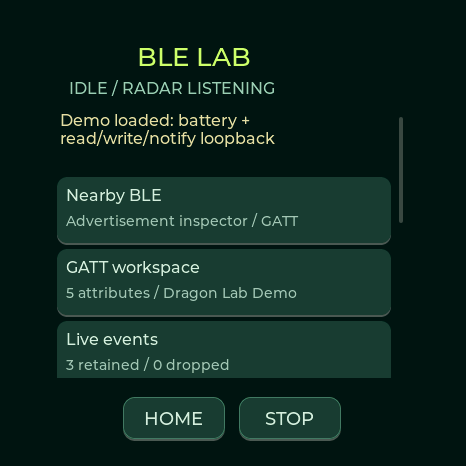

# BLE Lab · Waveshare AMOLED 1.75C

BLE Lab is available in **0.9.8+ on the 32 MB ESP32-S3-Touch-AMOLED-1.75C**. Open **Tools → Recon → BLE Lab**, or the **BLE Lab** section of the [web flasher](https://valleytechsolutions.github.io/Dragon-Detector/#ble-lab). The Spotpear, M5Stack, XIAO and Waveshare Lite retain their existing radar features and flash layouts; this release does not expose the lab on those boards.

## Workflow

1. **Nearby BLE** lists recent advertisements, strongest first. Select your peripheral to inspect the address type, age, RSSI and raw advertising structures. Random/private addresses do not identify a manufacturer or a persistent owner. A device may advertise without accepting connections.
2. **Connect + discover** explicitly opens one BLE connection. The worker discovers primary services, characteristics, descriptors and readable values. Failed/protected reads are marked; the firmware does not request pairing or retry protected reads. Passkey entry and numeric comparison are rejected because this release has no pairing interface; no default PIN or implicit numeric approval is submitted. Radar reception pauses while the connection owns the radio.
3. **GATT workspace** shows the captured hierarchy. Open a characteristic to read it again or subscribe to notifications/indications. **Live events** keeps the latest 64 events, with uptime, attribute index and hex bytes. Dropped-event counts are visible.
4. **Save workspace** uses a unique filename. The browser allows a descriptive name, download/import of `.ddg` files, loading a saved profile and comparison against the current workspace. Comparison reports added, removed and changed attributes, including property/value changes. Import validates the complete file before replacing the workspace; disk saves use a temporary file and atomic rename and never overwrite an existing name.
5. **Emulate profile** builds a local connectable GATT peripheral. Confirm Start. A client can read captured values, write writable characteristics and subscribe to their notifications. Use **Send current value** to notify a subscriber. Local writes are logged as events. **Load demo profile** provides a synthetic battery service and a read/write/notify characteristic for testing.
6. **Stop** or **Home** closes the connection or emulator and restores the previous radar listening state. If radar was deliberately paused before entering the lab, it remains paused. The workspace survives Stop but is volatile until saved. No active lab operation automatically resumes after reboot.

The detector has a single shared 2.4 GHz radio. It cannot provide uninterrupted radar coverage while acting as a GATT central or emulated peripheral. Entering the lab menu alone leaves scanning active. Home always exits active lab work; an in-flight Bluetooth request can take time to finish or fail before cleanup completes.

## What is cloned

Application services, characteristic UUIDs/properties and captured initial values, plus readable descriptors. Legacy advertisement and scan-response payloads are reused only when each fits its 31-byte limit; otherwise the emulator generates an advertisement using the profile name and a service UUID. The device retains its own Bluetooth address.

NimBLE owns the GAP/GATT services and CCCD descriptors; duplicate versions are not created from a snapshot. Original attribute handles are recorded as evidence but are not guaranteed in the emulation. Protected permissions, bond keys, identity resolution keys, security handshakes, live sensor behavior and proprietary application logic are **not** reproduced. An unreadable value is an unavailable snapshot, not a successful read of an empty value. Notifications require a real connected subscriber; emulation does not transmit a captured device's ongoing activity automatically.

This is a GATT profile emulator, not a transparent relay or a complete replacement for the original product. A profile marked partial cannot start emulation.

## Storage and update safety

| Region | Offset | Size | Update behavior |
|---|---:|---:|---|
| Settings / NVS | `0x9000` | 20 KB | Preserved |
| OTA selection | `0xe000` | 8 KB | Installer selects the updated app |
| App 0 / App 1 | `0x10000` / `0x610000` | 6 MB each | App 0 updated |
| Existing badge/history LittleFS | `0xc10000` | `0x3f0000` | Preserved, same size and address |
| New recon LittleFS | `0x1000000` | 16 MB | Preserved by Update |

Fresh installation initializes both filesystems. Update does not write NVS, badge/history or recon images. On an older 16 MB firmware, the new recon filesystem may initially be unavailable. After a full backup, choose **Initialize new BLE storage** in the web lab. This one-time action formats only the new upper partition and is rejected once it is mounted; it cannot clear an existing mounted profile library. There is no automatic format on a mount error.

Profiles are stored in `/profiles/*.ddg` on recon flash. Optional event logs rotate between `/events/current.csv` and `/events/previous.csv`, each bounded to 1 MB. Download either log from the web lab. The SD card is not required. Logging starts only when enabled for the current session. Free-space guards protect profile commits and stop logging when space is low.

The current workspace supports 16 services, 64 characteristics, 128 total attributes, 512 bytes per value and 512 advertisement bytes. Larger discoveries are marked partial. Large buffers and the advertisement/event caches live in PSRAM. One connection/workspace is supported at a time. Extra flash increases storage capacity; it does not increase internal RAM or make RSSI a distance measurement.

## USB and profile format

The browser shares the existing USB serial session. No cloud upload, account or wireless web server is needed. Stop a lab operation before loading or importing a different profile. Export is a checked sequence of hex chunks; import acknowledges every bounded chunk and verifies CRC before committing.

`DDG1` is a versioned little-endian binary format: a 580-byte header followed by up to 128 fixed 559-byte attributes and a trailing CRC32 on disk/download. Header and attribute definitions are in [`ble_profile.h`](../firmware/include/ble_profile.h). The browser validates UUID syntax, address types, lengths and parent relationships independently. CRC detects corruption; it does not authenticate who created a profile.

Diagnostic commands include `lab status`, `lab nearby`, `lab adverts`, `lab inspect AA:BB:CC:DD:EE:FF 0` (public) or address type `1` (random), `lab read INDEX`, `lab subscribe INDEX`, `lab events`, `lab log on|off`, `lab save NAME`, `lab list`, `lab load NAME`, `lab compare NAME`, `lab export`, `lab demo`, `lab clone`, `lab notify INDEX`, and `lab stop`. Use a captured address type rather than guessing it. `badge checksum` reports the saved badge's length/CRC and startup preference without returning image data.

## Attribution and testing

The workflow is inspired by [Matthew KuKanich's ChimeraBLE](https://github.com/MatthewKuKanich/ChimeraBLE). This is an independent MIT implementation using the project's existing NimBLE/LittleFS dependencies. ChimeraBLE's GPL source and Wireshark-derived OUI database are not bundled. [Full credits](../CREDITS.md).

Native tests exercise the profile parser and comparison boundaries. Web tests cover CRC, transport acknowledgements and factory/update separation. [`test_ble_lab_live.py`](../tools/test_ble_lab_live.py) is an opt-in Windows test using an original synthetic peripheral; it never automatically connects to arbitrary nearby devices. See [validation](VALIDATION.md) for the actual hardware results and outstanding limits.
