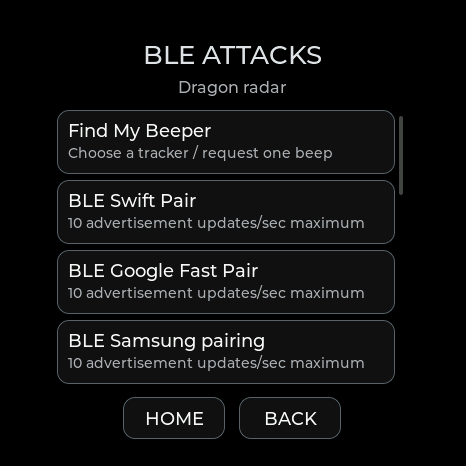

# Find My Beep and iBeacon · 0.13.20

For repeating requests, Beep All and improved radar taps, see the [0.13.22 instructions](RELEASE-0.13.22.md). The single-request behavior below describes 0.13.20.

Find My Beep sends one sound request to a tracker you select. It is available as **Find My Beeper** in BLE Lab on the five full board profiles. The Lite profile remains passive and does not include active BLE tools.

## Make your tracker beep

1. Open **Attacks → BLE attacks → Find My Beeper**, then refresh nearby devices. The same picker is available in **BLE Lab → Find My Beeper**. In the [web flasher's BLE Lab](https://valleytech-dragon-detector.pages.dev/#ble-lab), connect USB and choose **Refresh nearby**.
2. Select your tracker from a fresh scan. The device picker starts with Find My/Find Hub candidates; **Show all BLE devices** also includes accessories whose advertisements are not recognized. If several Find My signals are present, identify your own tracker first; signal strength alone is not a reliable identity check.
3. Choose **Find My Beeper** and confirm the selected device. Full GATT discovery is no longer required. If another BLE operation is running, stop it first.
4. Read the result in the device's BLE Lab overview or the browser's **Status** output. A direct request disconnects afterward and restores scanning.

The request uses the service actually exposed by the selected peripheral: legacy AirTag, Find My accessory (FMNA), or DULT. FMNA and DULT responses are subscribed before the write. DULT acceptance, rejection and completion are distinguished. A Bluetooth acknowledgement confirms delivery; listen to confirm the sound.

An owned AirTag was identified by removing and replacing its battery, then tested on the Waveshare 1.75C. Its sound write was acknowledged and the owner confirmed the audible beep. This is a test of that AirTag and firmware combination, not a guarantee for every tracker.

### If it does not beep

- **Connection failed:** refresh the list and select the tracker again. Its private Bluetooth address may have changed, or another device may be connected.
- **No supported writable service:** the advertised Find My signature alone does not establish that a device supports these sound protocols.
- **Write failed / rejected:** the result includes the Bluetooth error or DULT rejection code. The tracker controls access. [Marauder's Find My Sound guide](https://github.com/justcallmekoko/ESP32Marauder/wiki/findmy-sound) describes owner separation as a prerequisite; timing and behavior depend on the accessory.
- **Write acknowledged, no audible sound:** delivery alone does not prove the speaker ran. The firmware does not automatically repeat sound requests or pair with the tracker.

USB automation uses `lab select MAC TYPE`, `lab sound`, then `lab status`. Selection must match an advertisement observed within the last 30 seconds. `lab stop` cancels pending work and releases the radio; it cannot undo a sound command already delivered.

## Spoof iBeacon

In **Radio tools**, set the UUID, major, minor and measured-power fields, then choose **Spoof iBeacon** and a duration. Values remain stable throughout a run. Measured power is the signed calibration byte in the advertisement, not the radio's transmit-power setting. Configuration is held in RAM and resets at reboot.

To use the fields from your own observed beacon, select it in BLE Lab and choose **Copy iBeacon fields**. This prepares the configuration without transmitting. Review it in Radio tools before starting. The transmitter uses the detector's Bluetooth identity; copying the beacon fields does not copy pairing keys or account ownership.

USB: `tool ibeacon` reads the configuration. `tool ibeacon UUID MAJOR MINOR POWER` sets it. Major/minor accept 0–65535; measured power accepts -128–127. The timed transmitter is tool 24 and is limited to ten updates per second.

## Bluetooth tool coverage

| Tool | Implementation and limits |
|---|---|
| Find My Beep | One selected AirTag/FMNA/DULT request; direct connection, response handling and automatic cleanup. Actual AirTag beep confirmed on 1.75C. |
| iBeacon | Configurable UUID, major/minor and measured power; strict packet parsing and stable payload. |
| Advertisement replay | Selected legacy advertisement and scan response; default detector identity, optional captured random-static identity; 30-second limit. The browser now applies its displayed selection before replay. |
| Apple, Samsung, Google, Windows, Flipper and mixed pairing formats | Existing bounded packet builders and timed BLE transmitter. Native packet validation is covered; current phone popups or crashes are not claimed. |
| GATT inspection, writes, subscriptions, pairing, emulation and bridge | Existing [BLE Lab workflows and limits](BLE-LAB.md). These are not key cloning or an authentication bypass. |

Reference: [ESP32 Marauder](https://github.com/justcallmekoko/ESP32Marauder/tree/d3ceb28afeda1196ca27c13adeaa69ada52383f3), its retained MIT notices, and the [DULT accessory protocol draft](https://datatracker.ietf.org/doc/html/draft-ledvina-dult-accessory-protocol-00). DULT is a draft protocol; supported response forms are explicitly tested. See [credits](../CREDITS.md) and [release validation](VALIDATION.md).
