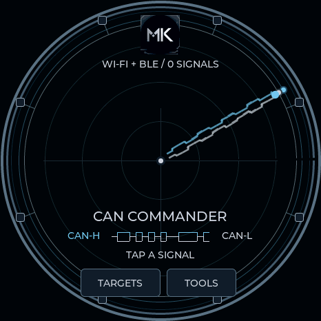
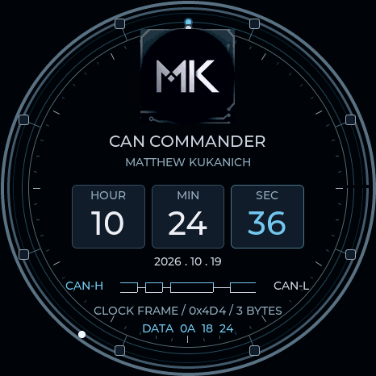

# Can Commander

A tribute to Matthew Kukanich, built around the supplied MK emblem and a CAN-bus instrument aesthetic. Available on all five boards in firmware **0.13.18**.

The logo retains its original shape, silver lettering, dark background and circuit border. Navy panels, brushed-silver details and blue signal accents carry through the radar, clock, menus and dialogs.

| Radar | Watch |
|---|---|
|  |  |

Previews rendered with the firmware drawing code at 466 pixels.

## Radar

Paired traces rotate across a circuit-ring dial. Small ECU-style nodes connect to two perimeter rails, with moving packet indicators and a differential CAN-H/CAN-L motif below the plot. Real Wi-Fi and Bluetooth contacts, signal strength, labels and controls work as before.

The CAN graphics are decorative. This theme does not add CAN hardware, vehicle-bus capture, injection or diagnostic capability. The radar still measures Wi-Fi/Bluetooth signal strength; the sweep does not measure direction.

## Clock and timer

The MK logo sits above a three-field, 24-hour **HOUR / MIN / SEC** display and a separate date. A seconds marker moves around the dial. Below it, a clock-data frame uses identifier **0x4D4** and three data bytes containing the current hour, minute and second in hexadecimal. For example, 10:24:36 becomes `0A 18 24`. This is a local display convention, not a vehicle identifier or received CAN frame.

The waveform animates without covering the logo or time. Until the clock has been set, the face shows dashes and **SET DATE / TIME** instead of inventing a reading. Use Settings → Time / Date, or the web flasher's automatic USB time synchronization.

The session stopwatch uses the same palette and a paired perimeter indicator. One circuit is one minute of elapsed time; pause freezes it and reset returns it to the start. Clock and timer mode continue to pause background radio scanning.

## Select it

1. Install firmware 0.13.18 for your exact board from the [web flasher](https://valleytech-dragon-detector.pages.dev/#install).
2. Open **Radar appearance → Can Commander** on the device or in USB device tools. Selecting the theme also selects its watch face.
3. On Waveshare Lite, tap BOOT to cycle themes and hold BOOT to change pages.

USB commands: `radar theme can-commander`, `screen clock`, `clock face 38`. Existing theme and watch IDs, including the personal-theme slot, are unchanged.

## Artwork and references

The [supplied MK artwork](../media/theme-logos/can-commander-mk.jpg) is preserved byte-for-byte. Firmware copies are resized and palette-encoded for the display; the mark is not redrawn, recolored or generated. Its SHA-256 is recorded in [the artwork ledger](THEME-ARTWORK.json). Artwork rights remain with its owner. This tribute does not imply endorsement.

CAN terminology and differential-signaling motifs were checked against Kvaser's [CAN protocol tutorial](https://kvaser.com/can-protocol-tutorial/) and [CAN data-frame guide](https://kvaser.com/about-can/the-can-protocol/can-messages-13/). Instrument geometry and animations are original drawing code.
