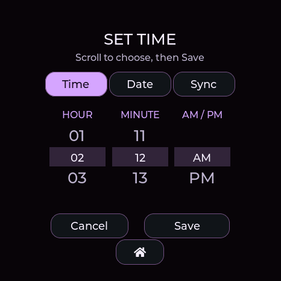
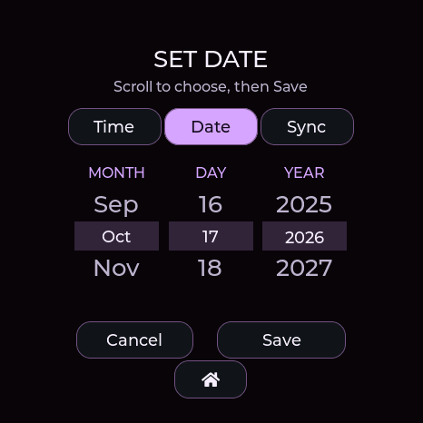
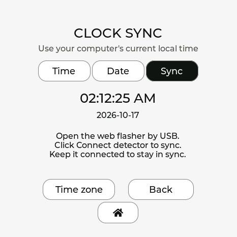

# Date and time setup

Use desktop Chrome or Edge on the [web flasher](https://valleytech-dragon-detector.pages.dev/). Check that your computer's date, time and timezone are correct before installing.

1. Select the exact board. Choose **Update** to preserve existing settings and user files.
2. Leave automatic local-time setup checked, connect the matching USB device, and install.
3. Keep USB connected. The installer closes automatically after successful flashing and starts clock setup on that same granted port. Wait for the date/time verification result before unplugging.
4. If USB re-enumerates, click **Finish clock setup**, select that running device, and wait for verification. Failed setup is explicitly reported and can be retried without reflashing.

Connecting **Detector tools** also sets and verifies the computer's current time and timezone. **Sync my local time** repeats this at any time. With **Keep my clock synchronized while connected** checked, the flasher checks once a minute while the USB connection is idle, corrects drift or unset time, and updates the offset after travel or daylight-saving changes. Keep the page open and computer awake; a sleeping browser may delay checks. Uncheck this option to keep a custom manual time. Saving a manual time in the web page pauses automatic checks. Without a connected computer, UTC offsets are fixed; resync after travel or a daylight-saving change. Firmware uses UTC internally and the saved offset for the displayed date/time.

## Set time and date on the device

On touch boards, open **Settings → Time** or tap the watch's settings icon. There are three tabs:

- **Time:** scroll the hour, minute and AM/PM wheels, then **Save**. Seconds start at zero and the current date is preserved.
- **Date:** scroll month, day and year, then **Save**. The clock keeps ticking while you edit; saving the date preserves its current hours, minutes and seconds. February and shorter months automatically limit the day wheel.
- **Sync:** see the current time/date and USB instructions. **Time zone** adjusts the local UTC offset in 15-minute steps without changing the underlying instant. USB synchronization sets the computer's current offset again.

If the clock is unset, confirm both Time and Date before saving; the first tab offers **Next** to take you to the other. Cancel/Home leaves the clock unchanged. After startup, an unset clock shows a themed **Set your clock** prompt. **Set now** opens these tabs; **Later** leaves the radar usable. Successful USB sync dismisses the prompt automatically.

All editors, detection notices, confirmations and error pop-ups use the selected theme, including light themes. Signal-family colors remain on the radar and its legend. Lite has no touchscreen settings tabs; use USB sync.

Actual AMOLED display captures from 0.13.11:

| Time · GhostStrats | Date · GhostStrats | Sync · DagNazty |
|---|---|---|
|  |  |  |

No firmware can know how long an unpowered clock was off without an independent powered clock or an external time source. USB-only users can keep the device powered, or reconnect the web flasher / enter the current time and date after complete power loss. USB power from a charger alone does not supply the date/time.

## Hardware clock versus powered system clock

| Device | Time source | After shutdown |
|---|---|---|
| Waveshare AMOLED **1.75 non-C / -G** · beta | PCF85063 hardware RTC | Requires a powered RTC supply; battery-backed retention awaits hardware testing |
| M5Stack StopWatch C152 | RX8130CE hardware RTC | 0.13.25 enables L1 power hold to keep the RTC supplied during normal button shutdown while the main battery is charged |
| Seeed XIAO + Round Display | BM8563/PCF8563-compatible hardware RTC | Install a healthy CR927 backup coin cell for timekeeping when the display supply is off |
| Waveshare AMOLED **1.75C** | ESP32 system clock on tested hardware | USB sync or configured saved-Wi-Fi recovery required after full power-off |
| Spotpear | ESP32 system clock | USB sync or configured saved-Wi-Fi recovery required |
| Elecrow CrowPanel 2.1 Rotary | ESP32 system clock | USB sync or configured saved-Wi-Fi recovery required |
| Waveshare Lite | ESP32 system clock | USB sync required after full power-off |

The 1.75C schematic does not show the PCF85063 present on the **non-C** 1.75. The manufacturer introduction mentions an RTC, but its [C schematic](https://files.waveshare.com/wiki/ESP32-S3-Touch-AMOLED-1.75C/ESP32-S3-Touch-AMOLED-1.75C-schematic.pdf) and direct I2C checks of the tested unit do not support promising a separate calendar RTC. The PMU's RTCLDO is only a supply output. Firmware still probes for an optional RTC; detected hardware is verified before any persistence claim.

In 0.13.10+, the flasher reads the hardware clock directly after setting it and checks again after 1.2 seconds to confirm that it advances. A missing RTC on StopWatch/XIAO/non-C AMOLED 1.75, invalid/stale readback, or stopped oscillator fails setup. A correctly set software clock is reported separately with its power-off limitation. The firmware never restores an old saved timestamp and presents it as current time.

Powered software resets retain system time in 0.13.9+. Hardware reset/power cycling are different: without an independent powered RTC, elapsed off-time cannot be reconstructed offline. Keeping a software-clock board powered preserves time; complete battery discharge also loses it.

## RTC retention fixes in 0.13.25

Update your matching board and synchronize once if its clock is unset. USB, manual settings and Wi-Fi synchronization all use checked hardware writes. Startup reads the retained RTC in UTC, applies the saved display offset, and retries transient bus failures without resetting the calendar. A failed initial probe can also recover on the next explicit synchronization.

The StopWatch's RTC shares the **L1** supply with its IMU. Its backup pin has a small capacitor, not an independent long-life clock battery. Firmware now enables and verifies the power controller's LDO hold setting, following [M5Stack's StopWatch power-management documentation](https://docs.m5stack.com/en/arduino/stopwatch/m5pm1_m5ioe1). This keeps that rail powered during normal shutdown. Retention therefore uses some battery power; it cannot survive an exhausted or disconnected main battery indefinitely. Forced resets/download modes may clear the power controller's hold setting; firmware reapplies it at startup.

On the XIAO Round Display, the independent RTC backup is a **CR927 coin cell**; the main rechargeable battery is a separate supply. See [Seeed's installation guide](https://wiki.seeedstudio.com/seeedstudio_round_display_usage/#install-the-rtc-battery). On the Waveshare non-C 1.75/-G, PCF85063 power comes from the AXP2101 RTCLDO rail, which stays supplied while its battery source is available.

The RX8130 **VLF** flag means its oscillator stopped and the date must be set again. **VBLF** is a backup-voltage warning; it does not by itself invalidate the calendar. The firmware now distinguishes them and avoids importing an unvalidated date through the board library. For XIAO and Waveshare RTCs, time-setting exits test/stop modes and checks the saved date by reading it back. Waveshare's oscillator load-capacitance setting is preserved.

To verify off-time retention, sync once, disconnect USB, shut down normally for several minutes, then power up before reconnecting to any auto-sync tool. Confirm that the clock advanced by the elapsed time. Direct `clock hardware` queries do not synchronize or repair it. If it loses time, check `clock diagnostics` and the RTC's battery/supply; writing an old timestamp to flash cannot reconstruct elapsed off-time.

## Optional recovery over saved Wi-Fi

All full profiles support saved-Wi-Fi clock recovery; Lite does not. Follow [the network setup steps](SPOTPEAR-CLOCK.md#recover-automatically-using-a-saved-wi-fi-network) for any full board. The profile must be explicitly saved and selected for clock recovery. A network with Internet access is required. The firmware retries after a failed attempt; while offline after power loss it cannot know the current date/time. Wi-Fi secrets are entered on the flasher, not in chat.

## Diagnostic commands

`clock status` reports the system time and local offset. `clock hardware` in 0.13.10+ reports a direct RTC read as `CLOCK_HARDWARE detected=1 valid=1 epoch=...` when available; a software-only board returns zeros. `net time status` reports the selected Wi-Fi recovery state. A valid system time alone does not prove a hardware RTC is present.

`clock diagnostics` in 0.13.25 reports RTC bus access and control/loss flags on full profiles. On StopWatch, `power_io=1 ldo=1 hold=1` confirms the RTC power rail and shutdown hold read back correctly. `flags`, `control` and `backup` are hexadecimal register values. A successful read/tick test proves current operation; the unplugged shutdown test above checks retention.

## Clock and timer power saving

From 0.13.16, clock, timer, lap-history and time/date settings pause background Wi-Fi/Bluetooth scanning on all boards. USB time synchronization remains available. Previously configured Wi-Fi time recovery may briefly connect to set the clock, then disconnects without restarting detection while these screens remain open. See [power-saving behavior](CLOCK-POWER.md).
