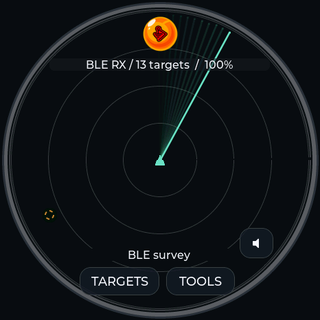
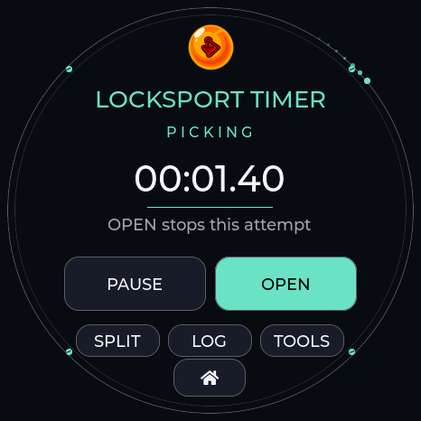

# Your own clock, radar and counter

Firmware 0.13.17 supports one personal theme on all five boards. The [Custom theme tab](https://valleytech-dragon-detector.pages.dev/#theme-studio) holds the entire editor. A normal installation does not show a personal theme on the device until you explicitly install a design.

## Create and install

1. Open **Custom theme** in desktop Chrome or Edge. Choose a PNG, JPEG or WebP logo. Transparent PNGs work well; the background tool can remove white or black connected to the image edges while keeping enclosed details.
2. Drag the logo or use the position and zoom controls. Choose a name, background, text and two accent colors.
3. Select an analog, hybrid or digital clock, hands, digital numerals, hour markers, logo size, date and seconds options. Choose a radar sweep and whether the counter uses **Locksport Timer** controls. Switch the preview between Clock, Radar and Counter.
4. Check **Install this personal theme**. Follow **Install / update firmware**, select the exact board and install. Keep USB connected through time synchronization and theme verification.
5. If the board already runs 0.13.17 or newer, connect it in the Custom theme tab and choose **Install custom theme** instead. This replaces the one personal slot after confirmation.

The logo appears at the top of the clock, radar and counter. Menus and dialogs use the chosen palette on full boards. Lite uses the same design with its BOOT controls. Clock and counter modes retain the scanning pause introduced in 0.13.16. Radar preview contacts are simulated; the device continues showing real detection results.

| Clock | Radar | Locksport counter |
|---|---|---|
|  |  |  |

Example design captured from firmware running on the AMOLED. The template is optional; your own image replaces the example logo.

## Save, change or remove

**Export design** saves a `.ddtheme` file containing the settings and a 160 × 160 transparent logo. **Import design** restores that file on any supported board. Export before refreshing or closing the editor; an unfinished browser draft is not saved automatically.

**Read saved theme** retrieves the current design from the connected device. **Remove saved theme** removes the personal slot after confirmation. The built-in themes remain available. A matching firmware update preserves the saved design; a fresh install erases it with other saved files.

Uploads are size-limited, checksum-checked and prepared before replacing the active design. An interrupted or invalid transfer leaves the previous design available. Stop timing, audio recording/playback and active radio sessions before installing or removing a theme. The logo and design stay in your browser and device; they are not uploaded to a server.

## Display details

- Logo sizes and hands scale to 240, 360 and 466 pixel displays.
- The digital numeral setting applies to the clock. Counter controls keep their standard readable typeface.
- Names accept 1–23 printable ASCII characters. This does not limit lettering already present in your logo.
- A browser preview approximates the panel. Device fonts, image sampling and colors can differ slightly.
- Seconds, date, colors and decorative sweeps do not change detection, clock accuracy or timer precision.

## USB format

`theme info` reports whether a design is present. `theme upload <bytes> <crc32>` transfers the fixed 102,468-byte DDT1 file in acknowledged chunks. The transfer checksum covers the complete file; the saved-theme checksum covers its content without the four-byte CRC trailer. `theme read <offset> <count>` reads at most 512 bytes per request. `theme apply` selects the saved design and `theme remove` removes it.

Theme index 34 and watch index 37 are available only when a valid personal design is loaded. Built-in DZ_AZ uses theme 33 and watch 36. Existing theme indices remain unchanged.
