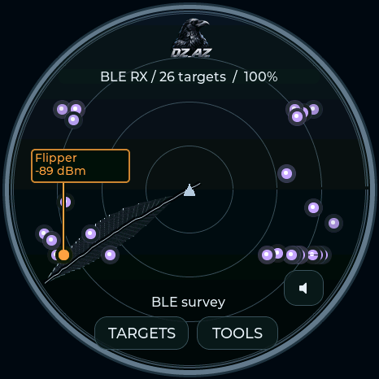
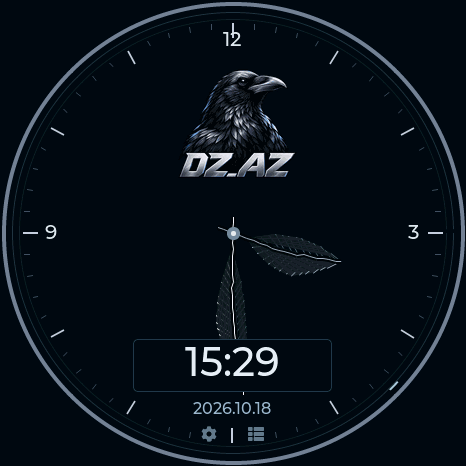

# DZ_AZ

DZ_AZ pairs a charcoal dial with cool silver and slate accents. A crow above the **DZ_AZ** wordmark sits at the top center of the clock. A short feather marks hours, a long feather marks minutes, and an outer indicator tracks seconds. Digital time and a separate date sit below the hands.

The radar uses a rotating crow feather instead of the standard line sweep. Its animation is decorative; detected signals and their labels retain their usual meaning. Menus and dialogs share the theme palette on the full boards. The standard stopwatch remains available.

Choose **DZ_AZ** under **Settings → Theme & radar labels**, or use `radar theme dzaz`. Lite cycles to it with BOOT on the radar page. Available on all five profiles from 0.13.17; watch index 36 on full boards.

| Radar | Clock |
|---|---|
|  |  |

These are firmware framebuffer captures, not panel photographs.

## Artwork

The unchanged supplied photo is [dzaz-reference.jpg](../media/theme-logos/dzaz-reference.jpg). The transparent [crow-and-name emblem](../media/theme-logos/dzaz.png) was generated with the built-in image-generation tool using that reference. It is an illustrated derivative, not a pixel-exact crop. Feather movement is drawn in firmware without stored animation frames.

Generation prompt: “Create one finished compact logo for a round electronic watch/radar theme named DZ_AZ. Use the attached crow photo as subject and palette reference, not background. A dignified crow head and upper neck in profile facing right, charcoal black feather masses with silver and cool slate-blue highlights; bold, clean illustrative shapes readable at 80 pixels. Beneath the crow, precise text ‘DZ_AZ’ in silver-white condensed uppercase. Centered vertical composition, no frame, scenery or mockup; transparent background.”
