# GUI tour

In **0.13.21 beta**, tap a radar dot for a color-coded family/RSSI summary.
Double-tap the same dot within 450 ms, or tap its summary, for Device Details.
Details offers Hunt, controls and, for BLE contacts, BLE Toolkit and GATT profile
tools. The selected identity is checked before opening a tool.

The **non-C 1.75 / 1.75-G** beta also adds SD capture streaming and a GPS-only
Wardrive screen. These differ from the older 1.75C screens below.
See the [current beta guide](WAVESHARE-AMOLED-175.md).

These are CRC-verified logical display captures from the firmware on the connected Waveshare AMOLED. They show the pixels sent to the display, not photographs of the physical panel. The storage screens below are from **0.13.2**; unchanged radar and Attacks examples retain their original version labels.

| Utilities · 0.13.2 | Settings · 0.13.2 | Capture studio · 0.13.2 |
|---|---|---|
| 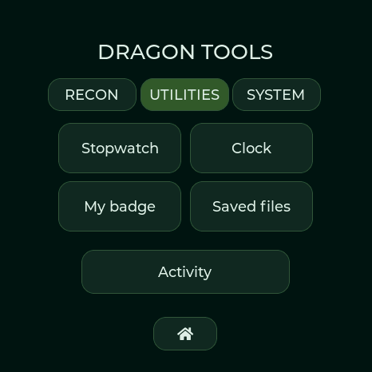 | 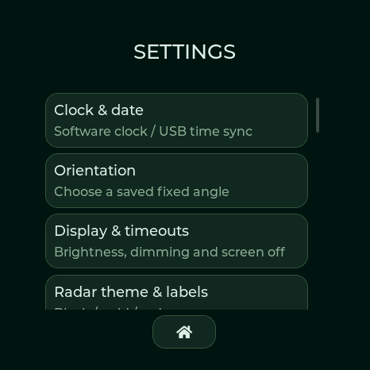 | 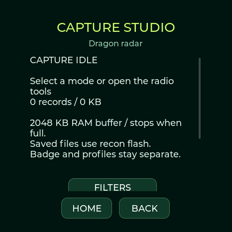 |

- **Tools → Utilities → Saved files** opens the internal-flash capture library on Waveshare AMOLED and M5Stack. There is no SD card menu or card prompt on either board.
- **Settings → Capture studio** opens Wi-Fi/BLE recording controls. **Settings → Saved captures** opens the same capture library. Download saved captures through USB at [Radio tools → Capture library](https://valleytech-dragon-detector.pages.dev/#radio-tools).
- GATT profiles and BLE event logs remain in BLE Lab; detection history has its own USB CSV export. Saved files is a capture library, not a browser for every private system file.
- Spotpear and XIAO keep **Utilities → SD files** and optional SD CSV/PCAP settings for their actual card slots. They also have the internal-flash capture controls.
- Lite has themed radar, compact clock, timer, signals and diagnostics pages. It has no touch settings, badge or interactive lab pages.

| Valleytech radar · 0.13.1 | Attacks menu · 0.13.0 |
|---|---|
| 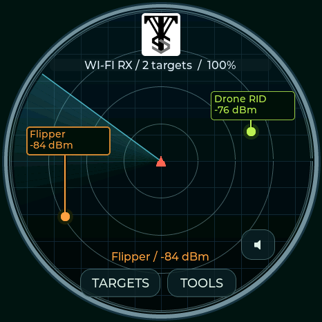 | 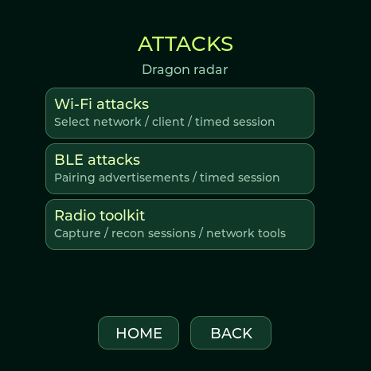 |

The four full boards provide **Tools → Recon → Attacks**, BLE Lab, notebook, modes and target hunting. Normal menus and badge mode keep background detection running. Explicit lab operations can take ownership of the shared radio; Stop/Home restores listening. RSSI indicates signal strength; radar angle is decorative.

**[Flash your board](FLASHING.md)** · [Hardware feature comparison](HARDWARE.md) · [Twenty-seven theme previews](THEMES.md) · [Controls](USER-GUIDE.md) · [Validation](VALIDATION.md)

## Pocket-watch collection · 0.13.6

Open Utilities → Clock and swipe left/right through twenty-four faces. Original brand marks and theme emblems replace face-name captions. ValleyTech now has a clean black dial, Arabic numerals and broad beveled hands; digital faces have much larger time. TOOOL is shown in the section below. Analog captures now show 0.13.6 with date-only labels; all current watch captures are from 0.13.6. JCMK military, 0ct0’s Pig, DeFlock and the Covert hybrid’s separate digital window use 24-hour time. Analog dials and the remaining digital faces use 12 hours. Tap the gear for time settings. The selection survives restart. Connecting Studio copies local date, time and the current timezone offset automatically. The manual wheels include AM/PM and handle leap years and short months. Lite now has five button-operated pages, including a compact clock; time setup uses USB.

| ValleyTech Arabic dial | Biscuit Shop dark gearwork | JCMK military |
|---|---|---|
| 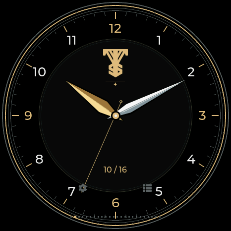 | 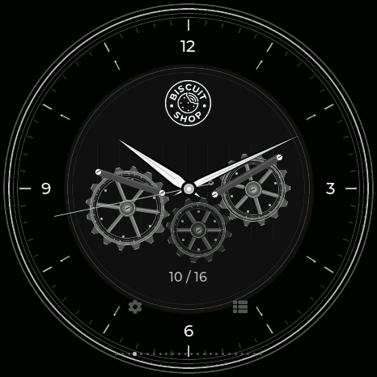 | 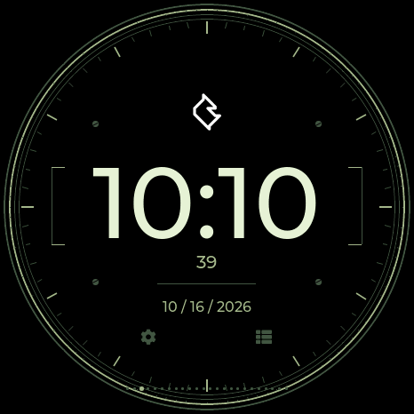 |

| DMAC acrylic picks | Sasquach character arms | Nyan Devices |
|---|---|---|
|  |  |  |

Current **0.13.11** clock settings have separate Time, Date and Sync tabs. Pop-ups use the selected theme. [Setup instructions and current screenshots](CLOCK-SETUP.md).

## TOOOL locksport · 0.13.6

Select TOOOL in Theme & radar labels. The white/red radar, matching analog watch and Locksport Timer use the supplied logo. OPEN records the final split and stops; SPLIT leaves it running. RESET asks before clearing the current attempt. The twenty-four-face collection also includes the Church of Malware binary watch.

| TOOOL watch | Locksport Timer | Picking splits |
|---|---|---|
|  |  | 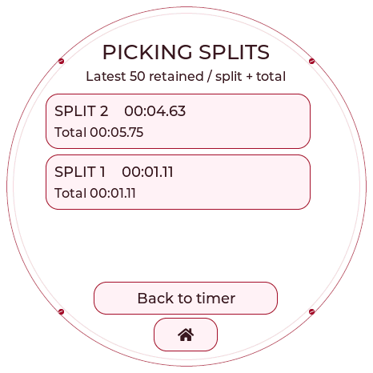 |

### TOOOL Dark

Near-black backgrounds, red accents and soft white details continue through the radar, watch, timer, split log and reset confirmation. Select TOOOL Dark in Theme & radar labels.

| Dark watch | Dark Locksport Timer | Dark split log |
|---|---|---|
|  |  | 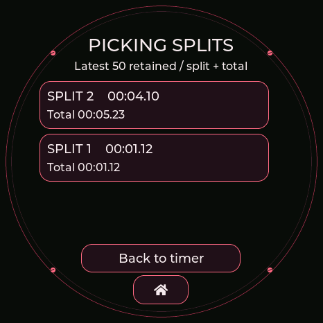 |

## Church of Malware binary watch · 0.13.6

The complete emblem remains unobstructed. White weighted bits show 12-hour H, M and S; AM/PM is beside H, never beside the date. Analog watch dates now have no AM/PM suffix.

## Covert Instruments × McNally · 0.13.6

The original marks, distinct Reaper pick hands and a 24-hour window share a black/silver dial. The Covert radar uses a rotating silver McTickler in place of the sweep line. Selecting the theme also enables Locksport Timer. Every selected theme now colors the menus, settings, dialogs and utility screens; the BWM2 logo alone fades in on black at startup. Detection-family colors and custom badge artwork remain intact.

| Hybrid watch | Locksport Timer | Tools menu |
|---|---|---|
|  |  |  |

| BWM logo-only startup | Settings | BLE Lab |
|---|---|---|
|  | 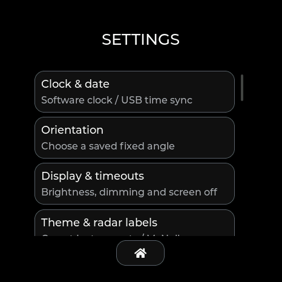 | 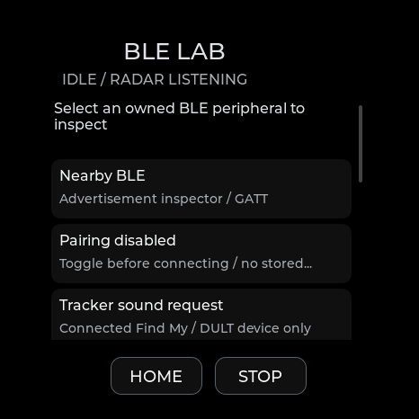 |

Startup captures replay the same renderer used at boot. The Covert watch gallery uses a fixed 10:10 test time; the device is resynchronized after testing.

## Community analog faces · 0.13.6

AWOK, Baph0Mau5, WDGWARS, GhostStrats and N3rdsec each have a matching radar and complete GUI palette. GhostStrats uses the requested glowing slit eyes and “Safety is an Illusion.”; N3rdsec retains the original skull on a black/white/gold dial. All five use the ordinary stopwatch. These screenshots use a fixed 10:10 test time; the attached device is resynchronized afterward.

| GhostStrats watch | N3rdsec watch |
|---|---|
|  |  |

See [all theme previews](THEMES.md).
