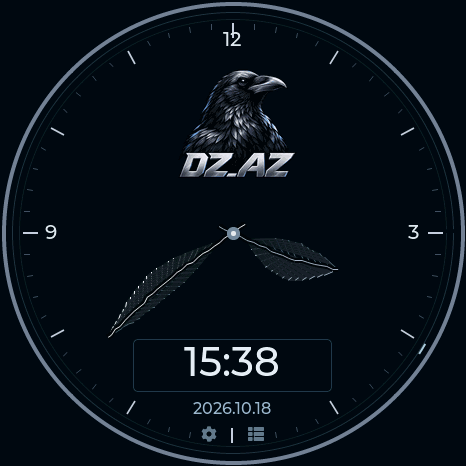

# M5Burner · M5Stack StopWatch C152

The M5Burner project is **Dragon Detector - M5Stack StopWatch C152**, with **StopWatch** as its only supported device. Its package contains only the C152 build.

**Catalog status checked October 19, 2026:** M5Stack marked **0.13.15 Rejected** because the image did not boot during their device tests. The downloaded file matches the original upload byte for byte. A corrupt upload or incorrect file extension has not been established as the cause. The **0.13.20 C152 package** passes structural validation; a complete factory installation and cold-start test on a physical StopWatch is still required before public review. Packaging checks do not prove the reported boot failure is resolved.

The public listing's name, description, screenshot and installation links now focus on the StopWatch C152. Version **0.13.20 was uploaded successfully as Private**, pending that physical test.

## Installation

1. Download the [**v0.13.20 StopWatch C152 factory BIN**](https://valleytech-dragon-detector.pages.dev/firmware/stopwatch/factory-0x0.bin) and its [SHA-256 checksums](https://valleytech-dragon-detector.pages.dev/firmware/stopwatch/SHA256SUMS.txt). This image is for **C152 only**. M5Burner factory boot validation is pending.
2. Back up saved files and settings. A factory image replaces them. For a compatible existing installation, use **Update matching Dragon Detector** in the [web flasher](https://valleytech-dragon-detector.pages.dev/#install).
3. Connect USB. Hold the StopWatch power button for about two seconds until the green LED lights, then release. Burn at **0x0**, **ESP32-S3**, **16 MB**, **DIO / 80 MHz**. No separate filesystem upload is needed.
4. Briefly press the power button to restart. Close M5Burner's serial connection, then connect **Detector tools** in the web flasher to set and verify time, date and timezone. M5Burner does not synchronize the clock.

On the device, **Settings → Time** has separate **Time**, **Date** and **Sync** tabs. The RX8130CE RTC keeps time while its backup supply is powered. Resync after travel or daylight-saving changes. [Clock setup](CLOCK-SETUP.md) · [Clock and timer power saving](CLOCK-POWER.md).

## Correct upload format

Current M5Burner accepts one **merged `.bin`**, written at **0x0**. Do not upload an application-only `firmware.bin` or the multi-file release ZIP. The legacy `m5burner.json` ZIP layout is not accepted by the current website's upload form. M5Stack's [publishing guide](https://docs.m5stack.com/en/uiflow/m5burner/publish) recommends its [firmware exporter](https://docs.m5stack.com/en/uiflow/m5burner/export); this project assembles the equivalent complete image from clean build files without exporting personal device data.

For C152: **ESP32-S3, 16 MB flash, DIO / 80 MHz boot header, OPI PSRAM**.

| Component | Offset |
| --- | --- |
| Bootloader | `0x0` |
| Partition table | `0x8000` |
| OTA boot data | `0xe000` |
| C152 application | `0x10000` |
| LittleFS | `0x810000` |

## Package verification

After building the matching release, run:

```text
python tools/package_m5burner.py --output .work/m5burner-package
```

The command accepts only a clean C152 release. It checks SHA-256 hashes, merged offsets, erased padding, the 16 MB size, C152 application identity, ESP32-S3 headers, and both bootloader/application checksums and validation digests. It writes a named C152 BIN, checksums and verification report.

- Factory image: `Dragon-Detector-0.13.20-M5Stack-StopWatch-C152-FACTORY-0x0.bin`, **16,777,216 bytes**.
- SHA-256: `a431d3cb71ddca8418b4353b70c65b110699917fe4834b37452e0235d53c67ac`.
- All merged offsets match release segments. NVS and the spare OTA slot contain erased bytes; no personal device dump is included.
- Existing M5Burner project: `2111312268664066049`.

## Physical validation before public review

Identify and back up a physical C152, then install the exact merged BIN through M5Burner and retain the flashing log. Briefly press the power/reset button after flashing, as directed by M5Stack's [StopWatch recovery instructions](https://docs.m5stack.com/en/guide/restore_factory/stopwatch). Confirm startup, display, touch, both buttons and RTC; run the self-test and a cold start without an active serial monitor. If the display stays blank, retain the boot log before changing the image. Finally synchronize and verify the clock using Detector tools.



This capture is from an earlier application update on a physical C152; it is not evidence of a complete 0.13.20 M5Burner factory installation. [Credits](../CREDITS.md) · [Validation](VALIDATION.md).
