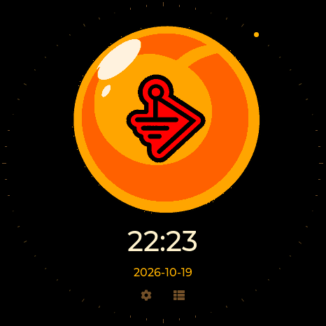

# M5Burner · M5Stack StopWatch C152

The M5Burner project is **Dragon Detector - M5Stack StopWatch C152**, with **StopWatch** as its only supported device. Its package contains only the C152 build.

**Hardware tested October 19, 2026:** the complete **0.13.20 C152 factory image** was installed on a physical StopWatch using M5Burner's bundled esptool 4.10.0, at **0x0 / 460800 baud**. The full 16 MB write passed hash verification. After a power cycle, the device booted, all 23 self-tests passed, and the owner confirmed the display, yellow/blue timing buttons and touchscreen Home control worked.

The live web flasher's **Update matching Dragon Detector** installation also passed on this C152. It automatically set local date, time and timezone, verified hardware RTC readback and ticking, and retained the correct time after a software restart. The original device data was backed up privately and restored.

The public-review package is labeled **0.13.20-c152.1** in M5Burner; it contains the same firmware **0.13.20** and factory BIN as the website. The earlier **0.13.20 Private** upload remains the test candidate. [M5Burner StopWatch catalog](https://burner.m5stack.com/device/stopwatch). M5Stack's catalog approval is separate from these hardware checks.

M5Stack rejected **0.13.15** for failing to boot during review. Its download matched the original upload; a corrupt file or incorrect extension was not established as the cause. During the current test, the C152 remained in download mode after a verified write and a brief reset. A full power cycle recovered it. This is an observed recovery for this device, not a confirmed diagnosis of M5Stack's earlier test.

## Installation

1. Download the [**v0.13.20 StopWatch C152 factory BIN**](https://valleytech-dragon-detector.pages.dev/firmware/stopwatch/factory-0x0.bin) and its [SHA-256 checksums](https://valleytech-dragon-detector.pages.dev/firmware/stopwatch/SHA256SUMS.txt). This image is for **C152 only**.
2. Back up saved files and settings. A factory image replaces them. For a compatible existing installation, use **Update matching Dragon Detector** in the [web flasher](https://valleytech-dragon-detector.pages.dev/#install).
3. Connect USB. Hold the StopWatch power button for about two seconds until the green LED lights, then release. Burn at **0x0**, **ESP32-S3**, **16 MB**, **DIO / 80 MHz**. **460800 baud** was verified with the bundled desktop tool. Leave all buttons untouched until writing and verification finish. No separate filesystem upload is needed.
4. Briefly press the power button to restart. **If the display stays blank:** close the serial connection, unplug USB, double-press power to turn it off, wait five seconds, then press power once. Reconnect USB after the logo appears.
5. Connect **Detector tools** in the web flasher to set and verify time, date and timezone. M5Burner does not synchronize the clock. After a web installation, use **Finish clock setup** if the board needed a manual restart.

The M5Burner website's first 1500000-baud attempt stopped with a serial-stream error. The successful factory test used its bundled desktop tool; this does not claim that failed browser attempt completed. If a write is interrupted, return to download mode and repeat the complete write, then wait for verification before restarting.

On the device, **Settings → Time** has separate **Time**, **Date** and **Sync** tabs. The RX8130CE RTC keeps time while its backup supply is powered. Resync after travel or daylight-saving changes. [Clock setup](CLOCK-SETUP.md) · [Clock and timer power saving](CLOCK-POWER.md).

## Correct upload format

Current M5Burner accepts one **merged `.bin`**, written at **0x0**. Do not upload an application-only `firmware.bin` or the multi-file release ZIP. The legacy `m5burner.json` ZIP layout is not accepted by the current website's upload form. M5Stack's [publishing guide](https://docs.m5stack.com/en/uiflow/m5burner/publish) recommends its [firmware exporter](https://docs.m5stack.com/en/uiflow/m5burner/export); this project assembles the equivalent complete image from clean build files without exporting personal device data.

For C152: **ESP32-S3, 16 MB flash, DIO / 80 MHz boot header, OPI PSRAM**.

| Component | Offset |
| --- | --- |
| Bootloader | `0x0` |
| Partition table | `0x8000` |
| OTA boot data | `0xe000` |
| C152 application | `0x10000` |
| LittleFS | `0x810000` |

## Package verification

After building the matching release, run:

```text
python tools/package_m5burner.py --output .work/m5burner-package
```

The command accepts only a clean C152 release. It checks SHA-256 hashes, merged offsets, erased padding, the 16 MB size, C152 application identity, ESP32-S3 headers, and both bootloader/application checksums and validation digests. It writes a named C152 BIN, checksums and verification report.

- Factory image: `Dragon-Detector-0.13.20-M5Stack-StopWatch-C152-FACTORY-0x0.bin`, **16,777,216 bytes**.
- SHA-256: `a431d3cb71ddca8418b4353b70c65b110699917fe4834b37452e0235d53c67ac`.
- All merged offsets match release segments. NVS and the spare OTA slot contain erased bytes; no personal device dump is included.
- Existing M5Burner project: `2111312268664066049`.

## Repeating the hardware check

Identify and back up a physical C152, then install the exact merged BIN through M5Burner and retain the flashing log. Briefly press the power/reset button after flashing, as directed by M5Stack's [StopWatch recovery instructions](https://docs.m5stack.com/en/guide/restore_factory/stopwatch). Confirm startup, display, touch, both buttons and RTC; run the self-test and a cold start without an active serial monitor. If the display stays blank, retain the boot log before changing the image. Finally synchronize and verify the clock using Detector tools.



This 466 × 466 display capture came from the physical C152 after the web update and software restart; its USB transfer CRC was verified. [Credits](../CREDITS.md) · [Validation](VALIDATION.md).
