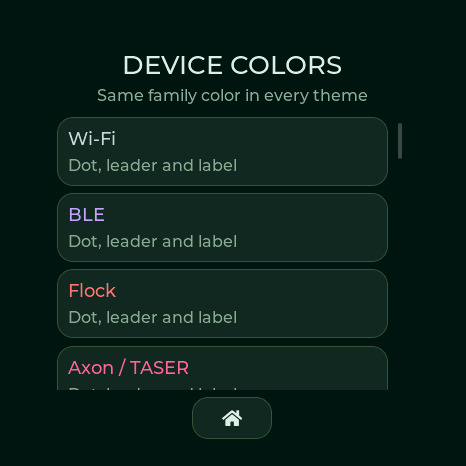

# Radar device colors

Every device family has a fixed color shared by its dot, leader and label in all six themes. Open **Settings → Radar theme & labels → Device color legend** to see them on the device.

Labels use a solid dark background and opaque leaders with a dark outline, including on the brighter Dragon Ball theme. Live contacts use filled dots; trackers use smaller dots. Older signals use segmented markers. Color identifies a family, not confidence, malicious intent or exact product model. Products sharing an indistinguishable signature, such as Biscuit Pro/Ultra, share their family color.

| Family | Color |
|---|---|
| Wi-Fi | `#CED4DA` |
| BLE | `#C3A6FF` |
| Flock | `#FF7676` |
| Axon / TASER | `#FF6699` |
| Meta glasses | `#76D7EA` |
| Wi-Fi Pineapple | `#FFE45E` |
| Pwnagotchi | `#FC8DEB` |
| nyanBOX | `#B8F781` |
| HaleHound | `#D1B3FF` |
| Find My / DULT tracker | `#57E6C2` |
| Skimmer | `#FFA6C9` |
| Flipper Zero | `#FFA040` |
| Biscuit | `#D9C29F` |
| Samsung SmartTag | `#7AB8FF` |
| Raven | `#E7EC87` |
| Google Find Hub | `#6BEDA8` |
| Tile | `#61D6FF` |
| Ring | `#7CE0D5` |
| Camera vendor | `#D0DFFF` |
| ALPR vendor | `#F4C47B` |
| Drone Remote ID | `#BAF251` |
| iBeacon | `#DDA0E6` |
| Deauthentication burst | `#FF8F91` |
| SSID conflict | `#FFC3A0` |
| BLE spam | `#A9B2FF` |
| Dragon fox beacon | `#FFF4B5` |

All 26 remain distinct in the displays’ RGB565 format. Text contrast against the label background is checked automatically. Names and marker shapes accompany color so it is never the only way to distinguish a target.

Actual logical display capture, not a panel photograph. Scroll the legend to see all 26 families.
