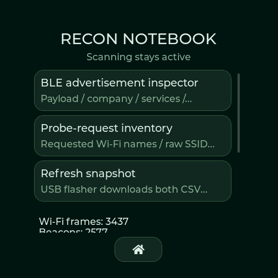

> **0.13:** The lab and 29-tool catalog now run on all four full boards. [Details](RECON-013.md).

# Recon Notebook and continuous detection · 0.12.0

Available on Waveshare AMOLED, M5Stack StopWatch, Spotpear and Seeed XIAO Round. Open **Tools → System → Recon notebook**, or use the web flasher's **Passive Recon** section. The notebook never starts a connection or transmitter.

CRC-verified 466×466 framebuffer capture from the Waveshare running 0.12.0; this is the native renderer, not a physical-screen photograph.

- **BLE inspector:** 96 recent address/type identities, RSSI, complete advertisements up to 512 bytes, separate advertisement/scan-response boundary, payload changes, common company/service/protocol names, appearance and advertised TX power. Raw bytes appear in the scrollable detail view. Longer/malformed input is counted as uncached rather than represented as complete. Tables are snapshots; Refresh updates them. Scan-response-only changes don't inflate advertisement churn.
- **Wi-Fi probe inventory:** 96 observed sender/SSID pairs, channel, RSSI, count and age. CSV uses raw SSID hex so embedded NUL bytes and spreadsheet formulas remain data. A probe-requested name is not proof of association or a person's identity.
- **Protocol counters:** beacons, probe requests, disconnects, EAPOL M1–M4 candidates, PMKID observations, SAE commits and retries. These are observations, not a validated handshake or attack success.
- **Vendor context:** [40,333 IEEE MA-L prefixes](VENDOR-REGISTRY.md), expanded from compressed flash into PSRAM after CRC verification. Randomized addresses are not assigned misleading vendors.
- **Export:** `notebook probes` and `notebook adverts` produce bounded CSV snapshots over USB. Download in the browser before powering off: these two tables are volatile. Existing detection history remains persistent. `notebook clear` clears only notebook RAM; incoming observations refill it.

## Scanning policy

Normal operation alternates **2.2 seconds BLE / 2.2 seconds Wi-Fi**. The Wi-Fi slice visits channels 1–11. The shared ESP32-S3 radio cannot listen to every Wi-Fi and BLE channel at the same instant, so continuous scheduling is not zero packet loss.

Badge, menus, stopwatch, display dim/off, notebook, history export, badge upload, screenshot transfer and SD file USB transfer keep this scheduler running. USB transfers cooperatively process receive queues; binary streams suppress unsolicited serial alert text while alerts still reach on-device history/audio/UI. GATT profile import/export, event-log/capture downloads and incremental capture saves also keep reception scheduled. Flash writes and display rendering can still briefly delay processing.

Hunt retains background detection on every board: BLE Hunt gets a 4.4-second BLE slice followed by a complete 2.2-second Wi-Fi sweep. Wi-Fi Hunt and a selected priority channel get a 2.2-second BLE slice, a complete Wi-Fi sweep, then up to 2.2 seconds on the priority channel. A stale Wi-Fi target continues sweeping instead of waiting indefinitely on its old channel. This trades some target refresh rate for ongoing detection of other devices. RSSI remains relative proximity, not distance or bearing.

On all four full boards, explicitly selected survey/capture modes or started BLE/network/portal/CSI/transmit sessions specialize or take ownership of the radio. Stop/Home/session timeout restores the previous listening mode. A saved Wi-Fi-only or BLE-only mode intentionally remains specialized until Dragon radar is selected. Ordinary Settings no longer offers Pause; legacy `pause` is rejected. `scan status` exposes both listening-time counters and all eleven channel dwell counters.

The separate Lite variant keeps its fixed always-on radar and shared classifiers. No notebook menu or active lab controls are added to its untouchable display.

## Advertisement tests

The existing 24 radio tools are retained. Five additions bring the menu to **29**: iBeacon, Eddystone UID, Eddystone telemetry, BTHome sensor simulation and custom legacy advertising. These are format simulators, not clones of a device's protected behavior.

In the web **Advertisement Workbench**, enter complete AD structures as up to 31 hex bytes. Validate/store only prepares RAM. Select **BLE custom advertisement** in Radio tools, review the duration/rate and explicitly start it. The detector uses its own identity, a nonconnectable advertiser, at most ten payload updates/second and at most 60 seconds. Payload/rate controls cannot change while a tool owns the radio. `tool payload <hex>` prepares bytes; `tool payload` reads them back. Stop and timeout restore reception. Driver acceptance is not evidence of an effect on another device.
