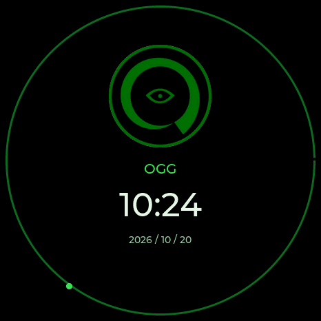
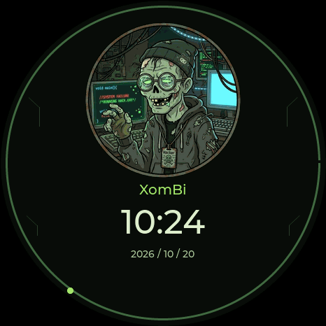

# Dragon Detector 0.13.23 — Ogg and XomBi

Two new themes use the artwork supplied by the project owner:

- **Ogg:** black surfaces, green outlines and the original green eye emblem.
  The clock keeps a simple layout with a large time and a small date.
- **XomBi:** the zombie hacker portrait, dark moss-green surfaces, pale green
  text and brighter green accents. Small circuit traces frame the clock.

Both include a radar, matching clock and shared menu, dialog, stopwatch and lab
colors. Detection dots keep their individual device-family shades. The radar
selection and repeating Beep All improvements from 0.13.22 are retained.

| Ogg | XomBi |
|---|---|
|  |  |

These previews render the actual firmware drawing code through native LVGL.
They are not panel photographs. Both designs were also rendered at 240, 360
and 466 pixels, including the unset-clock state.

Choose **Ogg** or **XomBi** in **Settings → Theme & radar labels**, or in the
web tools under **Radar appearance → Theme**. Selecting a theme selects its
matching watch. The watch remains independently selectable. Lite includes the
two themes through its existing BOOT controls.

USB commands:

```text
radar theme ogg
radar theme xombi
screen clock
```

The new theme IDs are 36 and 37; clock IDs are 39 and 40. Existing saved IDs,
including Personal theme and Can Commander, remain unchanged. The web selector
requires 0.13.23 before sending either new theme to an older device.

The original JPEG files are retained byte-for-byte in
[the artwork ledger](THEME-ARTWORK.json). Firmware copies are resized and
palette-encoded. A circular display mask hides the square corners; Ogg's original
white outer margin is outside that mask.

The non-C Waveshare 1.75 SD/GPS variants remain beta for their new SD/GPS
features. They still need no SD asset download. See
[the hardware guide](WAVESHARE-AMOLED-175.md).

[Validation and hardware-test limits](VALIDATION-0.13.23.md).
