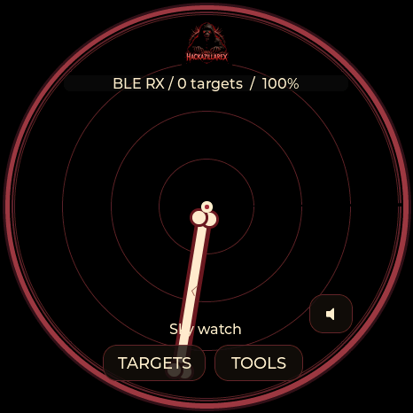
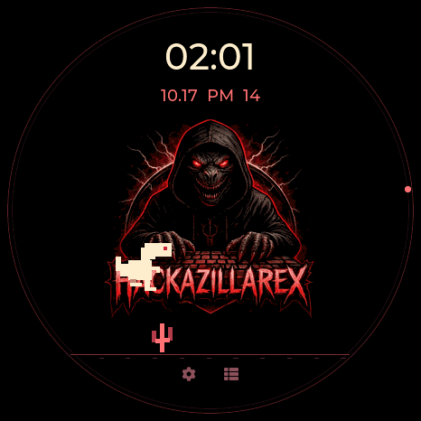
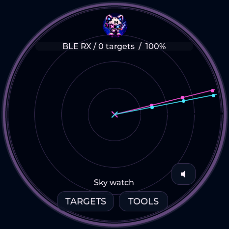
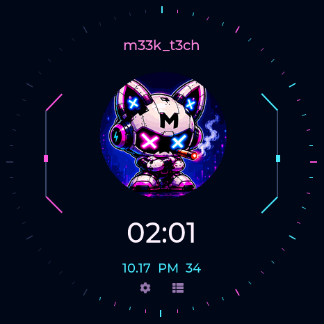

# Hackazillarex and m33k_t3ch

Requires firmware **0.13.12**. On a full board choose **Settings → Theme & radar labels**, then open **Tools → Utilities → Clock**. Theme selection picks its matching watch; swipe left/right to choose a different watch independently. USB Studio also offers both themes under Radar appearance.

| Theme | Radar | Watch |
|---|---|---|
| Hackazillarex | Supplied header artwork, red rings, ivory bone sweep | Large supplied logo, digital time/date, T-rex runs and automatically jumps over cacti |
| m33k_t3ch | Circular robot artwork, paired cyan/magenta beams | Neon digital dial, moving circuit lights, alternating-color seconds rim |

These are device framebuffer captures. The dinosaur and circuit lights animate while the clock is displayed. They are decorative and do not represent RF measurements or a playable game. The radar sweep freezes when scanning is paused; watch animation uses monotonic time and cannot alter the clock.

On **Waveshare Lite**, tap BOOT to change theme while on Radar or Clock, and hold BOOT to change pages. Both new compact clocks include their logo and animation. Lite retains a fixed orientation and has no touch controls. The four full boards retain the shared theme, clock and utility workflows; hardware capabilities still differ.

Artwork source hashes and derivative details are in [the artwork ledger](THEME-ARTWORK.json) and [credits](../CREDITS.md). Existing theme IDs 0–28 and watch IDs are preserved; the additions are radar IDs 29/30 and watch IDs 32/33.
