# Radar themes

Firmware **0.13.6** offers twenty-six themes, including Covert Instruments × McNally, TOOOL, TOOOL Dark and Church of Malware, on Waveshare AMOLED, M5Stack StopWatch, Spotpear and Seeed XIAO + Round Display.

The saved theme also controls menus, settings, dialogs, utility screens, BLE Lab and radio tools. Watch designs remain independently swipeable. The boot screen always shows the supplied BWM2 logo alone on black. Custom badge artwork and detection-family colors retain their meaning.

Open **Tools → System → Settings → Theme & radar labels** and scroll to the theme. It saves immediately; tap Home to return to radar. Or connect through the [web tools](https://valleytechsolutions.github.io/Dragon-Detector/#detector), choose Radar appearance → Theme, and save. Older firmware keeps its original three choices until updated. Waveshare Lite remains a fixed green radar without settings.

| Valleytech | Biscuit Shop | Marauder |
|---|---|---|
| 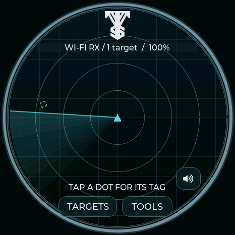 | 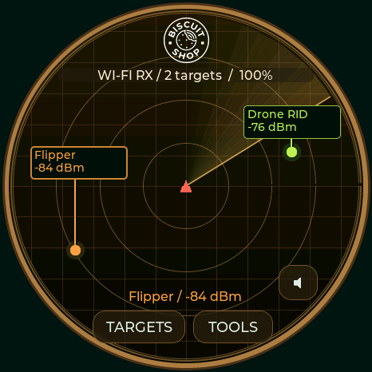 | 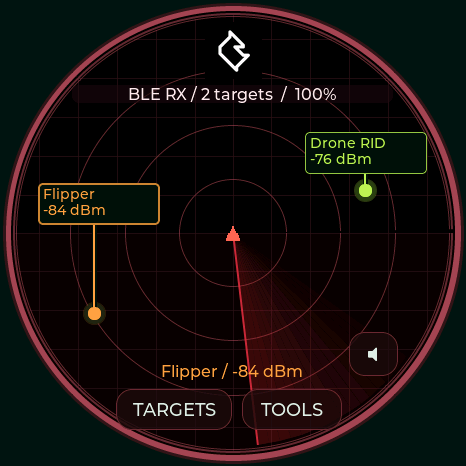 |
| Silver rings, cyan sweep, VTS logo | Amber rings, cream highlights, Biscuit Shop logo | Black field, red sweep, JCMK logo |

These are CRC-verified 466×466 logical display captures from the Waveshare, not panel photographs. The small logo is sized natively for each panel. The Valleytech silhouette is isolated on the dark radar, rendered in silver without a white backing; Biscuit's white logo uses transparency; the JCMK source retains its black background. [Unmodified sources and attribution](../CREDITS.md#radar-theme-artwork--0131).

Green radar (default), Dragon Ball and Black / gold / red keep their BWM1 logo. Existing saved selections stay unchanged. All twenty-six themes share the same [26 device-family colors](RADAR-COLORS.md), labels and leader lines. Radio status, target count, battery indicator, RSSI placement, scan scheduling and badge images are unaffected by a theme change.

USB names: `radar theme dragon`, `green`, `gold`, `valleytech`, `biscuit`, `marauder`, `toool`, `church`, `toool-dark`, `covert`, `awok`, `baph0mau5`, `wdgwars`, `ghoststrats`, `n3rdsec`, `halehound`, `waveshare`, `m5stack`, `lab5`, `sasquach`, `nyan`, `dmac`, `seeed`, `dagnazty`, `octo-pig`, or `deflock` (prefix each with `radar theme`). `radar status` reports saved indices 0–25 in that order. Unknown themes are rejected without changing the current selection.

## TOOOL · 0.13.6

A white face with deep red rings, a red sweep, engraved pin chambers and the supplied TOOOL keyway logo. Selecting TOOOL also selects its 12-hour analog watch and makes Utilities → Stopwatch a **Locksport Timer** with START/PAUSE, SPLIT, OPEN and confirmed RESET. Changing away restores ordinary stopwatch controls without clearing the timer. [Timer details and hardware buttons](STOPWATCH-CLOCK-ORIENTATION.md#toool-locksport-timer).

| TOOOL radar | TOOOL watch | Locksport Timer |
|---|---|---|
| 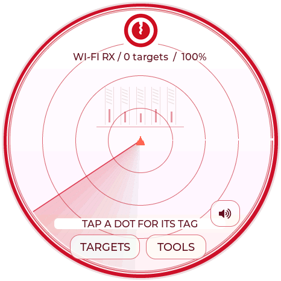 | 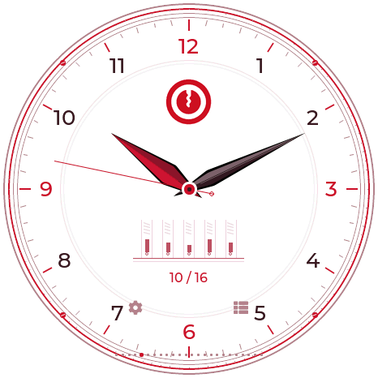 | 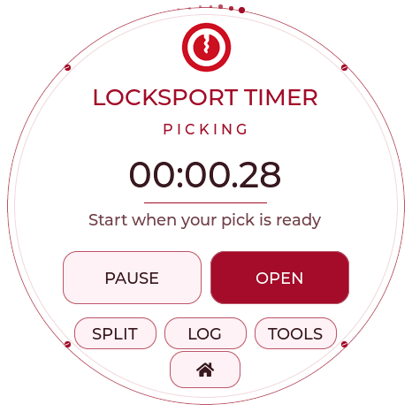 |

TOOOL needs firmware 0.13.6 or newer. These are CRC-verified Waveshare firmware captures. All four full boards include it; Lite excludes it. Family labels retain their standard colors and dark backing for contrast. The supplied original logo is retained unchanged in the source assets.

## TOOOL Dark · 0.13.6

Select **TOOOL Dark** for near-black surfaces, red accents and soft white details. The radar, analog watch, Locksport Timer, split log and reset confirmation all share the dark palette. The original logo is displayed in a circular inset. Controls and timer behavior match the light TOOOL theme.

| Dark radar | Dark watch | Dark Locksport Timer |
|---|---|---|
| 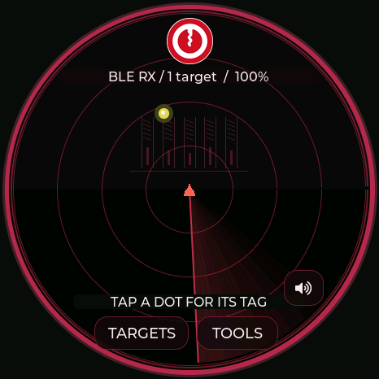 | 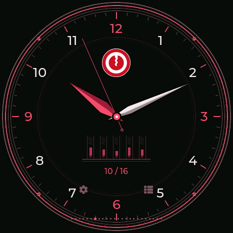 | 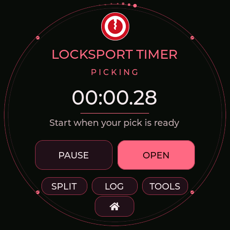 |

## Church of Malware · 0.13.6

Black/white circuit traces, silver rings and the supplied emblem. Selecting this theme also selects the binary watch: the complete original emblem fills the center, with weighted hour/minute/second bits around the rim. Add the white values in each group; H is 1–12 with AM/PM beside it, M/S are 0–59. The standard stopwatch remains available. [Binary clock guide](STOPWATCH-CLOCK-ORIENTATION.md#twenty-clock-faces).

| Church of Malware watch | Monochrome circuit radar |
|---|---|
| 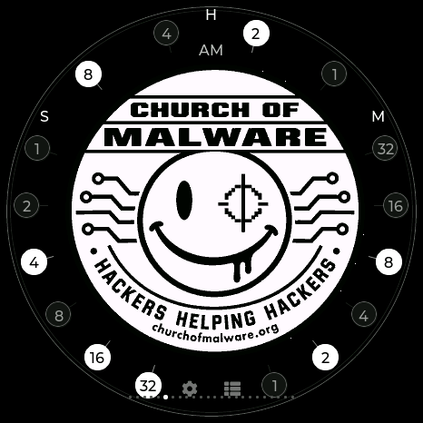 | 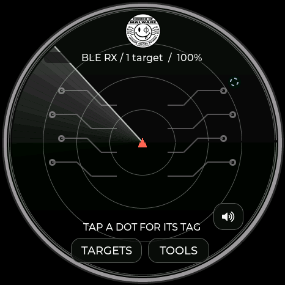 |

The original supplied PNG remains unchanged. This optional appearance theme is available on all four full boards; Lite excludes it.

## Covert Instruments × McNally · 0.13.6

Black surfaces, white text and silver accents. The original CI door mark appears on the radar, watch and Locksport Timer; the supplied McNally artwork appears on the watch and timer. The Reaper short hook is the hour hand; the longer McTickler is the minute hand. The silver profiles are drawn from the supplied references, with wider strokes for small-panel legibility. A separate digital window always uses 24-hour local time; the analog dial uses 12 hours. A small outer marker shows seconds. On the radar, the silver McTickler rotates around the center in place of the usual line and wedge; signals and their labels are drawn above it. The sweep is decorative, not a bearing measurement.

| Hybrid watch | Locksport Timer | Themed menu |
|---|---|---|
| 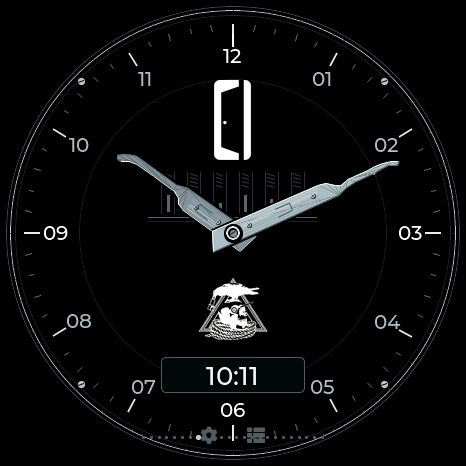 | 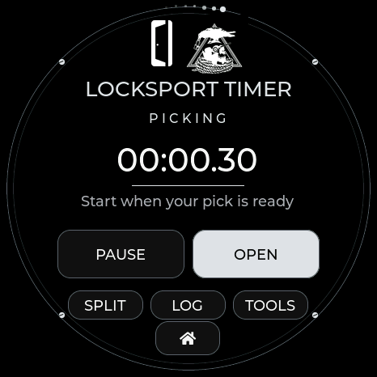 | 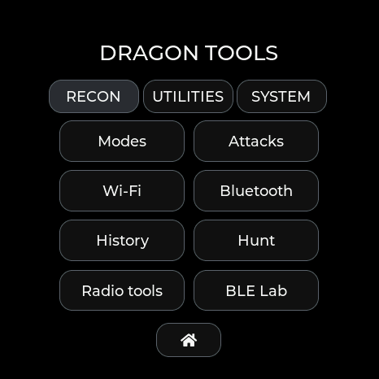 |

Select **Covert Instruments / McNally** or send `radar theme covert`. It selects watch 12 and enables the same START/PAUSE, SPLIT, OPEN and confirmed RESET behavior as TOOOL. Dark controls continue through the split log, settings, BLE Lab and radio tools. All four full boards include it; Lite excludes the added theme assets.

## AWOK, Baph0Mau5 and WDGWARS · 0.13.6

Each theme colors every menu, setting, dialog and the standard stopwatch. Choosing it selects its matching analog watch; the watch remains independently swipeable. All use 12-hour hands and date-only labels. The BWM2 logo-only startup remains the same.

| Theme / USB name | Design | Watch index |
|---|---|---|
| AWOK / awok | Midnight navy, neon paint drips, cyan/pink mushrooms and the original dripping mark | 13 |
| Baph0Mau5 / baph0mau5 | Violet/black ritual dial, supplied emblem, engraved sigils, decorative moons and ornate hands | 14 |
| WDGWARS / wdgwars | Black/cyan/magenta, supplied mark, stylized world-map watch/radar and signal ornaments | 15 |

Map and signal motifs do not indicate a measured location or bearing. Moon ornament is decorative, not a lunar calendar. These three themes keep the ordinary stopwatch; the locksport controls belong to TOOOL, Covert Instruments and DMAC.

| AWOK | Baph0Mau5 | WDGWARS |
|---|---|---|
| 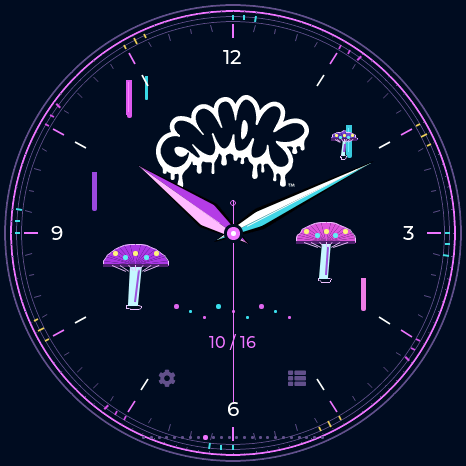 | 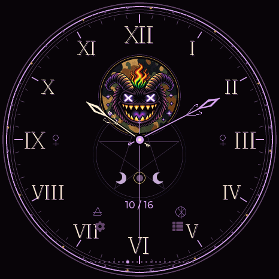 | 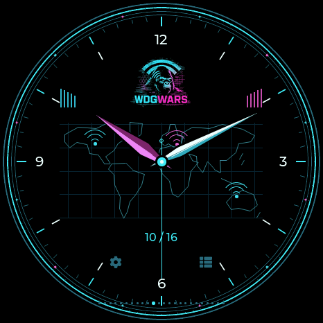 |
| 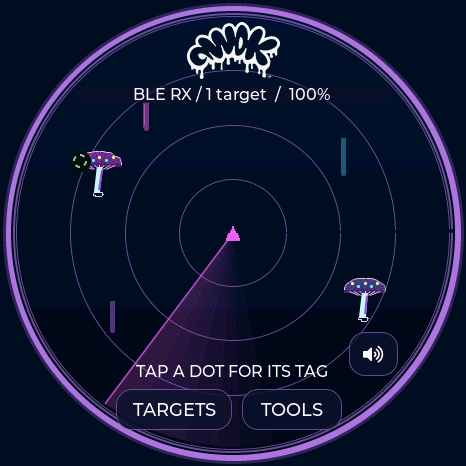 | 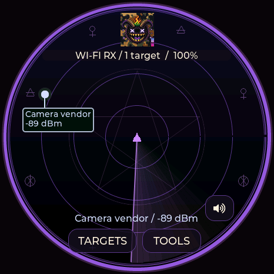 | 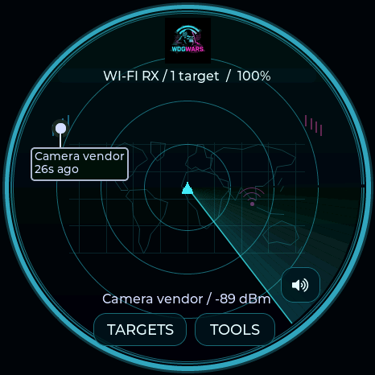 |

## GhostStrats and N3rdsec · 0.13.6

GhostStrats uses black, grey and purple throughout the GUI, with glowing slit eyes on its radar and watch. The analog face has silver/purple hands, faceted details and the requested “Safety is an Illusion.” tagline. N3rdsec uses black, white and gold, with the original skull on both radar and watch, an Arabic dial and broad gold/silver hands. Selecting either theme also selects its watch; both retain the ordinary stopwatch. The shared BWM logo-only startup remains independent of theme. USB commands are `radar theme ghoststrats` (13) and `radar theme n3rdsec` (14); watch indices are 16 and 17.

| GhostStrats | N3rdsec |
|---|---|
| 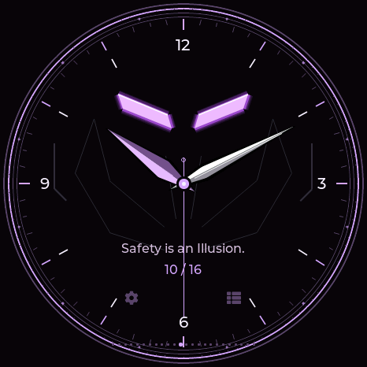 | 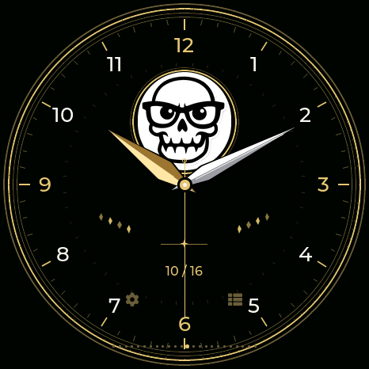 |
| 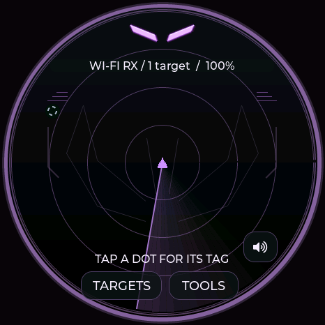 | 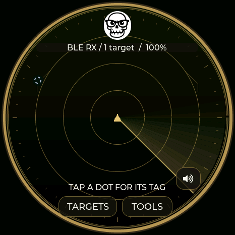 |

## HaleHound · 0.13.6

Black, hot pink and violet theme the complete GUI. Both original supplied logos appear on the Roman analog watch, with moving layered flames and rising embers on either side. The radar has a matching wordmark and subdued animated hellfire behind signal dots and labels. Flames use monotonic frame time, so setting the clock does not stop their motion. The ordinary stopwatch remains available; the BWM boot logo remains unchanged. USB command: `radar theme halehound` (theme 15, watch 18).

| Animated-fire analog watch | Hellfire radar |
|---|---|
| 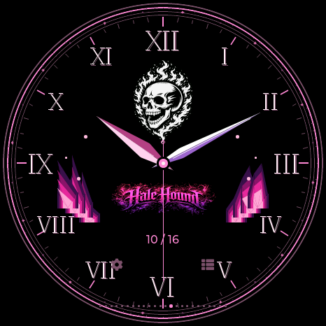 | 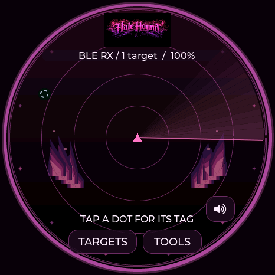 |

## Maker and character themes · 0.13.6

All nine themes below carry their colors through menus, settings, dialogs and utilities. Selecting one selects its unique watch. The universal BWM2 startup remains unchanged.

| Theme / USB name | Theme / watch ID | Design |
|---|---|---|
| Waveshare / `waveshare` | 16 / 19 | Original green logo, silver hands and a precision waveform dial. |
| M5Stack / `m5stack` | 17 / 20 | Original blue and white logo, modular dial and a separate 12-hour digital window. |
| LAB5 / `lab5` | 18 / 21 | Original scientist artwork, cyan and magenta circuits and large 12-hour digital time. |
| Talking Sasquach / `sasquach` | 19 / 22 | The cartoon becomes a character watch: furry arms and pointing hands tell the time. The portrait head appears on the forest radar. |
| Nyan Devices / `nyan` | 20 / 23 | The original logo colors run through the dial and menus. A pixel Nyan Cat flies across the radar with a moving rainbow trail. |
| DMAC / `dmac` | 21 / 24 | Teal, pink, charcoal and silver. Two acrylic McTickler profiles with copper inlays and pearl rivets tell the time; Utilities becomes Locksport Counter. |
| Seeed Studio / `seeed` | 22 / 25 | Supplied circular logo, deep teal and lime, leaf-circuit traces and a unique Arabic analog watch. |
| DagNazty / `dagnazty` | 23 / 26 | White field, black accents, original skull and a unique talon-and-fang analog watch. |
| 0ct0’s Pig / `octo-pig` | 24 / 27 | Pink ASCII octopus, live speech-bubble time and interactive wandering pig. |
| DeFlock / `deflock` | 25 / 28 | Navy and steel blue, camera-raven artwork, viewfinder radar and large 24-hour clock. |

DMAC’s Locksport Counter retains the current attempt’s elapsed time and latest 50 splits. OPEN records the final split and stops; RESET asks before clearing. It does not store a lifetime lock total. The other five keep the ordinary stopwatch.

### Waveshare

| Watch | Radar |
|---|---|
| 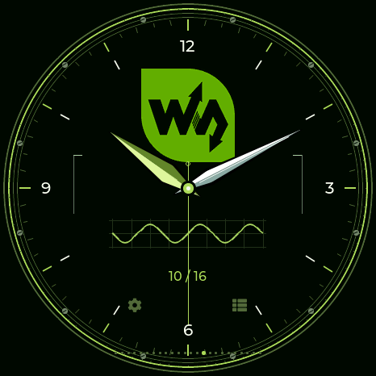 | 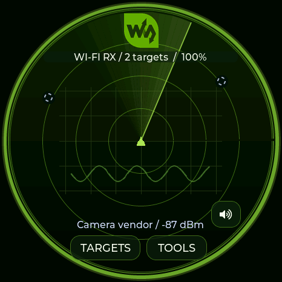 |

### M5Stack

| Watch | Radar |
|---|---|
| 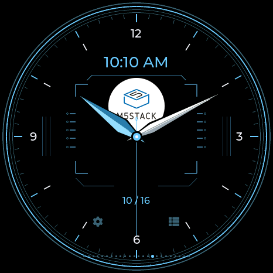 | 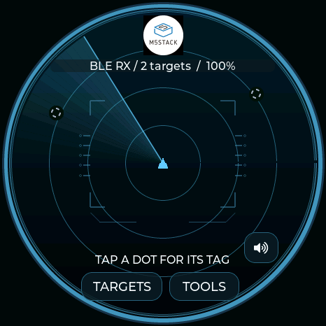 |

### LAB5

| Watch | Radar |
|---|---|
| 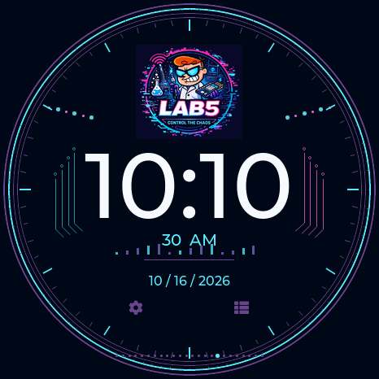 | 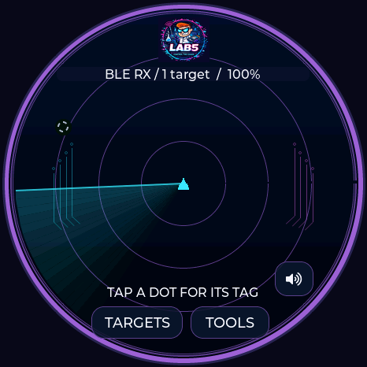 |

### Talking Sasquach

| Watch | Radar |
|---|---|
| 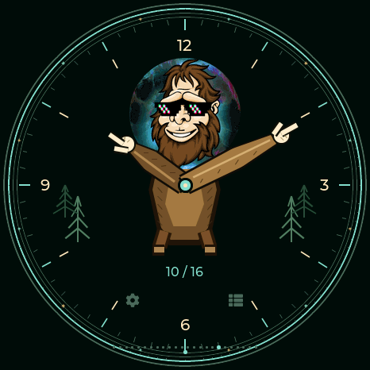 | 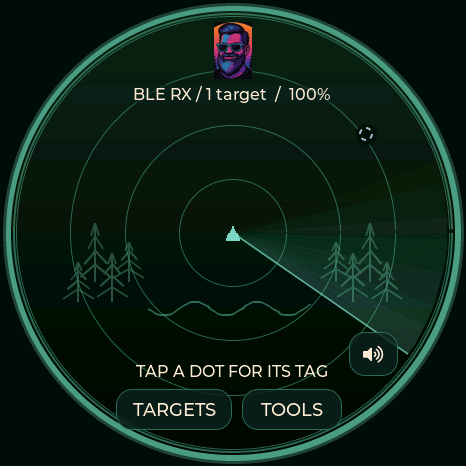 |

### Nyan Devices

| Watch | Radar |
|---|---|
| 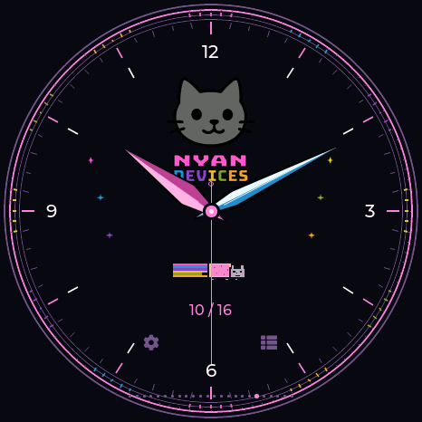 | 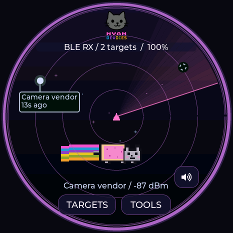 |

### DMAC

| Watch | Radar |
|---|---|
|  | 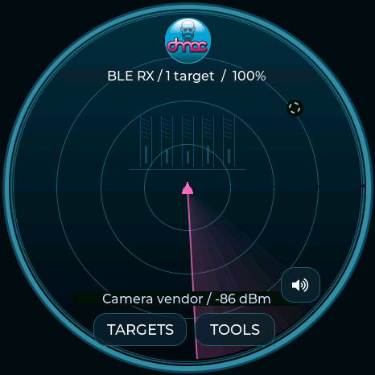 |

### Seeed Studio

| Watch | Radar |
|---|---|
| 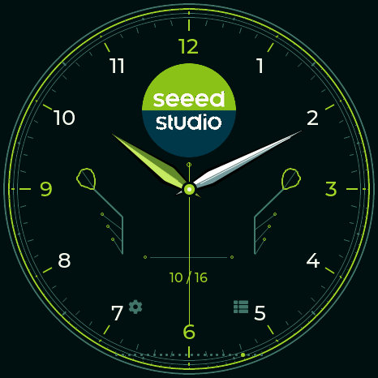 | 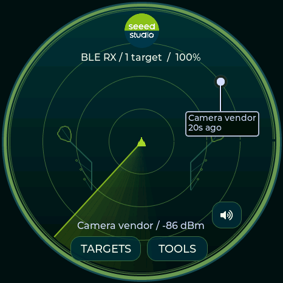 |

### DagNazty

| Watch | Radar |
|---|---|
| 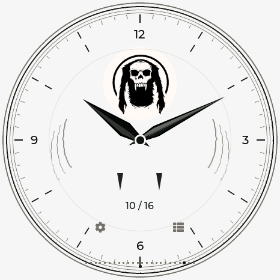 | 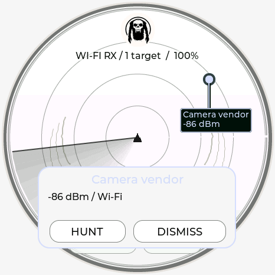 |

### 0ct0’s Pig

Theme 24 (`radar theme octo-pig`) selects watch 27. The supplied pink octopus is rendered as an ASCII character grid, with a black/pink interface, native pixel fonts, character rings, sweep and signal markers. Signal-family colors remain meaningful.

The watch’s ASCII pig wanders within the round screen, changes its gaze, blinks, and carries live **24-hour HH:MM:SS** in a speech bubble. Tap beside the pig to make it look and walk toward that side with an OINK reaction. The time stays visible throughout. Swiping still changes watches; `[+]` opens time settings and `[=]` opens the menu.

For USB interaction, `clock pig` reports animation position and live time; `clock pig left` / `clock pig right` trigger the same reaction handler as a tap. These commands require the Pig watch to be visible. They do not change the device clock.

| Watch | Radar |
|---|---|
| 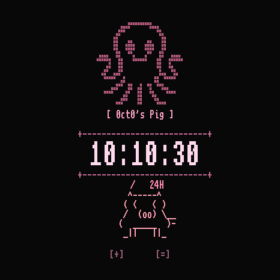 | 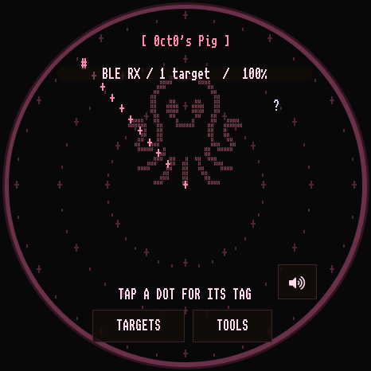 |

### DeFlock

Theme 25 (`radar theme deflock`) selects watch 28. The original supplied camera-raven artwork is retained unchanged. Midnight navy and steel-blue colors carry through the radar, menus, settings and ordinary stopwatch. Viewfinder corners and optical ticks surround a large **24-hour** clock, date and seconds; the marker on the outside rim follows the actual second. The radar keeps its live signal-family colors and adds a matching steel-blue sweep.

| Watch | Radar |
|---|---|
| 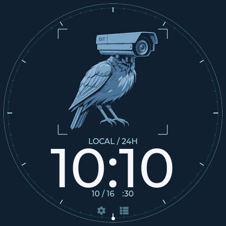 | 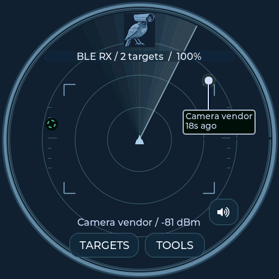 |
