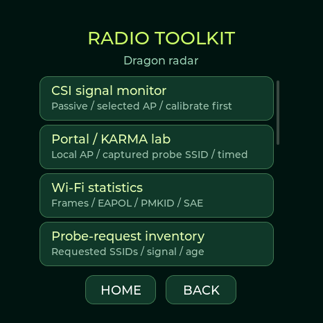
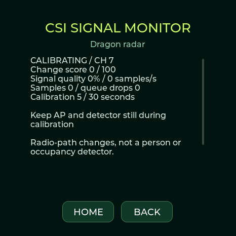
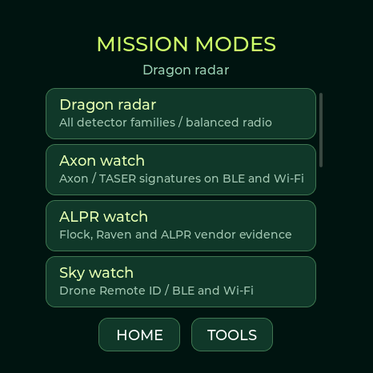
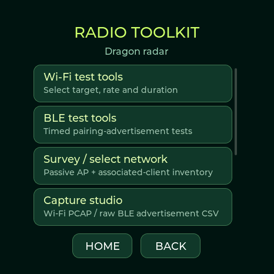

# Published 0.13.10 verification

[Release](https://github.com/valleytechsolutions/Dragon-Detector/releases/tag/v0.13.10), [CI](https://github.com/valleytechsolutions/Dragon-Detector/actions/runs/39007446005) and [Pages](https://github.com/valleytechsolutions/Dragon-Detector/actions/runs/39007619244) passed. All five clean builds preserve the 21% reserve. The 78 web tests, native/fuzz and sanitizer checks, and 135 native asset decoder checks pass. Every live firmware segment/manifest and changed web module matches its release source/CI output. All eight uploaded release assets were downloaded and SHA-256 checked.

The connected Waveshare 1.75C received the released app-only image after partition comparison; esptool verified the write. Application SHA-256: `a904ddf222a0055dcbb88be6c389ca9cb264ac81b6dfe832af98a196c4008bfa`. All 23 self-tests pass. The actual web clock module sets current date/time and UTC offset; the device returns valid time before/after a powered software restart. Direct RTC diagnostics correctly report no detected external chip. The clock framebuffer was inspected. Its saved-Wi-Fi clock recovery remains disabled pending the owner’s choice; full shutdown retention is **not** claimed. The already-correct StopWatch firmware was not changed in this correction. Other boards are build/package-tested.

The actual ESP Web Tools 10.4.0 browser lifecycle fixture passes automatic completion-to-clock handoff and selected-mode erase tests. It uses a test port, not hardware flashing; physical clock verification uses the real web module over a local serial-stream adapter. The browser USB chooser/full installation has not been automated end to end.

# 0.13.10 clock correction validation

The earlier 0.13.9 AMOLED check verified USB synchronization and a powered software restart, **not** a hardware RTC or retention through shutdown. The owner subsequently found the clock unset after a power cycle. Direct diagnostic firmware confirms no ACK at 0x51 at either 100/400 kHz; 0x18, 0x34, 0x40, 0x5A and 0x6B acknowledge at both rates. This agrees with the exact 1.75C schematic, which has no PCF85063 calendar device. The non-C model must not be substituted as evidence for the C model.

Local checks: 78 web tests pass, including missing/invalid/stopped RTC rejection, UTC offsets, automatic installer handoff and preservation of Update mode. A browser fixture runs the real pinned ESP Web Tools 10.4.0 dialog lifecycle and confirms automatic close only after post-flash initialization, plus update/factory erase behavior. That fixture does not itself flash hardware. The local 0.13.10 AMOLED build is app-only flashed with verified hashes and its time is set using the actual flasher clock module; hardware diagnostics correctly report no external RTC. Final CI/published-binary verification is recorded separately below when complete.

# Published 0.13.9 device and release audit

The [v0.13.9 release](https://github.com/valleytechsolutions/Dragon-Detector/releases/tag/v0.13.9) is published from `14e2719fd6648ed1d054402c246d37b109a9220b`. [CI](https://github.com/valleytechsolutions/Dragon-Detector/actions/runs/39004637749) passed all five builds, 72 web tests, native/fuzz tests, sanitizer checks and all 135 asset-decoder checks. [Pages deployment](https://github.com/valleytechsolutions/Dragon-Detector/actions/runs/39004913322) succeeded. Public manifests, image segments and web modules/artwork match their CI/source files. All eight uploaded release assets passed byte-for-byte download/hash verification.

- **M5Stack StopWatch:** application-only update after a private full backup and partition comparison; esptool hash verification passed. Running version 0.13.9 and app byte size match the released package. SHA-256 `6f81b7e75ae24c78166625bd0c73e0990f80131bbb971196cb773b080760eb95`. All 23 self-tests passed. Actual web clock-module synchronization, powered restart retention, both VTS fade stages, new theme/watch/menu/timer captures, and running/pause/OPEN timing checks passed. Final VTS framebuffer bytes match the reviewed public image. Saved theme/watch preferences were restored.
- **Waveshare AMOLED:** application-only update after a private full backup and partition comparison; esptool hash verification passed. Running version 0.13.9 and app byte size match the released package. SHA-256 `68a6d1ec9154b3024be36d8a5f9d6d9491ff76128ade833001409de260f06fb3`. All 23 self-tests passed. Actual web clock-module synchronization, powered restart retention, both VTS fade stages, new theme/watch/menu/timer captures, and running/pause/OPEN timing checks passed. Final VTS framebuffer bytes match the reviewed public image. Saved theme/watch preferences were restored.

StopWatch reports a usable RTC; this AMOLED reports no available external RTC. Both clocks are set to the computer time and UTC offset. Their saved-Wi-Fi time recovery remains disabled. Spotpear was checked on an earlier candidate and was unplugged before final CI binaries; no final-image update is claimed for it. Wi-Fi credentials remain deferred. XIAO and Lite are build/package-tested; Lite hardware troubleshooting stays stopped. Private backups are excluded from every published asset. Exact runtime counters, clocks and budgets are attached to the release in `RELEASE-VERIFICATION.json`. The source and local candidate checks below remain as an audit trail.

# 0.13.9 validation

All five local firmware builds and packages pass the unchanged 21% reserve guard. Connected M5Stack StopWatch and Waveshare AMOLED candidates pass 23/23 self-tests, real web clock-module set/readback, powered restart retention, both VTS fade stages, Ghostbusters/LPU radar/watch/menu/timer renders and monotonic timing checks (advance, pause freeze, resume and OPEN). StopWatch reports RTC available; this AMOLED reports RTC unavailable and uses ESP32 system time. Both receive Wi-Fi and BLE with zero receive/storage drops in the post-restart test. StopWatch's earlier post-flash startup had eight receive drops; counters after the tested restart were zero. One AMOLED USB response timed out during capture; reopening the port recovered communication, and the complete repeated check passed. No device panic or heap failure was observed. This is a short USB/runtime check, not an extended load or physical-touch test.

The local Spotpear candidate passed 23/23 on-device self-tests, actual web clock-module sync/readback, powered software-restart time retention, both new theme/watch/timer captures, and continuing Wi-Fi/BLE reception with zero drops during the short check. Its software clock had no external RTC. Wi-Fi provisioning was deferred by the owner, so live NTP and cold-power recovery are not claimed as tested. Screenshots are native framebuffer captures, not panel photographs.

72 web tests and the native suite (including 150,000 malformed-input fuzz cases, Lite gesture rollover and clock scheduling) pass. All 135 packed theme assets across three resolutions decode through the native firmware decoder to their exact original pixel CRC32. The lossless conversion uses additional PSRAM, measured on the hardware checks, with no frame-by-frame allocation.

Final clean-CI firmware, published hashes, actual device checks and per-board budgets accompany this release as `RELEASE-VERIFICATION.json`. Lite hardware work remains stopped; XIAO and new Lite pages are build/package-tested, not newly panel-tested. These limitations also appear in the release notes.

# Validation status · 0.13.8

## Post-release board audit and connected-device updates

- The published clean-CI v0.13.8 packages pass the release validator for all five boards: version, image hashes, non-overlapping offsets, both manifests and the 21% application-slot reserve. The four full profiles already share the AMOLED software workflows; the [feature matrix](FEATURE-MATRIX.md) and [flash budget](FLASH-BUDGET.md) now record the exact board differences and released image sizes. This audit changes documentation, not firmware functionality.
- A newly connected M5Stack StopWatch C152 received the released application only, after a complete private flash backup and confirmation of the existing partition layout. The write passed esptool checksum verification; firmware SHA-256 is `0705e1d8237be2e2b8f85869e9c40ce7f952d16dda30c7635347a35f80f80c56`. Settings and files were preserved. The running device identifies v0.13.8, passes 23/23 self-tests, and continues both Wi-Fi and BLE reception with zero receive/storage drops during the short check. CRC-verified radar and watch framebuffer captures were reviewed. The actual web post-install clock module reports an available RTC, valid time and the computer's UTC offset. Touch initialization reports enabled; physical taps, haptics and long-duration runtime were not tested in this check.
- The connected Waveshare Lite also received the released application only after a private full backup and matching partition verification. The 1,722,096-byte write passed esptool checksum verification; firmware SHA-256 is `4019d8105d023bf599f02d377a7ea600ed9eaf7f87c1348fe9f6040eb251289e`. **Normal startup did not pass verification.** Serial output showed ROM download mode, later connections were silent, and the owner reported a blank display. Hardware troubleshooting was stopped at the owner's request. The successful flash write is not a successful runtime test, and the cause of the startup problem is unresolved.
- XIAO Round remains build/package-tested for this release. The Waveshare AMOLED and Spotpear v0.13.8 runtime checks are recorded below. Private device backups and raw radio captures are excluded from the repository and release assets.

## Complete themes, community watches and locksport · 2026-10-16

- All five final builds and package checks pass. Waveshare AMOLED, M5Stack StopWatch, Spotpear and XIAO Round share 26 complete GUI themes and 24 selectable logo clock faces. Lite excludes the new watch/theme artwork and remains radar-only. The smallest application reserve is 21.29% (XIAO), above the 21% guard. Every delivered firmware binary matches its final build.
- The connected Waveshare received an application-only update with flash hash verification. Final application SHA-256: `45cbd95aa98f2e63ba284834d34274a6149b9b8f021423adcf595eddcd3a924a`. Existing badge data remained intact (`434320` bytes, CRC `1e889380`, saved startup preference `boot=1`). The universal BWM2 startup renderer supersedes the former startup presentation without deleting the badge.
- CRC-verified native captures cover watch, radar, menu and ordinary stopwatch for AWOK, Baph0Mau5, WDGWARS, GhostStrats, N3rdsec, HaleHound, Waveshare, M5Stack, LAB5, Talking Sasquach, Nyan Devices, DMAC, Seeed Studio, DagNazty, 0ct0’s Pig and DeFlock. Visual review confirms supplied logo placement, theme colors, broad hands, date-only labels and GhostStrats’ exact tagline. HaleHound includes both original logos; two captures changed 5203 pixels inside the flame regions, outside the clock hands and logos. These are display-buffer renders, not panel photographs.
- Retired face IDs 3–7 are rejected without changing the selected face; saved retired selections migrate to BWM. Existing logo IDs stay stable. Native captures show Sasquach’s furry character arms, DMAC’s acrylic pick profiles and isolated circular logo, and ValleyTech’s silver silhouette without a white plate. M5Stack keeps its original white circular logo. Nyan’s pink icing centroid changed between two radar captures: [290.29918032786884, 247.24006235385815]. DMAC’s counter recorded two splits and stopped on OPEN: `STOPWATCH_STATUS running=0 elapsed_us=4500009 laps=2 retained=2`.
- All 26 themes safely opened their stopwatch. A prior validation run exposed a null-control access when a dark regular stopwatch was treated as a Locksport Timer; the dark-locksport predicate now requires a locksport theme. Final captures and the complete theme loop pass after that fix. The Covert running-timer header remains visible in four successive captures (pixel counts: [1201, 1201, 1201, 1201]); PSRAM remains stable. OPEN records and stops, and RESET clears the attempt.
- The logo-only BWM startup replay has the same CRC in all 26 themes, with no content outside the centered artwork. This command replays the same renderer used at real startup. Four Covert radar captures differ, confirming the silver McTickler sweep moves; both receive counters advance during the check.
- Production Studio USB modules saved and read back all 26 themes, synchronized UTC and the computer’s local offset, and completed 72 clock-face changes without a reset. PSRAM before/after: 6937080 / 6937080 bytes. Elapsed stopwatch time remained independent of wall-clock, timezone and theme changes. Both radio counters and all 11 Wi-Fi channels advanced on radar, clock, stopwatch, binary watch and each of the sixteen new community faces, including animated HaleHound.
- All four locksport themes pass the orbit checks: visible movement around the rim, identical paused/opened captures, and reset returning the marker to the top. Motion uses monotonic elapsed time and continues correctly after resume.
- 0ct0’s Pig uses ASCII octopus artwork and an animated character with a live 24-hour speech bubble. Native captures and USB diagnostics verify bounded wandering, changing gaze, live time, and left/right reactions through the same reaction handler as tapping. Physical taps were not automated.
- Final self-tests passed 23/23. Production health: `HEALTH uptime=1078885 heap=45952 psram=6937072 contacts=32 wifi=7991 ble=36123 alerts=8 drops=0 storage_drops=0 malformed=0 channel=9 phase=WIFI storage=FLASH audio=0`. All 62 web tests pass, including actual palette contrast and every theme transfer. Native calendar, stopwatch, orientation, detector and 150,000-input fuzz suites also passed on the final source. The browser gallery is checked separately after copying final native captures.
- Original supplied CI, McNally, BWM2 and the supplied community logo/pick sources are preserved. The artwork ledger records source hashes and byte comparisons. Baph0Mau5 was copied before the shared Desktop filename was replaced; its recorded source remains unchanged.
- DMAC is selected and actual local time restored after testing. This attached Waveshare reports no usable RTC, so reconnect Studio to resync after a power cycle. Only Waveshare was physically attached; the other four profiles were build/package-tested. The user previously confirmed swiping in both directions. These short checks do not establish all-day runtime or physical display/touch behavior on other boards. Published CI builds and public flasher hashes are verified separately in the release’s RELEASE-VERIFICATION.json. These detailed captures refer to the hardware-tested candidate SHA above.

## Clearer hands and digital time · 0.13.5 · 2026-10-16

- All five final builds and package validations pass, including image offsets, SHA-256 checks and the 21% application-reserve guard. The smallest remaining reserve is 26.20% on XIAO. Every package matches its final build; M5Stack, Spotpear and XIAO are build-tested, and Lite excludes the watch renderer.
- CRC-verified Waveshare captures show the clean ValleyTech dial with twelve Arabic numerals and broad beveled gold/silver hands, both enlarged digital layouts, the unset-time prompt, 12:05 AM at midnight, 12:05 PM at noon and 23:58 military time. Visual review confirms clear digits, logo placement and date/control spacing. These are firmware renders, not panel photographs. The other six designs are unchanged.
- The compact digit font has native glyphs for 466, 360 and 240 pixel displays. Its generator checks glyph bounds and every hour/minute combination in both formats against the available width. Font data stays in flash and is excluded from Lite; the font license accompanies the packages.
- The connected Waveshare received an application-only update with flash hash verification. Production Studio USB functions synchronized actual UTC time and the computer's local offset. Twenty-seven face changes completed without a reset. Both radio counters and all eleven Wi-Fi channels advanced on each revised face; final receive/storage drops were zero and PSRAM matched the earlier capture check. The device passed 23/23 self-tests. Short checks do not establish all-day runtime.
- All 56 web tests and native calendar, stopwatch, rotation, detection and fuzz suites pass. The local gallery shows the updated captures without browser console errors. The original BWM badge checksum and startup preference are preserved. Local time was restored and ValleyTech selected after testing.
- The attached Waveshare still reports no available RTC and requires synchronization after restart. Other physical boards were not attached; their touchscreens and panels were not newly tested. Earlier physical left/right swipe confirmation remains recorded below. This is a local update, not a new public release.

## Detailed themed clocks · 0.13.4 · 2026-10-16

- All five final builds and package checks pass. Each full board includes the nine-face renderer; Lite excludes it. Application reserve remains above 21% everywhere (XIAO is the smallest at 25.22%). All 56 web tests and native calendar/stopwatch/rotation/detection/fuzz suites pass. Native tests round-trip all 24 hours through 12-hour display values, including midnight and noon.
- The Waveshare received an application-only update with flash hash verification. Nine faces, unset-time behavior, AM/PM wheels, time settings and stopwatch produced CRC-verified native display captures. Visual review refined fairytale foliage clearance, serif Roman numerals, pierced hands, JCMK background integration, monochrome Biscuit gearwork and ValleyTech's distinct sculpted rosettes/engraving. Original supplied logo PNG hashes match the user's files.
- Hardware captures confirm 12:05 AM at local midnight, 12:05 PM at noon, and 00:05 on the military face. Two Biscuit captures with the wall clock set to the same instant differed by 2,426 pixels in the gear region, verifying animation independent of the time hands. A running stopwatch continued across date/time, offset and page changes; paused time stayed fixed, and lap/reset and invalid face/offset checks passed.
- Production Studio transfer functions synchronized actual UTC time and the computer's current local offset. Short checks on animated ValleyTech, Steampunk, Biscuit and Stopwatch advanced both listening counters and all eleven Wi-Fi channels. Ninety face changes completed without resets; final PSRAM matched the baseline and receive/storage drops were zero. The device passed 23/23 self-tests. These checks do not establish all-day runtime or battery life.
- The BWM badge CRC and startup preference remain unchanged. The attached Waveshare reports no available RTC, so it still requires time synchronization after restart. Actual local time was restored and ValleyTech selected after testing. Other boards are build-tested; their physical displays/touchscreens were not attached. The user's earlier left/right swipe verification remains recorded below; this revision preserves that gesture handling.
- The local Studio gallery was inspected in the browser with all nine images and no console errors. Packages and source are local deliverables, not a new public release.

## Watch collection · 0.13.3 · 2026-10-16

- All five final builds and packages pass offsets, SHA-256 and the 21% application-reserve guard. Lite excludes the watch renderer and added fonts. All 56 web tests and the native calendar, stopwatch, rotation, detection and fuzz suites pass.
- A complete private 32 MB backup preceded an application-only Waveshare update. Five clock faces, unset-time state, chronograph, time settings and date wheels produced CRC-verified display captures. Visual review caught and corrected wheel spacing and cyberpunk subtitle clearance. These are firmware renders, not photographs.
- Production browser transfer functions synchronized actual UTC time and the computer's current local offset over USB. A running stopwatch continued across time/offset changes and page changes; pause and laps behaved correctly. Invalid face/offset commands were rejected. Fifty successive face changes completed without resets or growing PSRAM usage. Short Clock and Stopwatch checks advanced both listening counters and all eleven Wi-Fi channels, with no receive drops. The device passed 23/23 self-tests.
- Face selection and timezone survived a hardware reset. The attached Waveshare reports rtc=0, so its actual time needs resync after restart; the software does not fabricate retained time. The original BWM badge checksum and boot preference were preserved. Time was resynchronized after testing and Atelier selected.
- Only Waveshare is attached. Other full boards are build-tested, not newly tested on their physical touchscreens. The user physically verified that both left and right swipes switch faces on the connected Waveshare. All-day battery/runtime testing remains outstanding. Packages here are local builds; publication is not implied.

## Hardware-aware storage · 0.13.2 · 2026-10-16

- All five local builds and package checks passed, including firmware-binary guards against SD menus/card prompts on Waveshare AMOLED, M5Stack and Lite. The other two builds retain their SD code. All 55 web tests and documentation/manifest/image checks pass. Release CI additionally requires the native/fuzz and ASan/UBSan suites before its five builds can publish.
- The connected Waveshare received an application-only update. Utilities, Settings and Capture Studio produced CRC-verified logical display captures, inspected for readable controls and internal-storage wording. SD driver includes, browser rows, command handlers and logging allocations are excluded from its build; no-card contact handling no longer formats unused CSV strings. The compiled Waveshare image is about 9 KiB smaller than 0.13.1 with unchanged partition sizes.
- Ten live checks cover radar, badge, settings, utilities, saved files, Capture Studio, both notebook pages and synthetic BLE/Wi-Fi Hunt targets. Both radio dwell counters and all 11 Wi-Fi channels advance in each case. These tests start no radio transmission. The board reports 23/23 self-tests, retains the original badge CRC/startup preference, and preserves theme, audio, timers, orientation, clock offset and detector preferences. Short checks do not establish long-duration or battery performance.
- Browser checks exercised all five hardware selections, the matching-update option, confirmation gating and board-specific storage text. Badge Studio still resizes between boards and applies fit/rotation. The new three-image GUI gallery renders, and that browser flow reports no JavaScript errors. This release does not change the badge upload protocol or partition layout.
- Only Waveshare is physically attached for this release. Other boards are build-tested; inserted-card operation on Spotpear/XIAO and new physical touch/panel feedback are not claimed. GUI pictures are firmware renders, not panel photographs. Published packages are tied to one clean CI source commit; final release verification checks the public firmware hashes and the app flashed on Waveshare.

## Branded radar themes · 0.13.1 · 2026-10-16

- All five local board builds and package checks passed; the smallest remaining application reserve is 26.8% on XIAO. All 55 web tests and the native parser/tracking/fuzz checks pass, including the 158 SquachWatch table facts. Release CI additionally requires five builds and ASan/UBSan.
- The connected Waveshare received an application-only update. All six theme selections returned the correct USB index and produced CRC-verified logical 466×466 display captures. The three branded renders were visually checked for logo contrast, status-strip clearance and readable, unchanged family-colored labels. Production web read/save functions also round-tripped all six themes over real USB, restoring the original selection afterward. Invalid theme names were rejected without changing the selection. Physical panel/touch confirmation was not repeated for this appearance-only change.
- Both radio counters and channel 1–11 dwell advanced during theme switching. Final checks reported 23/23 self-tests, zero receive drops in the short validation interval, the original badge CRC/startup preference, and unchanged radar, audio, brightness/timeouts, fixed orientation and clock offset. The saved Black / gold / red theme was restored. This does not establish long-duration reception or battery performance.
- The other full boards have native 360/240-pixel logo assets and successful builds; their physical displays were not attached for this release. Lite remains fixed green and excludes the new logo arrays. Existing partitions and reserve rules are unchanged.

## Four-board recon lab · 0.13.0 · 2026-10-16

- All five local board builds and package checks passed. Every image remains above the 21% application-slot reserve. The complete 40,333-prefix registry passed decompression, CRC and lookup fixtures; the bounded decoder also passed 25,000 malformed blocks. HID tests cover keyboard modifiers/keys, signed mouse axes/report IDs, consumer controls, global push/pop and 40,000 malformed maps. The 158 SquachWatch table facts and existing AXEOFF/radar regressions still pass. All 54 web tests pass. Release CI additionally requires ASan/UBSan and builds all five variants.
- On the connected Waveshare, a controlled Windows peripheral passed discovery/read, writes with/without response, subscriptions/notifications/unsubscribe, MTU, replay and the synthetic tracker-sound opcode. The new GATT bridge passed cached read, forwarded write, forwarded notification and Stop restoring radar with zero bridge errors. Server registration now occurs without an active connection, then reconnects the original peer. Windows served both roles and retained its physical link after its client closed, so separate-device disconnect timing and protected/authenticated bridge peers remain unverified. No pairing bypass or transparent-proxy claim is made.
- Real USB tests recorded and downloaded both Wi-Fi and BLE recon sessions using production browser transfer code. ZIP integrity, manifest state, absent GPS fix and record alignment passed. AP archives saved/read/exported successfully. A passive recipe completed and restored the previous mode; Home cancelled another recipe and restored balanced scanning. Invalid recipes were rejected. Volatile source-address configuration and reset passed. An imported owned HID fixture decoded Shift, A and Enter on the device, and the prior saved GATT workspace was restored.
- The production USB regression downloaded notebook/history CSVs and checked captures, round-tripped a maximum 72,136-byte GATT file, saved a capture incrementally and rejected a complete deliberately invalid 434,320-byte badge upload. Both listening counters advanced during long transfers with no additional receive-queue drops; the original badge checksum and boot preference survived. Test-only files were removed.
- In the browser, all five hardware selections loaded their matching Update manifest. Badge Studio imported the supplied BWM logo, previewed 360/466/466/240-pixel full-board canvases, applied rotation/mirroring/text/centering and exported a valid 240-pixel PNG. No JavaScript errors appeared in that flow. USB tests use the same production transfer modules over a real serial link; the browser's physical port picker was not automated.
- The updated Utilities and Attacks pages were checked in CRC-verified 466-pixel framebuffer captures. Radar, badge, Settings, Notebook, BLE inspector and both Hunt cases advanced BLE/Wi-Fi listening time and all eleven Wi-Fi channels. The serial harness now retries a missing response marker instead of treating a delayed USB reply as an empty result.
- This release's physical checks cover Waveshare only. M5Stack, Spotpear and XIAO lab layouts are build-tested and scaled, not newly touch-tested on those physical boards. No claim of complete upstream parity, every physical device signature, all-day battery runtime, attack effect on a live network, or filled-to-79% flash is made. [Feature boundaries](FEATURE-MATRIX.md) and [budgets](FLASH-BUDGET.md) remain explicit.

## Continuous scanning and Recon Notebook · 0.12.0 · 2026-10-15

- On the connected Waveshare AMOLED, normal radar, badge, Settings, Notebook, BLE inspector, BLE Hunt and Wi-Fi Hunt each advanced both listening counters and all eleven Wi-Fi channel dwell counters. Legacy Pause was rejected. Hunt uses a complete sweep plus target priority; it no longer monopolizes one protocol. These are short bench intervals, not a guarantee of reception of every advertisement.
- Production browser USB modules downloaded both notebook CSVs and history. A complete 434,320-byte deliberately invalid badge upload was rejected after transfer: both radios advanced, no additional queue drops were observed, and the original badge CRC remained `1e889380` with its boot preference intact. A maximum 128-attribute / 72,136-byte GATT file round trip retained byte-for-byte integrity while both radios advanced; the saved workspace was restored. Stored capture downloads passed their CRC checks. Incremental capture saving also left the radar enabled; its resulting CSV passed download validation and the temporary test file was removed. All 23 on-device self-tests passed. The filesystem/partition layout and existing NVS were preserved.
- A separate laptop receiver observed all five new advertisement formats: marked iBeacon, Eddystone UID, Eddystone telemetry, BTHome and the custom DD-Lab payload. Each ran for four seconds at two payload updates/second, then restored radar. These new formats retain the detector's identity; existing pairing-advertisement modes keep their previous behavior. Format reception is not a demonstration of an effect against an unrelated device.
- The controlled Windows GATT regression passed discovery/read, writes with and without response, subscription/notification/unsubscription, MTU status, profile save/delete, advertisement replay and a tracker-sound command delivered to a synthetic characteristic. This does not establish real tracker audibility or complete Flipper interoperability.
- Native/fuzz checks cover all 158 pinned SquachWatch facts, AXEOFF priority, malformed notebook input, full channel sweeps despite scheduling jitter, randomized-address vendor rejection, advertisement formats and reserve arithmetic. All 50 web tests passed, including both update/factory manifests for all five board identities. Every packaged build enforces at least 21% free space in its application slot and includes an exact memory report. ASan/UBSan and all five builds are also required by release CI.
- This release's physical checks cover the Waveshare only. Other boards have build/package coverage. No claim of full upstream feature parity, all-day battery life, field detection of every product, or simultaneous Wi-Fi/BLE reception is made. See [feature gaps](FEATURE-MATRIX.md) and [flash allocation](FLASH-BUDGET.md).

## Connected-network diagnostics · 0.11.1 · 2026-10-15

On the Waveshare AMOLED, a temporary Windows 11 24H2 **2.4 GHz WPA2** access point verified association, DHCP, gateway/address/mask/DNS reporting and a genuine nonce/checksum-matched gateway ICMP reply. Tests verified the out-of-subnet rejection, unsaved-results guard, CSV storage, scan cancellation, Home restoration, a second connection without leaked netif handlers, automatic cleanup after AP loss and the 25-second absent-network deadline. Repeated Windows hotspot sessions exposed intermittent authentication timeouts, including one reconnect with a fresh SSID. The connection path now allows up to three explicit join attempts inside the same 25-second deadline. The fixture generates a new SSID and password for each run. The test removed its profile and stopped the temporary hotspot; original badge CRC and listening mode remained unchanged. WPA3 peer interoperability and the full 15-minute expiry were not exercised live.

Native tests add 25,000 malformed ICMP cases, wrong ID/sequence/nonce, checksum corruption, truncation and subnet bounds. Web tests total 47 with profile encoding, protocol gating and CSV validation. The public opt-in fixture is `tools/test_network_live.py`; it requires an unused profile slot and will not replace an already running Windows hotspot. Windows Wi-Fi Direct legacy publishing did not provide a usable connection here; the separate per-session tethering API supplied the successful controlled fixture without changing persistent hotspot settings.

This is an experimental development release. Automated signature checks and basic board checks do not establish field detection accuracy or all-day battery life.

## Waveshare detection and recon expansion · 0.11.0 · 2026-10-15

- Saved and hashed a fresh private 32 MB recovery image. The application-only update leaves NVS, the badge/history volume and the upper recon volume at their existing addresses. Production browser USB modules checked the original badge checksum/startup preference, saved display/radar/audio/orientation/clock preferences and a pre-existing 3,379-byte GATT profile after flashing. The Uno Q was not modified.
- Audited the pinned SquachWatch source against the committed ledger: all 158 table facts match, and all have native recognition/radar-visibility fixtures. Additional cases cover body-camera reserved-queue handling, public versus randomized addresses, BWC payload bounds, vendor false positives, service encodings and protocol composites. These are parser/transport checks, not sightings of every physical product.
- A Windows-created GATT fixture verified discovery/read, response and no-response writes received at the peer, notification delivery, unsubscribe with the peer's CCCD state cleared, MTU control/status, and save/delete of a uniquely named test profile. A separate receiver observed the captured service advertisement replayed at the detector's own address. A synthetic tracker characteristic received the expected sound-request opcode. This does not establish that a real AirTag will accept the request or that proprietary behavior is cloned. Successful authenticated pairing/passkey exchange and captured-address replay have not been verified on a physical peer.
- A temporary laptop connection to the detector's test AP verified DHCP, the local HTTP page, captive DNS, an invented form submission, rejection of an oversized POST, and CRC-checked log download. The original laptop Wi-Fi connection was restored and its temporary test profile removed. Three subsequent portal timeouts closed the AP and restored radar. Custom HTML import/reset also passed through the production browser transport.
- Selected-AP beacon capture produced 68 checked PCAP records, all with the selected BSSID and correct Radiotap channel. This exposed and fixed an initial channel-transition bug: the receiver now tunes the selected channel before enabling capture. Filter changes, channel-plan changes, Stop restoration and saved PCAP transfer passed. EAPOL/PMKID/SAE parsing has bounded fixtures; complete live handshake acquisition is not established by this release.
- CSI callbacks ran on the selected test AP, but only one usable shape comparison arrived during the short trial. The monitor correctly reported **LOW DATA**. Baseline and normalized shape calculations have native fixtures; this installation did not provide enough samples to validate walking/still discrimination. CSI remains experimental, with no occupancy or detection-range claim.
- Native parser/fuzz checks and 45 web tests pass. New malformed-input coverage includes 25,000 advertisement/HID/EAPOL/PMKID/DNS cases and CSI baseline/shape checks. On-device self-tests report **23 passed, zero failed**. Logical round-screen captures are checked against their USB CRC; the capture path now clears pending partial invalidations before requesting a complete frame. The active CSI view and toolkit were inspected. These are not photographs or a new physical touch confirmation.
- Active tools release the shared radio on Stop/Home/timeout. A short post-test radar run showed increasing BLE/Wi-Fi counters and zero receive drops. These checks do not establish all-day battery life, crowded-field performance, or the peer effects of every transmission format. See the [feature matrix](FEATURE-MATRIX.md) for implemented workflows and remaining upstream differences.

| Expanded radio toolkit | Experimental CSI status |
|---|---|
|  |  |

## Waveshare modes and radio toolkit · 0.10.0 · 2026-10-15

- Saved a fresh private 32 MB recovery image before the update. Flashed only the application at `0x10000`, with esptool hash verification. NVS, both filesystems and partition addresses remain unchanged. The 434,320-byte badge retained CRC32 `1e889380` and its startup preference; saved radar/audio/display/orientation preferences and the pre-upgrade GATT profile passed production USB checks. The Uno Q was left untouched.
- All eight mode transitions and 30 menu/radar transitions passed without reset. All 23 on-device self-tests passed. The menu captures below are CRC-checked logical 466×466 LVGL frames, not photographs or a new physical touch confirmation. The owner stepped away before confirming this release's menus.
- Wi-Fi Radiotap PCAP and BLE advertisement CSV recordings saved to recon flash and exported byte-for-byte with verified checksums. One run produced 26,029-byte PCAP and 20,126-byte CSV files. The production JavaScript transport also downloaded both formats. A generated test capture was removed without removing other files. Saved SSID list replacement, duplicate suppression and persistence across application flashing/restart passed.
- A short AP-scoped run on the owner's explicitly selected network accepted three frames, observed one matching EAPOL frame, stopped at its timeout and restored scanning. One-frame authentication/probe sessions and Home cancellation of a named-beacon test also passed without driver errors. This does **not** establish client disconnection, complete handshake capture, password recovery or effectiveness of every attack. Client-specific tools and the remaining experimental formats have construction/bounds tests, not verified peer effects.
- A separate laptop received seven synthetic Flipper-format BLE advertiser addresses during a five-second run. This verifies advertisement transmission/reception, not an effect on a real Flipper. Broad Apple/Samsung/pairing disruption tests were not performed against surrounding devices.
- The existing controlled GATT peripheral again yielded all 63 attributes with no partial flag, characteristic/descriptor reads, a successful CCCD subscription and live notifications. Local GATT emulation passed read/write/notify/descriptor checks after radio testing. The real owner's Flipper remains detected on radar; full Flipper GATT capture/emulation remains unverified.
- The initial transmit test exposed a missing Wi-Fi event loop. STA sessions now initialize it. Adjacent-channel reception also exposed unstable AP channel selection; inventory now prefers DS/HT beacon channel information and passed repeated channel sweeps without channel flapping. Wi-Fi capture's callback flag is atomic. Stale AP/client selections and radio ownership are checked before starting.
- LVGL menu allocations use PSRAM on Waveshare; the DMA display tile remains internal. The application stack is 12 KB. A fresh post-update passive run had about 54,988 bytes internal heap free, 7,720,804 bytes PSRAM free and 6,448 bytes minimum loop-stack margin, with increasing BLE/Wi-Fi counters and zero receive drops. The capture/menu run also had zero drops and 5,184 bytes minimum stack margin. These are short bench measurements, not crowded-field or battery-life guarantees. Earlier diagnostic runs and screenshot transfers are not latency benchmarks.
- Native regressions cover all eight mode definitions, all 24 bounded builders, complete beacon IE preservation, AP/client identities, advertised channels, Radiotap layout, 70,000 BLE payload cases and existing detector/tracker/fuzz fixtures. All 134 pinned detection facts and 43 web tests pass. Five board profiles built during development; release CI builds each profile from the published source and validates image offsets/hashes. Physical testing applies only to the connected Waveshare.

| Listening modes | Radio toolkit |
|---|---|
|  |  |

## Waveshare BLE Lab and 32 MB · 0.9.8 · 2026-10-15

- Esptool identified the connected ESP32-S3-Touch-AMOLED-1.75C with physical 32 MB flash and 8 MB PSRAM. A complete private 32 MB recovery image was saved before migration. The lower 16 MB partition addresses/sizes are unchanged; the new upper 16 MB recon filesystem was initialized explicitly. The Uno Q was not modified.
- The saved 434,320-byte badge retained CRC32 `1e889380`, including its startup preference. Saved theme/labels, brightness/timers, audio preferences, detector threshold/mask and fixed orientation were checked against the baseline. A saved DDG1 profile loaded after the final flash/restart. New detections can continue extending history; history is not frozen to its pre-test count.
- An original Windows GATT test peripheral passed discovery, characteristic/descriptor reads, CCCD subscription, live notification receipt, profile save and comparison. Its full Windows database produced 63 attributes without the partial flag. The test waits for subscription completion before publishing its notification. It passed again after replacing NimBLE’s default PIN/numeric-confirmation callbacks with explicit rejection when user input would be required.
- A Windows Bleak client connected to the detector's synthetic emulator, read the battery and custom characteristic, wrote and read back a value, received a notification, and read a descriptor. Three repeated sessions returned to the same 59,164-byte free-heap reading after cleanup. These are short bench checks, not a long-duration memory/battery guarantee.
- The production browser USB modules passed profile import/export, including the maximum 128-attribute / 72,136-byte file, corruption rejection without replacing the workspace, overwrite rejection, structural comparison and CSV download. Optional logging retained the synthetic local-write events on the new filesystem.
- Reopening the lab exposed a stale shared microphone-label pointer. It is now cleared when changing pages. Twenty lab/radar round trips, a final live emulation run and all 23 on-device self-tests passed after the fix. The logical display capture was CRC-checked; it is not a physical screen photograph. A GATT connection timeout/disconnect also returned the radio to normal scanning. Normal scan counters increased, with zero queue drops in the short runs; screenshot/large USB transfers intentionally pause reception and inflate maximum processing-lag statistics.
- The owner's Flipper advertisement was detected, but its GATT link disconnected during service discovery. A partial snapshot was retained and radar resumed. **A complete Flipper GATT capture/clone is not verified.** No protected reads, pairing bypass or proprietary application behavior are claimed.
- Native core/fuzz checks and 39 web tests passed. All five board profiles built. Packaging validates exact image sizes, offsets, hashes, board manifests and physical flash bounds. The factory package explicitly builds the old badge filesystem and new recon filesystem separately; updates omit both. Physical checks in this release apply to the attached Waveshare, not the other four boards.

## Badge upload and BWM stock image · 0.9.7 · 2026-10-15

- Reproduced the original 0.9.6 reset on the connected Waveshare 1.75C before `BADGE_READY`. The decoded panic identified a NimBLE advertised-device double-free while the application stopped scanning. Scanner mutations now execute on the BLE host event queue, serially with receive callbacks.
- The final firmware passed 30 rapid pause/resume cycles and two consecutive 434,320-byte uploads using the production `BadgeSerial` and `uploadBadge` JavaScript through a local serial adapter. Uploads took about 9.0 and 9.5 seconds. A separate full transfer with an invalid CRC and an interrupted transfer were rejected.
- A real framebuffer capture after those rejected transfers matched the saved BWM pixels (allowing the intentional one-pixel AMOLED shift). A capture after a hardware restart matched them exactly, without requesting a switch to badge mode. Wi-Fi/BLE reception resumed and the device retained its saved preferences.
- The browser accepted the owner's original 741×810 PNG. The BWM preset, text size/position/color controls, and downloaded PNG were checked. The text and image are composed into the same canvas sent to the device; preview guides are separate.
- Thirty-three web tests cover the wire format, fragmented/repeated acknowledgments, circular text bounds, editor transforms and existing controls. Three complete studio connection sequences passed on the board using the production serial, clock/orientation and radar modules. The old radar parser rejected the 0.9.6 response (which no longer contains `page`); both schemas are now accepted. Read-only settings queries retry a stalled USB response without repeating image transfers or preference writes.
- Native core/fuzz tests passed. All five firmware profiles built and their packaged manifests, partitions and checksums passed validation; physical upload checks here apply to the connected Waveshare only.
- A fresh pre-update recovery image was saved privately. Only the application partition was flashed and esptool verified its hash. These changes are included in the 0.9.8 release.

The release workflow covers five profiles: Spotpear JC3636W518, Waveshare 1.75C, M5Stack StopWatch C152, Seeed XIAO ESP32-S3 + Round Display and Waveshare ESP32-S3-LCD-1.28 Lite. Audio-equipped boards retain full-range PCM/codec output and a 100% volume default. The Seeed assembly has no onboard speaker. Release packaging checks are separate from physical hardware tests.

## Axon priority and one-screen radar · 0.9.6 · 2026-10-15

- The connected Waveshare ESP32-S3-Touch-AMOLED-1.75C initially reported 0.9.3, Quiet mode ON and strong-only alerts. That configuration suppressed sound and non-priority patterns; it does not establish which exact packet was missed during the owner's field test.
- Saved the complete 16 MB prior flash and its SHA-256 under the separate Private Device Backups folder. Installed only the application at `0x10000`, with esptool data-hash verification. Preserved the filesystem/NVS, enabled Axon priority and labels, and turned Quiet mode OFF as requested for audible alerts. The strong-only general filter remains saved; priority detections bypass it.
- All 23 built-in device checks passed. On the final application, the Windows BLE transmitter exercised manufacturer `034D`, service data `FC81`, `FE6B`, `FE6C`, and custom 128-bit service data containing the AXEOFF UUID pattern. All five reached the board's Axon counter. The custom UUID triggered the first-packet alert despite strong-only filtering. The tested UUID was `1234fc81-1111-2222-3333-444455556666`; this is explicitly synthetic evidence.
- Axon queue drops were zero during these short checks. The first custom hit was processed in about 0.1 seconds. Screenshot transfers pause scanning and stall queue processing, increasing the cumulative maximum-lag counter; it is not a clean RF latency benchmark. These observations do not establish all-day performance or reception in a crowded field environment.
- CRC-verified 466×466 framebuffer captures showed the primary Axon tag/leader, family-colored lower notification bubble, simplified signal/radio text, and a single radar with multiple received synthetic contacts. No CLUE/hint labels or radar page controls remain. Physical touch usability and an all-384-dot hardware load were not independently exercised; host tests cover selected-label behavior and 384-contact tracker crowd priority.
- Native parser/tracking tests passed, including all 134 pinned SquachWatch reference facts, AXEOFF partial UUID/address handling, name signatures, malformed boundaries, priority alerts/cards/tones, 200,000 radio-parser fuzz inputs and 50,000 tone-parser fuzz inputs. All 27 web tests passed. All five board profiles compiled; package manifests, hashes, partition offsets and documentation links passed validation.
- The other four boards were build-tested in this session. Lite has neither touch nor sound hardware. Real Axon body-camera detection must still be rechecked against the same camera that the owner's OUI Spy, phone, Biscuit Pro and SquachWatch detected. No body camera or raw capture from that encounter was available for this bench test. Shared identifiers remain lower-specificity evidence in Details; no claim of camera model or recording state is added.

Earlier release results below are historical and describe their former paging/confidence UI.

## Lite readability and rendering refinement · 0.9.5 · 2026-10-14

- The owner confirmed that 12-pixel device names are readable and that the final slim-callout, fine-ring design looks better. The 240×240 framebuffer passed CRC32 and the current hardware guide includes the captured preview.
- The final app was flashed at `0x10000` with esptool hash verification and restarted into radar-only mode. All **23 on-device tests** passed; brightness stayed at 100%, disabled-mode commands were rejected and passive BLE/Wi-Fi counters continued increasing with zero receive-queue drops in the short check.
- UI diagnostics measured a typical draw at **65.8 ms**, versus 101.3 ms in the earlier large-text build. Frames advanced at approximately twelve per second. The 115 KB background cache left roughly **175 KB internal heap and 1.65 MB PSRAM free**, stable across the check. This is a bench comparison with one visible candidate, not a guarantee for all target counts or RF conditions.
- All five firmware profiles compiled. Native tests verify all 384 contacts across both four- and six-target pagination, larger callout containment within the circular panel, non-overlap and existing signature/fuzz cases. Twenty-seven web tests passed. Full-board defaults remain six labels per page; Lite cycles four every seven seconds. Multi-page radio operation with more than four distinct controlled devices has not been physically exercised.
- Detection logic did not change in this visual revision; the 0.9.4 synthetic Axon receive checks below remain the relevant radio evidence. Screenshot transfer briefly pauses reception, so it was performed after timing/queue measurements, then the board was restarted to leave normal scanning active.

## Waveshare ESP32-S3-LCD-1.28 Lite · 0.9.4 · 2026-10-14

- The connected non-touch board reported an ESP32-S3R2, 16 MB flash and 2 MB quad-SPI PSRAM, with a CH343 UART bridge. Its older third-party 0.9.1 port was saved as a complete private recovery image. The partition table matched; only the application at `0x10000` was written, with esptool hash verification. Private flash dumps and local observations are excluded from GitHub and the flasher.
- The first display attempt stalled in TFT_eSPI initialization. Selecting SPI3/HSPI explicitly resolved the issue on this S3/Arduino combination. Startup now reaches the fixed green radar and reports **23/23 on-device self-tests**. No touch, speaker, motion polling or menu tasks are initialized.
- The final profile uses an 11,520-byte internal display tile, holds animation/RSSI positions steady across one frame, caps drawing at eight frames per second and retains all 384 contact slots. Bench checks observed roughly 175 KB free internal heap and 1.77 MB free PSRAM, increasing BLE/Wi-Fi counters and zero receive-queue drops. These short checks do not establish all-day battery life or crowded-environment performance.
- Old badge/display/filter preferences are ignored. USB checks confirmed 100% brightness, no dim/off timers, all 26 families enabled, passive BLE, Axon priority on and no Hunt lock. Attempts to pause, enter menus/badge/Hunt, disable Axon priority, enable active scanning or change display timers were rejected. The dedicated build does not allocate or write persistent history.
- Controlled synthetic advertisements from the local computer tested manufacturer `034D` and services `FC81`, `FE6B`, `FE6C`. Each produced an Axon classification/visual alert, with zero priority-queue drops. This verifies those receive paths, **not real body-camera model/recording state or field accuracy**. Synthetic test contacts were cleared by restarting after the tests.
- Multiple 240×240 framebuffer captures passed CRC32, including a synthetic Axon visual alert with the radar still visible. The UART screenshot command deliberately pauses reception for its approximately ten-second transfer; its inflated maximum queue-age statistics are excluded from normal-scan latency assessment. A fresh restart restores ordinary scanning.
- Native checks cover automatic seven-second pagination, empty lists, changing page counts and millisecond rollover, alongside all 134 pinned reference facts and existing parser/tracking/fuzz cases. Twenty-seven web tests include exact Lite identity, minimum release version, manifest/partition checks and exclusion from badge controls. Browser checks confirmed Lite factory/update selection and resetting hardware confirmation when the installation type changes.
- The owner confirmed correct physical panel orientation and colors, but reported that the 0.9.4 text was too small. Multi-page cycling is covered by native logic tests, not a controlled live test with more than six distinct target devices.

## Waveshare Axon correction · 0.9.3 · 2026-10-14

- The connected board identified itself as Waveshare ESP32-S3-Touch-AMOLED-1.75C running 0.9.1. Its saved general alert threshold was strong-only, Axon was enabled, quiet was off, volume was 100%, and no target was locked. Exported road-session history contained no Axon entries. Historical queue statistics included 3,609 drops and a 3.6-second maximum lag; those cumulative figures cannot be attributed specifically to the drive.
- A synthetic over-the-air manufacturer `034D` advertisement from the local computer was classified by 0.9.1, but its alert count remained zero under the saved threshold. On 0.9.3 the same test produced an Axon alert on its first processed observation despite strong-only remaining selected. A CRC-verified 466×466 framebuffer capture showed the Axon popup and signal label. The initial observed processing lag was 16 ms; this is a single bench result, not a field latency guarantee.
- Additional independent over-the-air service-data advertisements for `FC81`, `FE6B` and `FE6C` each incremented the correct service counter on normal radar. Across these short tests, 196 Axon observations were processed with zero Axon queue drops. A USB framebuffer transfer temporarily paused scanning and delayed queued processing, so the session's later 3.9-second maximum includes that diagnostic operation. Windows rejected the initial service-list publisher setup; service-data publishing succeeded. The host fixture suite separately tests service-list encodings.
- A complete private 16 MB recovery backup was saved. The existing partition table matched the build; only the application at `0x10000` was written and its hash verified. The board reports 0.9.3, ready badge storage/audio, retained 100% volume, and 23/23 on-device tests passed. Priority off/on commands passed; an actual restart restored priority on, the same theme/labels and normal radar without a Hunt lock. A second CRC-checked capture verified the new setting row.
- Native regressions cover all assigned Axon IDs across 16/32/base-128 encodings, unnamed random-address adverts, public identity addresses, empty advertisements, valid fields preceding malformed tails, ADV/scan-response boundaries, header-only Wi-Fi evidence, weak compatibility cases, immediate-versus-repeat alert policy, and planned channel coverage across timer rollover. Another 50,000 random inputs exercise the actual transport wrappers. Existing 134-entry SquachWatch coverage, parser/tracking, display and tone tests still pass; 26 web tests passed.
- **Limits:** all transmitted Axon test signals were synthetic. No real Axon body camera, Wi-Fi Axon transmitter, controlled drive comparison, RF congestion trial or battery endurance test was available. The exact cause of the reported road miss is unresolved without the corresponding AXEOFF packets/log. A registered identifier can describe other Axon/TASER equipment. Test history may contain the computer's synthetic beacon; private addresses/captures/backups are not published. See [Axon configuration and evidence](AXON.md).

## Seeed XIAO Round Display · 0.9.2 · 2026-10-14

- The attached XIAO was identified as an ESP32-S3 with 8 MB flash and 8 MB octal PSRAM. A complete private recovery backup was saved before flashing. Its dedicated factory layout and application writes were hash-verified. A native USB watchdog reset was needed to leave download mode; USB then reported the exact XIAO identity, 240-pixel resolution and ready internal badge storage. On-device self-tests passed 17/17.
- CRC-checked logical display captures cover all three themes, compact family labels, Tools, stopwatch/laps and badges. These are framebuffer captures, **not photographs or proof of panel colors/touch alignment**. All four manual-angle commands passed; screenshots are captured before the physical rotation transform, so identical logical images do not verify the panel angle. Native tests round-trip every pixel at 240, 360 and 466 pixels through all four transforms.
- The RTC was detected, accepted current UTC time and a saved UTC−04:00 offset, and restored valid time after an actual restart. Stopwatch start/lap/pause, frozen paused time and rejected paused laps passed through USB. Long-term RTC drift, battery retention and physical BOOT operation remain unmeasured.
- The browser exported the owner's logo at 240×240. Full 115,208-byte badge upload, deliberately bad CRC, interrupted transfer and restart retention passed. Captured RGB565 pixels matched the exported image, including the existing one-pixel badge shift. Early 128-byte transfers intermittently stalled; the final web uploader uses 127-byte chunks so full writes end with a short USB packet, and firmware separates ACK records. The final complete upload/recovery sequence passed. Browser USB permission-picker and end-to-end upload are still unverified because hardware tests used the same protocol through a host script.
- Passive and optional active BLE received alongside Wi-Fi with no observed queue/storage drops or malformed frames during short desktop checks. A fresh final sample at 21.8 seconds reported 165,452 bytes free heap, 7,704,240 bytes free PSRAM, 187 Wi-Fi frames and 467 BLE adverts. Peak observed UI work was 101 ms. Final settings are passive scanning, green radar, labels/recent targets enabled, fixed 0°, brightness 100% and dim/off timers disabled. These observations are not endurance or field-accuracy results.
- **Physical checks still pending:** the owner has not yet confirmed visible panel colors, touch/BOOT controls or rotated touch alignment. No touch transition has been observed in the available USB diagnostics. The SD mount reports missing/unavailable; inserted-card presence and formatting are not yet confirmed, so SD read/write remains unverified. Firmware does not format the card, and badges/history use internal flash. See [switches, pinout and card requirements](XIAO-ROUND.md).
- All four final profiles compile. The existing 134-entry detection ledger and native fuzz/rotation/timing suite pass. Twenty-six web tests cover all three resolutions, all four board choices, exact manifest offsets, the XIAO minimum version, badge transfer boundaries and existing controls. Desktop/mobile browser checks covered the XIAO selection, update warning, confirmation reset, logo crop/rotation/positioning and 240-pixel PNG export with no JavaScript errors.

## Automated checks

- The 0.5 coverage ledger enumerates all 134 table entries in SquachWatch `a6167db`: each must be recognized and radar-visible even with strong-only audible alerts. Additional runtime-name, Apple pairing, changed-MAC Pwnagotchi, scan-response padding/boundary, address-cache collision/reuse, event-overlay, disconnect-window and lost-channel fixtures pass. See [the audit](COVERAGE-AUDIT.md).

- Native C++ positive/negative fixtures cover all added detector families, dedicated/shared vendor prefixes, public/random BLE addresses, Axon manufacturer/services, Meta composite evidence, Flock probe roles, Biscuit shared-UUID exclusions, Google Find Hub framing, Tile, Raven, iBeacon defaults, and drone Remote ID BLE/beacon/NAN messages encoded with the upstream library.
- Tracking tests cover signal spikes, reacquisition, timer rollover, history traces, alert cooldown/auto-quiet, SSID conflicts including binary SSIDs and mesh false positives, and display defaults.
- 150,000 random inputs exercise both bounded radio parsers. A further 50,000 inputs exercise RTTTL parsing. The runner explicitly keeps assertions enabled in optimized builds. All 26 default melodies validate; tests also cover invalid notes/tempo/octaves, size and duration bounds, silence, queue coalescing/expiry/cooldown/rollover, and hunt pitch/cadence bounds. CI runs the native suite with AddressSanitizer and UndefinedBehaviorSanitizer as well.
- Twenty-six Node tests cover all three image resolutions, RGB565/CRC, crop geometry, serial framing/disconnects/timeouts, acknowledged small transfers, a full 512-row history export received in one USB chunk, compatible 0.3–0.9 USB handshakes/tool availability, radar preference loading and acknowledged saves, the independently pinned web installer dependency, exact board identity, manifest offsets/erase policy, rotated/mirrored safe-circle fitting and board-scaled pan controls. Clock tests cover valid/invalid local dates and UTC offsets, acknowledged RTC writes and failures, RTC availability and fixed orientation commands.
- The release packager checks partition sizes, every merged image segment, checksums and workstation-path exclusion. Manifests identify the exact board and distinguish fresh installs from updates.
- Browser QA checked detector/audio settings at mobile and desktop widths, 26 family choices, disabled disconnected controls, display defaults, and absence of JavaScript errors. Badge image selection/cropping was checked in 0.3.1. Hardware USB tests use host scripts implementing the same protocol; browser USB permission-picker and end-to-end upload remain unverified.

## Stopwatch, RTC and orientation · 0.9 · 2026-10-14

- The owner confirmed stopwatch hardware buttons, then reported unreliable automatic rotation and delayed touch. Profiling measured an approximately 195ms M5Stack radar redraw. Persistent PSRAM frames reduced observed redraw time to approximately 141–159ms. A buffered 100 Hz touch/key path was then added; the owner reported better touch and brighter labels. These are short desktop observations, not a guaranteed frame rate or endurance result.
- At the owner's request, the final 0.9.1 release removes automatic rotation and motion polling completely. All boards retain saved manual angles. Native tests cover every pixel of both display sizes through all four display/input transforms. The 26 family colors remain unique after RGB565 conversion and exceed 4.5:1 text contrast against the fixed dark label background; readable labels and leaders no longer fade with evidence age.
- All three final board profiles compile. Native tests cover start/pause/resume, paused-time exclusion, split/cumulative laps, the latest-50 ring, reset/lap guards, timing beyond 49 days and calendar boundaries. Every pixel at both 360px and 466px round-trips through all four rotation/input transforms. Existing detection fixtures still pass all 134 pinned reference facts.
- The initial 0.9.0 M5Stack application was written at `0x10000` and hash-verified, preserving its settings and filesystem. USB reported version 0.9.0 and a detected RX8130 RTC. RTC writes and readback, saved UTC offset, software stopwatch start/lap/pause, stable paused time, rejected paused laps and running resets, and elapsed time continuing on radar were checked through real USB commands. Moving wall time forward and back did not change elapsed time.
- A real restart retained the clock, UTC offset and fixed 90° preference; the stopwatch correctly reset. A follow-up host comparison measured the reported clock within 1.6 seconds of host time. An earlier harness arrival-time assertion failed during reboot polling; that assertion includes USB/startup delivery latency and is not a measurement of RTC drift. Long-term clock accuracy and battery retention with USB removed remain unmeasured.
- Seven 434,312-byte display captures passed CRC32, covering stopwatch, laps and clock at all four manual angles. The published images are logical LVGL renders, not panel photographs. The tile rotation path compiled for all boards; physical viewing direction and touch alignment after rotation still require the owner's check. Waveshare start/lap and RTC behavior and Spotpear hardware remain physically unverified in 0.9.
- The initial 0.9.0 short M5Stack reception check reported approximately 91–93 KB free internal heap, 7.49 MB free PSRAM and no queue/storage drops or malformed frames. Captures deliberately pause reception and inflate the maximum queue-age diagnostic; they do not establish field latency or endurance. A reproducible USB response stall at an exact 64-byte packet boundary was corrected with a terminating blank line; the subsequent command/capture sequence completed without that timeout.
- The final 0.9.1 application was flashed to the attached M5Stack at `0x10000` and hash-verified. USB confirmed all four fixed angles, rejected Auto and 45°, and returned a valid RTC. Eight CRC-checked captures covered all four orientation settings, the family-color legend and all three radar themes. The short final reception check reported 131,408 bytes free internal heap, 6,627,328 bytes free PSRAM, and zero radio/storage/input drops or malformed frames. The device was restored to green radar at 0°. Final manual rotated touch has not been physically confirmed.
- The 0.9 browser panel was checked at desktop and 390px mobile widths: local date/time, UTC offset, fixed orientation choices, disabled disconnected actions, no horizontal overflow and no JavaScript errors. Twenty-three Node tests pass. Real USB protocol checks used host tools; browser permission-picker and end-to-end installation remain unverified.

## StopWatch C152 · 0.8 hardware and Badge Studio checks · 2026-10-14

- Saved a private 16 MB recovery image before updating the attached StopWatch. Its partition layout matched the current profile. Wrote only the application at `0x10000`, hash-verified by esptool, retaining NVS and the existing filesystem. USB reports `BADGE_INFO 0.8.0 466 READY`; the on-device self-test passes 17/17.
- The owner initially reported visible radar but unresponsive touch. The revised adapter removes a pre-init I²C scan and explicitly maps native CST820B coordinates to the centered display canvas. The owner then confirmed Tools/Wi-Fi/Home taps and yellow/blue buttons work. USB recorded seven touch presses delivered to LVGL and four menu actions. Swipe-to-open is removed on every profile; list scrolling and buttons remain.
- Eight CRC-verified 434,312-byte captures covered three radar themes, the uploaded badge, preservation after bad CRC and interrupted transfer, badge startup after a real restart, and final radar. The 434,320-byte badge came from the real browser's BWM1 PNG export, was encoded as RGB565 and uploaded using acknowledged 128-byte chunks. Its rendered pixels matched, allowing the intentional ±2px idle badge shift. Invalid CRC and an incomplete transfer preserved the accepted image.
- Wi-Fi/BLE reception continued during short passive/active runs with zero queue/storage drops and malformed-frame counts. Active reception reported 114,020 bytes free internal heap, 7,495,984 bytes free PSRAM and 2,448 bytes minimum loop stack margin after the transfer/restart checks. These are short desktop checks, not endurance or saturation results.
- Speaker initialization and a brief glasses-family preview at 100% volume succeeded. Final preferences are green theme, labels/recent signals on, passive BLE, candidate scope, volume/brightness 100%, no dim/off timer, alerts enabled. The BWM1 badge remains saved; startup and current view return to radar. Haptics and battery endurance were not independently measured.
- Browser QA at desktop and 390px mobile widths checked image selection, board-specific 360/466px previews, rotation/mirroring, keyboard nudging, safe-circle fit, clean PNG download, guides, disabled disconnected controls and no horizontal overflow or JavaScript errors. All three factory/update board selections load validated manifests and reset confirmation when changed. The in-app browser did not expose a usable USB chooser; browser-to-hardware installation/upload remains unverified. Physical flashing and USB upload/recovery checks used host tools, not a simulated browser port.
- Local native coverage still passes all 134 pinned reference facts and parser/tracker/radar/audio fixtures; all three board profiles build and all 20 Node tests pass. No new controlled field trial against every named product is claimed.

## Radar and protocol checks added in 0.7

- All 134 pinned reference facts still pass recognition and radar eligibility checks. New fixtures compare 23 service clues across 16/32/exact-Base-128 representations, including Google Find Hub and Remote ID payload offsets, Snap corroboration, custom UUID exclusions, truncation and advertisement/response boundaries.
- Pagination fixtures cover every contact count from zero to 384. Radius/angle fixtures verify markers stay clear of the header and controls while preserving RSSI radius within pixel rounding. Two thousand layouts verify deterministic unique label slots, display bounds and non-overlapping text boxes. Recent-signal fixtures verify the 30/120-second boundaries, expired evidence, disabled families, watch/ignore behavior and timer rollover. None of these establish physical ranging accuracy.
- The owner confirmed Flipper Zero on the attached Waveshare. The detector also observed an intermittent Pineapple local-address clue; that clue has not been authenticated as the owner's Pager. Private names and addresses are excluded from published images and logs.

## Waveshare 1.75C · 0.7 hardware and browser checks

- All three profiles compile locally. The Waveshare application was flashed at `0x10000` and hash-verified, preserving NVS and files. USB reports `BADGE_INFO 0.7.0 466 READY`; self-test passes 17/17. Spotpear and M5Stack were not physically available.
- Eight consecutive 434,312-byte captures passed CRC32: three themes, radar settings, a real Flipper hunt, two crowded radar pages and the restored candidate radar. Six labeled contacts per page and next/previous controls worked. Visual inspection found one wrapping signal label; the final build uses shorter strength text, checked again after flashing with two more CRC-verified captures. Spotpear uses a smaller callout font to fit both lines within its 360px layout; this is not a physical Spotpear display check.
- Passive and active BLE reception continued with increasing uptime, no resets, zero queue/storage drops and no malformed frames. At the end of the 111-second final-layout run, free internal heap was 114,780 bytes, free PSRAM 7,933,672 bytes and the lowest loop stack margin 3,228 bytes. These are short desktop checks, not endurance or saturated-radio benchmarks.
- A real restart retained the selected theme and disabled label/recent preferences. Afterwards, green theme, labels on, recent signals on, candidate scope, passive reception and radar were restored. Volume and brightness remain 100%, dim/off timers zero, and the owner's existing quiet mode remains enabled. The speaker shortcut toggles quiet mode.
- The 0.7 flasher was checked at desktop and 390-pixel mobile widths with no horizontal overflow or browser errors. The logo and all three theme images loaded. All three boards loaded matching factory/update manifests; changing boards reset confirmation. Radar preferences were selectable and their save action remained disabled without compatible USB firmware. The browser USB chooser and end-to-end installation remain unverified; physical flashing and USB protocol tests used host tools.

## Traffic and RSSI checks added in 0.6

- The pinned SquachWatch reference was checked against the 134-entry ledger again; all recognition and radar-visibility fixtures still pass.
- Host fixtures exercise interleaved Wi-Fi retries, destination/subtype/sequence reuse, disconnect-window expiry and truncated protected frames. BLE fixtures cover changing addresses, fixed-address pairing-payload churn, identical repeats, normal tag telemetry, sparse traffic, cooldown and timer rollover. A further 50,000 crowded observations check bounded table turnover. No attack traffic was transmitted for these checks.
- RSSI fixtures compare identical signals arriving every 10 ms versus 100 ms, verify monotonic/clamped ring mapping, and exercise missing hunt samples, long gaps and timer rollover. These verify algorithm behavior, not physical ranging accuracy.
- All three final board profiles build locally. The BWM1 emblem is encoded at native sizes for both display resolutions. Only Waveshare was available for physical checks; Spotpear and M5Stack require on-device validation.

## Waveshare 1.75C · 0.6 hardware and browser checks

- The final application was flashed at `0x10000` and hash-verified; NVS, history and badge files were retained. USB reports `BADGE_INFO 0.6.0 466 READY`; the on-board self-test passes 17/17.
- Twelve consecutive 434,312-byte display captures passed CRC32, covering radar, Activity, Targets, a real BLE hunt, Radio health, Settings and filters. Passive and active BLE, two USB reconnects and two hunts completed with increasing uptime, no resets, no queue/storage drops and no malformed frames. Radar free internal heap was roughly 117–118 KB; the lowest observed loop stack margin was 1,948 bytes. This short desktop check does not establish all-day stability.
- The rendered logo, RX/count/battery row, dBm rings, fading markers, Activity text and hunt values were inspected. Sparse hunt reception originally produced no joined line; individual valid samples now render as points, with gaps preserved. The published radar image is an actual LVGL capture without names or addresses, not a photograph or simulated detection.
- `traffic status` was exercised; no deauth or BLE spam bursts were observed in the ambient run. Attack recognition is covered by host fixtures, not an over-the-air field validation. Dedicated hunting follows an observed address and cannot authenticate its transmitter.
- The final check retained volume 100%, brightness/output 100%, dim/off timers zero, existing quiet mode and badge storage. Hunt was stopped and passive reception/radar restored. Quiet mode can be changed with the radar speaker button.
- The local 0.6 flasher was checked at desktop and 390-pixel mobile widths with no horizontal overflow or browser errors. Both PNG assets loaded, all three board selections loaded their matching 0.6 update manifest, board changes reset confirmation, and installation stayed disabled until confirmation/component readiness. Activity stayed disabled without compatible USB firmware. The real browser USB chooser/install path remains unverified; the physical update and USB protocol checks used host tools.

## Waveshare 1.75C · 0.5 reception and resource checks

The update was written at the application offset and hash-verified, preserving NVS and files. Its on-device self-test passes 17/17. The 134-signature suite runs on the host against the same parser/visibility code; it does not broadcast simulated surveillance devices over the air.

- In the same desk environment, 0.4 reported about **76,092 bytes** free internal heap; 0.5 passive reception reported **121,456 bytes**, about 45 KB more, with contact capacity increased from 160 to 384. Board adapters allocate different display resources, so this measurement applies to Waveshare.
- Passive and optional active BLE runs continued receiving Wi-Fi/BLE with **zero queue drops, storage drops or malformed-frame counts**. Active mode stayed around 120–121 KB free heap during the short check. This is not a saturated-radio benchmark or an all-day endurance test.
- The cache served 6,861 hits with 40 misses by 223 seconds; no contact eviction was needed. The highest observed ready-queue occupancy was 21/96. Normal processing sometimes took about 12 ms for one batch, including first-contact history work: the 4 ms budget is a yield target, not a hard real-time limit.
- Radar, Targets, detector filters and Radio health were inspected through 466×466 display captures. The radar uses hollow clues, filled stronger detections and the Targets/quiet shortcuts. In 0.5.0, some diagnostic screenshot transfers were short and one panic reset occurred during capture. Another 42 captures reproduced transfer loss but not the panic, so its precise cause is unknown. Version 0.5.1 replaces the temporary LVGL snapshot display with a copy of the ordinary refresh and adds paced USB writes, a 2 KB transmit queue and a checksum footer. USB screenshot pauses inflate the reported maximum queue age and are not a radio-throughput measurement.
- USB reports `BADGE_INFO 0.5.1 466 READY`. The web tool accepts 0.5 and retains compatible 0.3 badge/0.4 detector support; unknown versions and unavailable storage remain rejected. The actual browser USB permission-picker/upload path is still not verified.
- On 0.5.1, **24 consecutive 434,312-byte captures passed CRC32 verification**, covering Radar, Targets, Radio health, Settings and detector filters, passive/active BLE and four USB reconnects. Uptime increased throughout, with no resets or queue/storage drops. The added USB transmit queue leaves roughly 119 KB free heap on the radar, still about 43 KB above the 0.4 desk baseline. This short check does not establish all-day stability or prove the unidentified earlier panic can never recur.
- The update retained 100% speaker volume, 100% brightness, Never dim/off, stored history and the existing badge filesystem. Active scanning was returned to passive and the screen to radar after checks.

The 0.5 changes have not been physically tested on Spotpear or StopWatch. All three board profiles build; use the preceding hardware checks only for the hardware/functions actually exercised.

## Retained Waveshare 1.75C checks from 0.4 · 2026-10-13

The owner confirmed this exact board and working touch. A private 16 MB recovery image was saved before flashing. The 0.4.0 images were written and hash-verified with esptool.

- Wi-Fi/BLE reception counters advance, the display reports 466×466, and the on-device self-test passes all 17 checks. Short continuous runs and USB operations report no radio-queue or storage drops.
- A real BLE target was selected for continuous hunt reception; its live RSSI, peak and trace rendered. Hunt was stopped and balanced scanning restored. These are reception checks, not a calibrated range test.
- Real history was exported with the expected CSV structure. Sensitive local captures remain private and are excluded from the repository.
- Display output changed from 100% to the configured 8% after two seconds and to off after four seconds; waking restored 100%. Both timers were restored to Never. The settings screen image is an exact LVGL render, not a photograph.
- ES8311 and I2S output initialize successfully. A >255-byte custom RTTTL melody saved correctly; invalid RTTTL and overlong commands were rejected without replacing it. Silence, reload and actual restart persistence were verified, then the original Axon melody was restored.
- The owner heard both the Axon and glasses previews and requested higher volume. The driver now uses full codec gain and near-full-scale unclipped sine PCM, with user volume set to 100%. Volume remains configurable. Radio reception continued through preview playback.
- Radar startup, full brightness and no display timeouts were restored after checks.

## Retained badge checks from 0.3.1

A complete 434,320-byte RGB565 badge upload matched the LVGL screenshot pixel-for-pixel. Bad CRC and interrupted uploads preserved the prior image. A real restart restored the accepted badge. The temporary color test was removed. Version 0.3.1 fixed a USB receive-queue overflow with a 4096-byte receive buffer and acknowledged 128-byte chunks; this transfer implementation remains in 0.4.0.

## Remaining hardware limits

Spotpear still requires physical testing. StopWatch has the 0.8 controls and 0.9 USB checks above; its haptics remain unverified. Waveshare's new RTC writes, PWR lap button and manual touch rotation require a physical 0.9 check. Full touch-edge calibration, maximum-volume acoustic quality, battery runtime and long-duration stability remain unverified on all profiles. No controlled field trial against every named product has been performed. Axon vendor evidence can include other Axon/TASER equipment; glasses and tracker models cannot always be distinguished. Radar angle is decorative and RSSI is not a measured distance or bearing.

Historical 0.1/0.2 reports apply to their archived board projects only.

## 0.13.7 refinement checks

69 web tests cover the new post-install clock handoff and reduced-motion/visibility behavior alongside existing tooling. Native BOOT tests cover debounce, startup holds, long presses, rearming and timer rollover; the native detector/fuzz suite remains required. All five firmware/package builds must pass before Pages deploys. The release verification asset records exact source/build hashes, public firmware comparisons and completed physical checks. Waveshare AMOLED has passed all 26 theme selections, clock write/readback, self-tests and continued Wi-Fi/BLE reception. XIAO Round and Lite have not been physically connected for this release. The Lite theme cache reuses its existing PSRAM allocation.

## 0.13.8 LockPickingLawyer checks

- 70 web tests pass, including rejection of LPL on 0.13.7 and older firmware, all 27 radar protocol indices, and contrast checks for every GUI palette.
- The LPL theme was rendered on physical Waveshare AMOLED (466px) and Spotpear (360px) devices. CRC-verified framebuffer captures show the original CI header, centered LPL seal, moving two-pan scales, two silver pick hands, backed date/24-hour window, and navy/gold menus and Locksport Timer. Successive radar and running-timer captures differ; PAUSE preserves elapsed time, resume continues it, SPLIT records, OPEN records/stops, and reset returns elapsed time to zero.
- Both devices report 23 self-tests passed, no failures, and continued Wi-Fi/BLE reception during the checks. The actual post-install clock module releases/reopens the same serial port and verifies local time. These connected devices report no usable RTC; their software clock needs resync after power loss.
- The supplied LPL JPEG and CI PNG are retained unchanged. LPL artwork uses 256-color native assets on 360/466px panels and 16-color assets on 240px panels to retain the 21% application-slot reserve. The candidate XIAO build retains 21.03%; release verification records final clean-CI figures for all five boards.
- The release verification asset records clean build hashes, public-flasher comparisons and final-binary checks on Waveshare and Spotpear. StopWatch hardware testing was skipped at the user's request. XIAO Round and Lite were not physically connected; their results are build/package checks, not a hardware-performance claim. Browser USB chooser/install-and-close interaction was not automated end to end.
