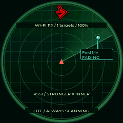

# Waveshare ESP32-S3-LCD-1.28 · Lite

First supported in **0.9.4**, build profile `waveshare_lite`. Use the [exact non-touch Waveshare board](https://www.waveshare.com/esp32-s3-lcd-1.28.htm). This is **not** ESP32-S3-Touch-LCD-1.28, Waveshare 1.75C AMOLED, or Seeed XIAO Round; their wiring and memory profiles differ.

Actual 240×240 framebuffer capture from the connected board, not a panel photograph. The displayed signal is a protocol candidate; it does not identify a particular accessory model.

## Five BOOT-operated pages · 0.13.9

Hold BOOT for about 0.8 seconds to cycle **Radar → Clock → Timer → Signals → Diagnostics**. Release between holds. Detection continues on each page. Boot still opens the saved radar theme at full brightness; 100% means backlight, not battery charge.

| Page | Tap | Double tap | Hold |
|---|---|---|---|
| Radar / Clock | Next of 31 themes | Next theme | Next page |
| Stopwatch, running | Pause | Lap | Next page |
| Locksport timer, running | Pause | OPEN (final split and stop) | Next page |
| Timer, paused | Start/resume | Reset attempt and laps | Next page |
| Signals | Next recent visible contact | Next contact | Next page |
| Diagnostics | No action | No action | Return to radar |

Single taps wait 300 ms to distinguish double taps. BOOT held during startup is ignored until released; BOOT + RESET download/recovery remains available. Themes save one second after the last change.

The compact clock has a logo, analog dial, 24-hour readout and separate date. GhostStrats and 0ct0's Pig use native marks. Covert/DMAC/LPL/LPU have compact pick-style hands; LPU has moving pin seconds. These share a lightweight layout instead of the full boards' elaborate watch scenes. Clock sync from the installer or Studio is supported; Lite has no external RTC or Wi-Fi recovery. Time survives a powered software restart, but complete power loss requires USB sync again. The UTC offset is saved.

Timer durations are monotonic and independent of clock corrections. The last 50 laps/splits remain in RAM until reset/reboot. TOOOL, TOOOL Dark, Covert/McNally, CI/LPL, DMAC and LPU use locksport behavior. A moving rim indicator follows elapsed time and freezes on pause/OPEN; LPU uses 60 animated pins.

Radar retains all 26 detector families and displays recent contacts using filtered RSSI. Signal radius and decorative sweep angle are not measured distance or bearing. The signal page shows name/family, protocol, RSSI, MAC and age; diagnostics shows reception/drop counters, memory, uptime and clock state. Passive Wi-Fi/BLE alternate on the shared 2.4 GHz radio; channel hopping creates listening gaps. There is no touch, badge, speaker, SD capture, active lab or persistent history.

The new pages are build/native-test checked. Physical Lite startup and gesture testing remain unverified; troubleshooting was stopped at the owner's request.

## Hardware configuration

| Item | Lite profile |
|---|---|
| MCU / memory | ESP32-S3R2 · 16 MB flash · 2 MB **QSPI** PSRAM |
| Panel | GC9A01A · 240×240 RGB565 · SPI3/HSPI at 40 MHz |
| LCD MOSI / SCLK | GPIO 11 / 10 |
| LCD CS / DC / RESET | GPIO 9 / 8 / 12 |
| Backlight | GPIO 40, continuously on |
| USB | CH343P UART bridge, 115200 diagnostics; native USB CDC disabled |
| Input / sound | BOOT / GPIO 0, active low with pull-up; no touch or onboard speaker/buzzer |

An 11,520-byte display tile uses internal RAM; the 384-contact store and receive queues use PSRAM. Animation time and RSSI positions stay fixed while the tiles of one frame are drawn. Radar artwork is rendered at startup and on a theme change into the same reusable 115,200-byte PSRAM cache. Animation is capped at twelve updates per second; the earlier green-radar hardware check measured about 66 ms per draw, down from 101 ms before this refinement. This leaves time between frames for reception; a fixed set of lightweight page objects is reused; no audio tasks or flash history journal run in Lite. The QMI8658 is intentionally unused. Battery percentage is not inferred from an uncalibrated ADC.

## Install and recover

Open the [web flasher](https://valleytechsolutions.github.io/Dragon-Detector/), choose **Waveshare 1.28 Lite**, confirm the exact board and select its CH343 USB serial port. Use desktop Chrome/Edge and a USB data cable. Close serial monitors first. If connection fails, hold BOOT, tap RESET, then release BOOT and retry. A missing CH343 port may require the driver linked in [Waveshare's documentation](https://docs.waveshare.com/ESP32-S3-LCD-1.28).

Fresh installation erases the previous firmware/data. Back up a third-party port first. Update is for this exact Lite 0.9.4+ layout: app0 `0x10000` (6 MB), app1 `0x610000` (6 MB), reserved LittleFS `0xc10000` (0x3f0000 bytes). An older port may be updated without erasing only after verifying the actual partition table; its version/name alone is insufficient. Lite does not mount or write the reserved filesystem.

Build: `python -m platformio run -e waveshare_lite`. Package: `python tools/build_release.py --board waveshare_lite`. Factory/update manifests and SHA-256 checksums are published with the other boards. The badge editor recognizes Lite but disables incompatible controls.

Read-only USB diagnostics: `status`, `contacts`, `selftest`, `axon status`, `traffic status`, `detector status`, `radar status`, `display status`, `ui status`, `loop diagnostics`, `badge info`. The developer `screenshot` command briefly pauses reception for its serial transfer and resumes it afterward. Timing commands include `time <epoch>`, `clock offset <minutes>`, `clock status`, `stopwatch start/pause/lap/finish/reset/status/laps`, and `screen radar/clock/stopwatch/signals/diagnostics` (choose one command alternative). `system restart` restarts when idle. Commands that enter Hunt, transmit, change display settings or upload a badge are rejected.

See [validation status](VALIDATION.md) for checks actually completed. A matching signature is evidence of a radio pattern, not proof of malicious intent or recording state.

All five profiles share the Dragon Ball/BWM fade-in at startup. Lite switches to radar automatically after the brief splash; BOOT recovery remains unchanged.
