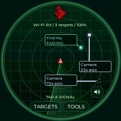
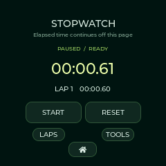

# Seeed XIAO ESP32-S3 + Round Display

Use the **XIAO ESP32-S3** with Seeed Studio's **Round Display for XIAO**. This profile is `xiao_round`, first supported in **0.9.2**. It is not the XIAO ESP32-C3/C6, another GC9A01 display, or the SD slot on the Sense camera expansion board.

The [Seeed Round Display](https://wiki.seeedstudio.com/get_start_round_display/) has a 240×240 GC9A01 LCD, CHSC6X capacitive touch, BM8563/PCF8563-compatible RTC and a microSD slot. The standard [XIAO ESP32-S3](https://wiki.seeedstudio.com/xiao_esp32s3_getting_started/) provides 8 MB flash and 8 MB octal PSRAM. Use the XIAO's external antenna for reception.

## Install

Choose **Seeed XIAO Round** in the [web flasher](https://valleytech-dragon-detector.pages.dev/). Use Fresh install when coming from Seeed examples or any other firmware. Updates require this exact profile's 0.9.2-or-newer partition layout. The two application slots are 3 MB each; the internal badge/history filesystem occupies `0x610000`–`0x7FFFFF`. Other Dragon Detector board images have different wiring and flash layouts.

To enter download mode, hold BOOT, tap RESET, then release BOOT. After flashing, release BOOT and tap RESET if it stays in the bootloader. Keep the Round Display power switch on. On revision 1.1, the BL switch must connect D6 for brightness/dimming to be controlled by firmware; its bypass setting can leave the backlight permanently on. [Seeed switch and pin documentation](https://wiki.seeedstudio.com/seeedstudio_round_display_usage/).

## Features and controls

| Radar | Stopwatch | Uploaded badge |
|---|---|---|
|  |  |  |

Actual logical framebuffer captures from the attached XIAO running 0.9.2. These are not panel photographs; physical touch and SD validation status is listed below.

- The same detection families, evidence rules, RSSI filtering, radar themes, unique family colors, history, watch/ignore controls, traffic monitors and visual foxhunt are shared with the larger boards.
- Fonts and the BWM1 logo have native 240-pixel assets. Six labeled signals fit each radar page; use Targets for complete evidence. The sweep is animated; radius represents signal strength and angle is decorative.
- Tools/Home and all stopwatch controls work by touch. The XIAO BOOT key starts/pauses on Stopwatch and opens Tools elsewhere. Lap/reset are on screen; the extension board's slide switch is not a lap button.
- Settings saves a fixed 0°, 90°, 180° or 270° angle. There is no automatic rotation.
- Settings → Clock & date configures the RTC when detected. USB tools can copy computer time and its current UTC offset. RTC reads reject invalid dates and lost-clock-integrity flags. Battery retention depends on the expansion board's power supply.
- Badge Studio selects a 240×240 preview and upload when connected. Badge images and detection history live in internal flash and do not require an SD card.
- There is **no onboard speaker or buzzer**. The profile does not initialize I²S or claim audio/haptic alerts. Visual alerts and on-screen RSSI hunting remain available. The right-hand percentage shows brightness; no accurate fuel gauge is claimed.

## microSD

Use a FAT32 card, up to 32 GB as specified by Seeed, in the **Round Display** slot. Insert before startup. Firmware never formats the card. Existing files remain; new sessions go under `/dragon/session-…`. Settings enables CSV event logging or bounded 16 MB PCAP capture. Tools → Daily → SD files browses folders/text. USB `put`/`get` and history export remain available.

Display and SD use the same SPI instance with separate chip selects. Display transfers finish synchronously before card work; no display DMA is left using the bus. A full PSRAM frame avoids repeatedly drawing the radar for many small tiles. Touch transitions and BOOT events are sampled in a separate 100 Hz task, with bounded queues. Touch and RTC share an I²C mutex. Logging and raw capture remain opt-in because card latency can delay radio processing.

| Signal | XIAO pin | ESP32-S3 GPIO |
|---|---|---|
| LCD CS / DC | D1 / D3 | 2 / 4 |
| Shared SPI SCK / MISO / MOSI | D8 / D9 / D10 | 7 / 8 / 9 |
| Round Display SD CS | D2 | 3 |
| Touch/RTC SDA / SCL | D4 / D5 | 5 / 6 |
| Touch interrupt | D7 | 44 |
| Backlight, when switch enabled | D6 | 43 |
| BOOT | On XIAO | 0 |

Touch uses I²C address `0x2E`; RTC uses `0x51`. The Sense camera-board SD slot uses a different chip-select and is not mounted by this profile. [Validation](VALIDATION.md) records hardware checks and limits; [credits](../CREDITS.md) retain the upstream notices.

Initial USB checks pass for reception, RTC, stopwatch commands, saved badges and transfer recovery. Physical panel/touch confirmation is pending. The attached assembly currently reports no mounted SD card; inserted-card presence and formatting still need confirmation.
